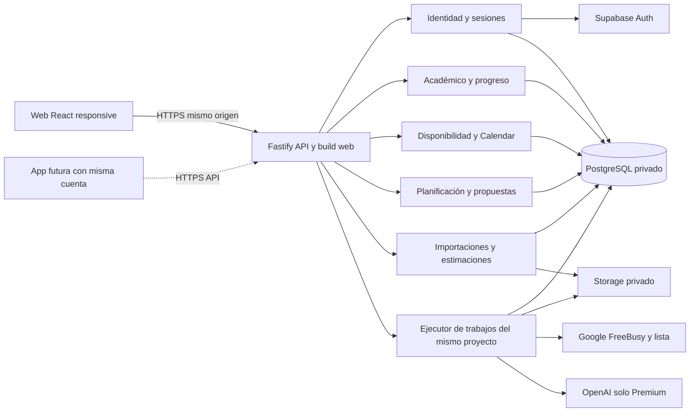
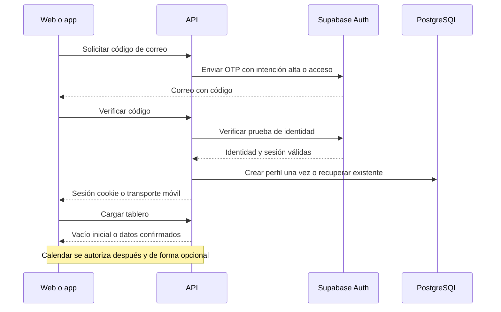
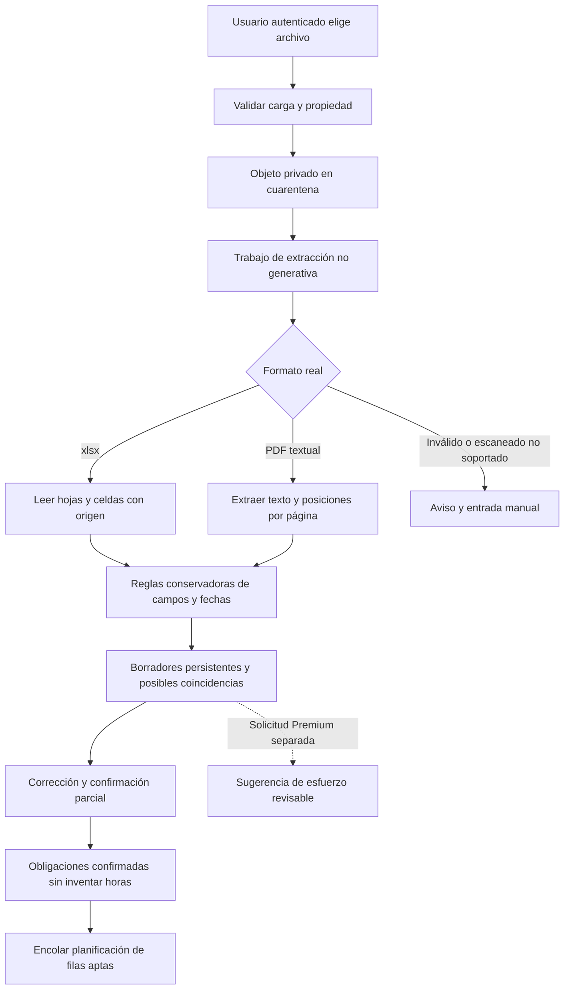
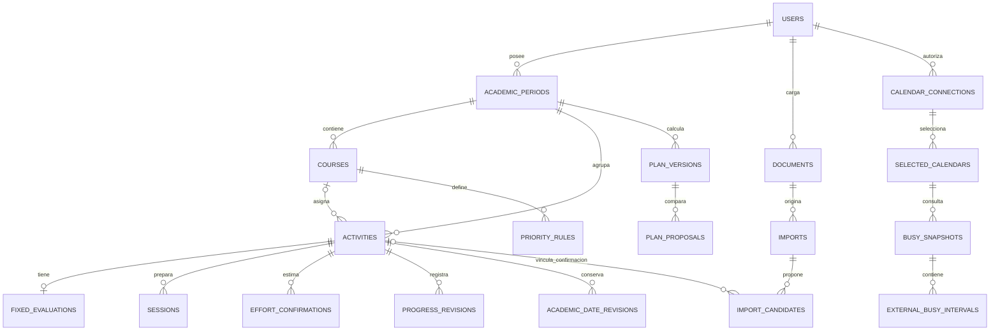

# CargaWise — Arquitectura técnica

Versión 1.1 · 3 de noviembre de 2026 · **Aprobado para implementación**.

**Registro de inicio (03/11/2026):** una instrucción posterior del promotor autoriza F0 y F1 tras preparación probada y revisada; supera el límite documental de la aprobación original, sin cambiar el stack. El estado actual de ejecución se mantiene en PLAN §15. Se aceptan solo para desarrollo/pruebas OTP 10 min/5 intentos/reenvío 60 s y sesión web 7 días/24 h de inactividad. SUP-08 queda aprobado para cero pendiente de revisión y reapertura explícita con restante confirmado e historial. Las referencias siguientes a parámetros pendientes se mantienen para piloto/producción o para políticas aún no resueltas; esta autorización no aprueba pruebas, hitos ni despliegues.

**Seguimiento de implementación (03/11/2026):** Fastify/Drizzle/PostgreSQL y Supabase Auth locales implementados en F0/F1; UI demo conservada y sin integrar. El promotor indicó continuar backend y dejar Google real pendiente. La prueba Capacitor no generó APK por falta de Java/SDK; no bloquea backend. Se conserva el diagnóstico original como antecedente, no como inventario actual. Estado/evidencia, límites de eliminación y pendientes: PLAN §15 y docs/DEVELOPMENT.md. El cambio de fecha utiliza una tabla privada `date_change_proposals` y el comando REST previsto de propuestas; el motor/las propuestas de sesiones generales se completan en F4. No se cambia la arquitectura aprobada ni se acredita ningún hito por esta nota.

**Registro de aprobación:** el promotor y responsable del producto aprobó este documento y [PLAN.md](./PLAN.md) como base de implementación el **3 de noviembre de 2026 (America/Lima)**. Gate **G0: Aprobado**. Se aprueban las direcciones técnicas D-01/02/03/06/12/13; D-05 queda aceptada provisionalmente. Esta aprobación no acredita implementación, pruebas ni hitos de entrega y no incluye los parámetros operativos o políticas expresamente pendientes en §13.

El stack aprobado conserva React + TypeScript + Vite y CSS del frontend; Fastify + Node.js + TypeScript; PostgreSQL + Supabase Auth/Storage; Drizzle; REST con OpenAPI; motor determinista; IA Premium mediante adaptador de proveedor. Capacitor es la opción preferida para Android, pendiente de comprobación técnica. Las alternativas documentadas se conservan como fundamento de la decisión, sin reabrir la selección tecnológica.

Esta actualización es exclusivamente documental: no instala dependencias, crea infraestructura ni transforma el prototipo. **Fase 0 no comienza hasta la siguiente instrucción del promotor**. No autoriza recursos cloud pagados, credenciales de producción ni despliegues. Se mantienen los gates de las fases posteriores.

Fuentes: [PRD-v6](./PRD-v6.md), versión 0.6.0; [UX-FLOWS](./UX-FLOWS.md), C-01–C-10 y SUP-01–SUP-11; [DESIGN-SYSTEM](./DESIGN-SYSTEM.md), revisión visual 1.1; código y configuración inspeccionados durante el diagnóstico original. `DESIGN.md` no existía en esa revisión. Los límites históricos documentan entregas anteriores; la solicitud actual autoriza registrar aprobación y planificar dos comprobaciones Android, **no ejecutar F0 ni implementar backend**.

## 1. Diagnóstico y diferencias que deben resolverse

### 1.1 Estado comprobado

La aplicación actual es una SPA web responsive. No hay manifiesto PWA, service worker, proyecto Android/iOS, API, base de datos, autenticación real ni infraestructura de producción. Vite sirve el prototipo en loopback `127.0.0.1:5173`; esto no constituye publicación en Internet.

| Área | Implementación inspeccionada | Tratamiento propuesto |
|---|---|---|
| Framework | React y React DOM 19.3.1 resueltos; `package.json` permite `^19.0.0` | Conservar componentes y frontend |
| Lenguaje/build | TypeScript 5.9.3 estricto; Vite 6.4.5; plugin React 4.7.0; lockfile npm v3 | Conservar; evaluar mantenimiento y actualizar herramientas en tarea separada con regresiones |
| Runtime local | Node 20.17.0 observado | Proponer Node 24 LTS con último parche; no cambiar el equipo en esta entrega |
| Estilos | CSS propio: `tokens.css` y `app.css`; sin Tailwind, Bootstrap ni biblioteca de componentes | Mantener identidad CargaWise, tokens, breakpoints y superficies |
| UI reutilizable | `Button`, `Badge`, `Field`, `Notice`, `Modal`, `Icon`, `Empty`, formularios de actividad/horas y componentes de dominio | Conservar presentación y accesibilidad; conectar estados remotos |
| Routing | Hash, `useRoute`, `navigate` y guardia de formulario modificado en `src/navigation.ts` | Conservar destinos; añadir callbacks técnicos fuera del hash, sin rediseñar navegación |
| Estado | Context React, estado local de formularios; `Workspace` completo por perfil en `localStorage` | Sustituir persistencia y decisiones autoritativas por API; conservar formularios pendientes en memoria |
| Identidad | Correo selecciona perfil ficticio; Google usa temporizador; logout oculta la vista | Sustituir por proveedor de identidad y sesiones verificadas |
| Datos | `src/demo.ts`, siete obligaciones iniciales, siete escenarios, importaciones y Calendar ficticios | Conservar exclusivamente como fixtures de desarrollo/pruebas |
| Planificación | `src/rules.ts`: unión/resta de intervalos, prioridades, asignación secuencial, validación, grupos, resumen semanal | Extraer núcleo puro, inyectar reloj y zona; revisar limitaciones antes de uso real |
| Coordinación | `App.tsx` calcula propuestas, aplica cambios y simula concurrencia con `savedAt` | Sustituir por comandos de dominio, revisiones del servidor y propuestas persistentes |
| Documentos/IA | Solo nombre del archivo, ejemplos fijos y sugerencias constantes | Implementar extracción gratuita y estimación Premium separadas |
| Tests | 22 casos `node:test` con `tsx`; 18 casos Playwright en escritorio/móvil = 36 ejecuciones; Playwright 1.64.1 resuelto | Retener suite demo; añadir pruebas reales de API, aislamiento y contratos |
| Desarrollo | npm, `dev/build/preview/test/test:e2e`; Prettier 3.9.10; navegador de prueba en `.local/browsers` | Añadir infraestructura local y CI después de aprobación |
| Git | Rama local `main`, remoto `jordinnreyes/LoadFlow`; solo README estaba versionado al iniciar esta revisión | Publicar ahora los seis documentos pedidos; incorporar el código local como baseline en F0, sin mezclarlo con esta entrega |

No existe cliente HTTP, ORM, SDK Google/OpenAI ni sistema de migraciones en las dependencias actuales. El reloj está fijado al 2 de noviembre de 2026, 08:00, Lima. La marca visible es CargaWise; carpeta, paquete y clave histórica `loadflow-prototype-v1` conservan el nombre anterior. Esto no exige renombrar ni migrar la aplicación.

Rutas conservadas: `/#/acceso`, `/#/tablero`, `/#/calendario`, `/#/importar`, `/#/disponibilidad`, `/#/prioridades`, `/#/ajustes`, `/#/calendario/:id` y `/#/calendario/nueva`. Progreso S09, cambios S10, conexión S11 y comparación S12 siguen siendo paneles, no nuevos destinos permanentes. Los flujos F01–F18 siguen vigentes.

### 1.2 Registro de discrepancias y límites

| ID | Hallazgo / fuentes | Resolución propuesta antes de implementar |
|---|---|---|
| C-01 | RF-25/27 exigen identidad y continuidad; README y código declaran simulación local | Es una limitación deliberada del prototipo. Reemplazar acceso/almacenamiento, sin importar automáticamente perfiles ficticios a cuentas reales |
| C-02 | Registro/login desde app sin alta previa en navegador; PRD §1.1, RF-25/27 y UX S01/F01/F02 contemplan ambos clientes | Sin contradicción funcional. OTP dentro de app/web y Google Sign-In aceptados provisionalmente el 03/11/2026; interfaces seguras del SO/proveedor permitidas para OAuth. No existe todavía app empaquetada; F0-07 y AM-01 verificarán viabilidad e integración |
| C-03 | README «No se abre proveedor externo» describe el Google simulado | No es compromiso del producto real. Google real puede mostrar interfaz del proveedor/SO. No reutilizar esa frase en modo real |
| C-04 | `plan()` ordena todo por plazo cuando mezcla prioridades declaradas y ausentes; SUP-04 deja la política abierta | Preservar captura sin inventar Media. Proponer política versionada de §7.3; requiere aprobación. No trasladar ese fallback demo como regla definitiva |
| C-05 | Asignación voraz puede dejar trabajo sin ubicar aunque exista otra distribución; README reconoce que no prueba optimalidad | Añadir reparación determinista y distinguir conflicto probado de búsqueda inconclusa. No afirmar imposibilidad global solo por fallar la heurística |
| C-06 | Datos/modelo usan fechas civiles y minutos con Lima fija | Usar instantes UTC, zona IANA y fechas locales originales; reloj real inyectable. SUP-01/02/05 requieren aprobación de las políticas detalladas |
| C-07 | UX S05/S06 prevé editar compromisos/cursos y copiar ventanas; prototipo permite alta de compromisos, alta de cursos y reasociación, sin cubrir toda edición/listado/copia | Completar dentro de las superficies existentes en F6. No declarar cobertura íntegra por reutilizar las pantallas |
| C-08 | F10 propone restaurar semana/posición y S04 «Siguiente pendiente»; el prototipo conserva parte del contexto pero no implementa todo ese detalle | Añadir comportamiento documentado en F6 y sus tests; no crear rutas nuevas |
| C-09 | UX C-07 admite recálculos flexibles seguros automáticos; el prototipo revisa muchos cambios mediante modal | Mantener confirmaciones del dato y de autorizaciones adicionales. Automatizar solo actualización externa segura según §7.5, con resumen/deshacer. Revisar SUP-06 antes de cambiar el comportamiento |
| C-10 | El pedido introductorio nombra `arquitectura.md`, pero objetivos y entregables especifican `ARCHITECTURE.md` | Crear un único archivo canónico `ARCHITECTURE.md`; no duplicar documentos divergentes |
| C-11 | Documentos de diseño contienen límites históricos y políticas comerciales abiertas | Conservarlos como antecedentes; este documento propone opciones. Retención, cuotas, precios y suficiencia del historial necesitan aprobación explícita |

No se modifica el PRD, UX-FLOWS ni DESIGN-SYSTEM en esta actualización. El estado vinculante de cada decisión figura en §13: la dirección técnica aprobada no elimina parámetros pendientes ni constituye orden de iniciar tareas en esta ejecución.

## 2. Stack aprobado y alternativas evaluadas

### 2.1 Dirección técnica aprobada

**Monolito modular TypeScript**: un despliegue Node/Fastify sirve el build de React y una API REST bajo `/api/v1`; un ejecutor de trabajos del mismo proyecto procesa importaciones, refrescos Calendar y estimaciones. PostgreSQL es el registro autoritativo. Supabase suministra PostgreSQL, Auth y Storage privado; no se expone una API de negocio alternativa desde el navegador. No Redis, Kubernetes, microservicios, vector DB ni entrenamiento propio en el MVP.

| Decisión | Alternativas razonables | Elección propuesta y consecuencias |
|---|---|---|
| Frontend | React/Vite actual; Next.js con servidor integrado | Conservar React/Vite y hash routing. SSR/SEO no resuelve una necesidad de este espacio privado; cambiarlo añade reescritura |
| API | Fastify 5 modular en Node; Supabase Edge Functions con lógica distribuida por función | Fastify: comparte lenguaje, facilita transacciones, procesos documentales y pruebas. Edge reduce servidor propio, pero introduce límites de ejecución y otra forma de operar trabajos |
| Runtime | Node 24 LTS; Node 26 LTS | Node 24 último parche como base conservadora, con compatibilidad comprobada en F0. Node 20 observado ya está EOL; no promoverlo a producción. [Calendario Node](https://nodejs.org/en/about/previous-releases), [soporte Fastify](https://fastify.dev/docs/latest/Reference/LTS/) |
| Datos | PostgreSQL gestionado; SQLite/libSQL con servicios separados | PostgreSQL: transacciones, índices, relaciones, control concurrente y RLS. SQLite simplifica local, pero no evita diseñar aislamiento y escrituras concurrentes |
| Proveedor gestionado | Supabase PG/Auth/Storage; Neon PG + identidad y objetos de otros proveedores | Supabase reduce cuentas e integración inicial. Neon sigue siendo alternativa si costos/región/portabilidad lo justifican; abstraer identidad y objetos mediante adaptadores |
| Acceso SQL | Drizzle + `pg`; Prisma | Drizzle con SQL/migraciones revisables y tipos TS; RLS y restricciones avanzadas se expresan en SQL cuando sea necesario. Prisma aporta herramientas maduras, pero no elimina la necesidad de SQL ni validación de políticas. [Drizzle migraciones](https://orm.drizzle.team/docs/migrations), [RLS](https://orm.drizzle.team/docs/rls) |
| Autenticación | Supabase Auth gestionado; Auth0 u OIDC gestionado independiente | Supabase Auth por integración y correo/Google. No construir contraseñas propias ni usar correo del payload como identidad |
| Correo | OTP escrito en la interfaz; contraseña + verificación/recuperación | OTP aceptado provisionalmente por acceso completo desde app. SUP-03 queda resuelto provisionalmente respecto al mecanismo; proveedor SMTP, límites y parámetros de seguridad continúan pendientes |
| Excel | `read-excel-file/node`; ExcelJS | Lector especializado `.xlsx`, sin necesidad de escribir formatos. Probar celdas/hojas/fechas con corpus. La API actual difiere entre majors: fijar estable compatible, no copiar ejemplos viejos de `readSheetNames`. [Proyecto oficial](https://github.com/catamphetamine/read-excel-file) |
| PDF | `pdfjs-dist` de Mozilla; Poppler `pdftotext` | PDF.js en proceso aislado para texto y posiciones; comparte entorno Node. Poppler es alternativa si las tablas del corpus lo requieren, a costa de binarios/operación adicionales. Ninguno ofrece OCR universal. [Ejemplos oficiales](https://mozilla.github.io/pdf.js/examples/) |
| Calendar | FreeBusy + lista de calendarios; `events.list`/sincronización de eventos | FreeBusy + `calendarList.list`, sin contenido de eventos. No solicitar lectura amplia para obtener únicamente ocupación |
| Planificador | Reglas y reparación determinista; CP-SAT/OR-Tools | Reglas primero, aprovechando funciones puras existentes; exactitud de restricciones comprobada independientemente. CP-SAT solo con evidencia de que el alcance o los falsos negativos lo requieren |
| Premium | OpenAI Responses + salida estructurada; proveedor alternativo o modelo local | OpenAI como adaptador sustituible, solo tras solicitud Premium. Candidato de bajo costo `gpt-6-luna`, comparado con `gpt-6.1-sol` en corpus; no habilitar escalamiento automático de costo. [Luna](https://developers.openai.com/api/docs/models/gpt-6-luna), [Sol](https://developers.openai.com/api/docs/models/gpt-6.1-sol) |
| Archivos | Supabase Storage privado; S3/R2 privados | Supabase inicialmente; interfaz de objetos separada de negocio. Claves opacas por propietario y enlaces firmados cortos |
| Trabajos | Tabla PostgreSQL con leases; Redis/BullMQ | Tabla duradera y transacciones con datos. Un único ejecutor inicial; extraerlo a otro proceso del mismo proyecto si aumenta volumen, sin dividir dominios |
| Tests | node:test/tsx + Fastify inject + Playwright; Vitest + Supertest | Retener runner actual y añadir Fastify inject e integración con PG real local. fast-check para invariantes; tipos cliente desde OpenAPI |
| Observabilidad | Pino + métricas simples/monitor del hosting; plataforma APM completa | Logs estructurados redactados y alertas básicas primero; OpenTelemetry/Sentry opcional si hay necesidad y presupuesto |
| Hosting | Node/React juntos en Render; Pages estático + API Render | Un origen simplifica cookies, CSP, CORS y despliegue. Separar estáticos es evolución posible, no requisito inicial |
| Android | Capacitor sobre UI web; React Native/Expo evaluado como alternativa | Capacitor aprobado como opción preferida, sujeto a F0-07 y AM-01. No convierte la web actual en app ni se instala en esta actualización. No se autoriza desarrollar la app completa. [Capacitor](https://capacitorjs.com/docs) |

Fastify usa JSON Schema/TypeBox y Ajv para validar entradas/salidas; `@fastify/swagger` genera OpenAPI. Mantener semántica de formularios existentes y generar tipos de transporte, no compartir entidades SQL directamente con React. Usar `@js-temporal/polyfill` o equivalente verificado para resolver zonas; preferencia por Temporal tras comprobar compatibilidad en F0. Fijar versiones exactas estables en lockfile y verificar avisos de seguridad/licencias antes de instalar. No usar `latest`, versiones preliminares ni forzar `--ignore-engines` para ocultar incompatibilidad.

### 2.2 Estructura de carpetas futura, sin mover archivos ahora

```text
LoadFlow/
  src/                         # frontend actual, mismas páginas/paneles/estilos
    api/                       # cliente HTTP, errores y adaptadores de DTO
    state.tsx                  # estado de interfaz + consultas, sin autoridad de negocio
    demo.ts                    # solo modo demo explícito / fixtures
  server/
    app.ts                     # Fastify, composición y entrega del build web
    modules/
      identity/ academics/ availability/ calendar/
      imports/ planning/ progress/ estimates/ entitlements/
    adapters/                  # Supabase Auth/Storage, Google, OpenAI, correo
    jobs/                      # reclamación, leases, ejecución y reintentos
    db/                        # esquema, migraciones SQL, repositorios con propietario
  packages/
    contracts/                 # esquemas/API y tipos generados
    planning-core/             # reglas puras, sin React, red ni base de datos
  tests/
    rules.test.ts flows.spec.ts # conservar como pruebas de demostración
    integration/ contracts/ e2e-real/ fixtures/
  infra/                       # Docker local y especificación de staging futura
  .github/workflows/          # CI, staging, producción con aprobación
  PRD-v6.md UX-FLOWS.md DESIGN-SYSTEM.md ARCHITECTURE.md PLAN.md README.md
```

Workspaces npm solo para `packages/*` y `server` cuando la extracción lo justifique. El frontend puede seguir en raíz: no se necesita trasladarlo a `apps/web` ni adoptar herramientas de monorepo. `server/modules` agrupa rutas, aplicación y repositorio de cada dominio; no crear capas vacías por cada función.

### 2.3 Comprobaciones Android acotadas

**F0-07 — Spike técnico Android con Capacitor**, definido en PLAN §2.1, reutilizará el build del frontend en un proyecto de prueba aislado, propuesto en `spikes/android-capacitor/`. Verificará compilación/APK de desarrollo, arranque, rutas hash, navegación, responsive y comunicación HTTPS con un endpoint explícitamente simulado o de pruebas. Investigará mecanismos seguros Google y retorno a app, sin implementar Google Sign-In real ni Calendar. No sustituye ni reconstruye `src/`.

Estado actual: **Pendiente; ninguna compilación, APK, dispositivo ni conexión Android verificados**. En la futura tarea se inventariarán SDK/JDK/Gradle/emulador/dispositivo; si el entorno no permite completarla, se documentarán pasos locales y evidencias faltantes. Esa limitación no bloquea F1 ni el hito de preparación principal. Una incompatibilidad detectada se registra; no habilita cambiar el stack automáticamente.

**AM-01 — Integración Android de identidad y Calendar**, definida en PLAN §14.2, dependerá del APK de prueba y de las capacidades F1/F2 operativas. Comprobará Google Sign-In, autorización Calendar independiente por flujo permitido, retorno seguro, persistencia/revocación de sesión, disponibilidad y misma cuenta/datos que web. Requiere entorno y configuración de pruebas autorizados, no producción. Se ejecutará antes de validar Android para distribución; no forma parte del DoD del backend F1/F2 ni autoriza la aplicación móvil completa. Superar F0-07 no satisface AM-01 ni RF-27 por sí solo.

## 3. Componentes, comunicación y procesos



Las cajas internas son módulos del mismo backend, no servicios desplegados por separado. API + coordinación de trabajos comparten inicialmente una instancia; extracción pesada usa un proceso hijo restringido. PostgreSQL conserva la cola aunque reinicie el servidor. El cliente móvil futuro no conoce la base de datos ni secretos de proveedores.

| Módulo | Responsabilidad y frontera |
|---|---|
| Identity | Probar identidad mediante Auth, crear perfil mínimo una vez, manejar sesiones y bienvenida; no conceder Premium ni Calendar por login |
| Academics | Periodos, cursos, obligaciones, evento evaluativo separado, restricciones, prioridades y versiones académicas |
| Availability | Ventanas autorizadas, excepciones, compromisos locales y cobertura manual explícita |
| Calendar | Consentimiento OAuth propio, selección, intervalos ocupados, estado/antigüedad de cada fuente; sin títulos de eventos |
| Imports | Carga, validación, extracción reconocible, candidatos persistentes, coincidencias y confirmación parcial |
| Planning | Snapshot, motor, diagnóstico, propuestas, aplicación, historial/deshacer; no altera esfuerzo ni fechas por iniciativa propia |
| Progress | Totales reales corregibles, cierre de preparación y cumplimiento separados; historial gratuito |
| Estimates | Sugerencias iniciales/personalizadas orientativas, abstención, validación y aceptación separada |
| Entitlements | Derechos Free/Premium, presupuesto y consumo reservados transaccionalmente; no checkout |

### 3.1 Operaciones síncronas y asíncronas

Lecturas, edición de entidades, confirmación de mínimos y progreso son transacciones cortas. Crear trabajo y actualizar datos que lo requieren se confirman en la misma transacción; un recálculo fallido no revierte una fecha académica real ya aceptada. Resultado: datos guardados y `planningState=stale|queued|failed`, sin presentar el plan previo como actual.

Extracción, consulta de proveedores, estimación y cálculos que excedan el presupuesto síncrono se ejecutan como trabajos. Respuesta `202` con ID/URL de estado; polling con retroceso y pausa al cerrar la vista, no WebSocket obligatorio. Estado observable `queued → running → succeeded|partial|failed|cancelled`. Cancelar es solicitud, no garantía de detener una llamada ya enviada ni de borrar archivos.

Cola inicial: `jobs` con `owner_id`, tipo, referencia de entidad, `dedupe_key`, intentos, `run_after`, lease, `heartbeat_at`, estado y error seguro. Reclamación con `FOR UPDATE SKIP LOCKED`; renovación y recuperación de leases vencidos; reintentos limitados solo para fallos transitorios, con backoff/jitter. Procesamiento al menos una vez, efectos idempotentes; nunca afirmar «exactly once» frente a proveedores externos.

El ejecutor necesita descubrir trabajos de varias cuentas: usar una función de reclamación restringida o rol exclusivo con permisos únicamente sobre la cola. No desactivar RLS de negocio ni ejecutar todos los repositorios con service role. Una vez reclamado el job, resolver su propietario desde la fila persistida y abrir las transacciones de dominio con ese contexto. Probar que un ID enviado por HTTP no permite reclamar/ejecutar trabajos ajenos; funciones privilegiadas con `search_path` fijo, permisos explícitos y sin SQL dinámico del cliente.

No mantener transacciones SQL abiertas durante Google/OpenAI/extracción. Trabajar sobre snapshot y comprobar revisiones antes de guardar. Payload de trabajo contiene referencias, no documentos completos ni tokens en logs/cola. El acceso a secretos se resuelve al ejecutar, verificando otra vez propietario, conexión y derecho Premium.

### 3.2 Lectura y actualización entre clientes

PostgreSQL es la fuente compartida. Lecturas devuelven `workspaceRevision`, revisiones de entidades, `activePlanRevision`, fecha de actualización y estado de fuentes. Refrescar al abrir, recuperar foco o confirmar una mutación; para trabajo en curso consultar su estado. No se promete tiempo real ni edición offline completa.

Las escrituras usan `If-Match` por entidad y/o revisión del workspace según alcance. Un conflicto retorna `412 REVISION_MISMATCH` con versión vigente autorizada; S12 compara y ofrece conservar o reaplicar explícitamente. «Último cliente gana» no es política válida. Un error de red deja el formulario pendiente, no un éxito ficticio. En logout vaciar datos/cachés en memoria; las respuestas privadas usan `Cache-Control: no-store`.

## 4. Autenticación y acceso desde la app

### 4.1 Correo aceptado provisionalmente: código OTP en la propia interfaz

S01 conserva Crear cuenta / Iniciar sesión y correo. Solicitar código, abrir correo donde prefiera y escribirlo en **la misma app o web**, sin registrarse previamente en navegador. El método aceptado provisionalmente no usa enlace mágico obligatorio ni contraseña. Supabase admite OTP; la plantilla debe incluir el código, porque `signInWithOtp` por defecto puede enviar un enlace. Diferenciar intención de alta de acceso existente mediante configuración del proveedor, evitando enumeración en las respuestas. [OTP oficial](https://supabase.com/docs/guides/auth/auth-email-passwordless).

El backend valida propósito/challenge y verifica el código con Auth; no genera ni almacena códigos en texto plano. Alta del perfil/periodo vacío es idempotente por identificador Auth y ocurre solo tras identidad verificada. Primer registro ofrece Calendar opcional, luego tablero vacío/guía; sesión existente abre tablero directo. Recuperar acceso vuelve a probar control del correo, con mensajes genéricos, límites de intentos y reenvío; no existe contraseña que restablecer. Duración e intentos son parámetros de seguridad por aprobar/probar en F1, no cuotas comerciales.

El SMTP por defecto de Supabase no es adecuado para usuarios reales; requiere proveedor SMTP propio y dominio/remitente verificados antes del piloto. Propuesta: Resend SMTP; alternativa Brevo/SES. Verificar condiciones/precios y entregabilidad antes de contratar, sin asumir un cupo gratuito estable. [Limitaciones SMTP](https://supabase.com/docs/guides/auth/auth-smtp).

### 4.2 Google Sign-In y el significado de «sin navegador»

En web: OIDC de Google mediante Supabase, PKCE, redirect URIs exactas y callback del servidor. Solo identidad (`openid`, correo/perfil necesario); **sin scopes de Calendar**. Crear o recuperar el mismo `auth.users.id`; no fusionar cuentas por una dirección recibida sin prueba. La vinculación de identidades debe seguir garantías de correo verificado del proveedor; revisar colisiones y no construir un merge casero.

En app futura: iniciar desde S01 y preferir SDK de identidad nativo (Android Credential Manager / Google Sign-In iOS) con ID token y nonce verificados por Auth, sin exigir que el estudiante abra la web de CargaWise. No seleccionar un plugin Capacitor sin comprobar compatibilidad, audiencia, nonce y ciclo de vida. [Supabase Google](https://supabase.com/docs/guides/auth/social-sign-in/auth-google), [Android](https://developers.google.com/identity/android-credential-manager), [iOS](https://developers.google.com/identity/sign-in/ios/start-integrating).

**Aclaración aprobada por el promotor el 03/11/2026:** registro/login se inician desde la app sin alta previa en navegador; se permiten interfaces seguras del SO/proveedor cuando OAuth lo requiera, incluido Calendar con retorno seguro. No se exige ausencia absoluta de interfaz externa. Se mantiene la prohibición de OAuth en WebView propia; la implementación y el retorno deben verificarse en AM-01, sin dar el flujo por probado por esta aprobación. [Política oficial Google](https://developers.google.com/identity/protocols/oauth2/policies).

### 4.3 Sesiones y autorización

Web usa BFF: cookie opaca `__Host-cw_session`, `Secure`, `HttpOnly`, `SameSite=Lax`, `Path=/`, sin `Domain`. La cookie referencia una sesión servidor cuyo hash se almacena en DB; tokens Auth se guardan cifrados y solo el backend los renueva. React llama a nuestra API y **no usa un SDK Auth persistente en localStorage**. Es una sesión de backend propia apoyada en Supabase Auth, no una receta de SSR que requiera que JavaScript lea sus cookies. [Sesiones Auth](https://supabase.com/docs/guides/auth/sessions).

Para mutaciones con cookies: validar Origin exacto y token CSRF ligado a sesión; no confiar solo en SameSite. Renovación serializada por sesión para evitar carreras con refresh tokens; rotación, límites absolutos/inactividad configurables y revocación comprobada. Logout revoca sesión de este cliente, borra cookie y cachés; invalidación de todas las sesiones solo si se aprueba esa acción de cuenta.

Cliente móvil futuro usa bearer de Auth de vida corta y refresh token en almacén seguro del SO; nunca en WebView localStorage. Backend verifica firma, issuer, audience, expiración y sesión revocada, además de pertenencia de cada entidad. La interfaz web usa solo transporte cookie. El indicador de tipo de cliente no concede derechos: ambos transportes resuelven el mismo propietario. ID token Google **no es** un access token de nuestra API ni un token de Calendar.

Los endpoints operan sobre `owner_id` derivado de identidad verificada, nunca del cuerpo o de un parámetro elegido por el cliente. El plan Free/Premium se consulta en derechos de servidor; modificar HTML, localStorage o metadata de usuario no habilita IA. No se agrega un panel empresarial/admin al MVP: concesiones de piloto son operaciones restringidas, auditadas y fuera del cliente público.



## 5. Google Calendar de solo ocupación

### 5.1 Permisos y privacidad

Conexión independiente desde S11, disponible para cuentas correo y Google. OAuth Authorization Code para servidor, `state` único ligado a usuario/flujo, PKCE donde corresponda y retorno allowlist. Pedir acceso offline solo para las consultas backend autorizadas. No reutilizar automáticamente tokens de Google Sign-In.

Scopes propuestos: `https://www.googleapis.com/auth/calendar.calendarlist.readonly` para selector y `https://www.googleapis.com/auth/calendar.events.freebusy` para ocupación. Comprobar exactamente scopes concedidos y calendarios accesibles: rechazar permisos insuficientes de forma recuperable. No pedir `calendar`, `calendar.readonly` amplio ni scopes de escritura por comodidad. [CalendarList](https://developers.google.com/workspace/calendar/api/v3/reference/calendarList/list), [FreeBusy](https://developers.google.com/workspace/calendar/api/v3/reference/freebusy/query).

La lista puede mostrar nombre del calendario para seleccionarlo, no títulos/descripciones/asistentes de **eventos**. Persistir solo ID de calendario protegido, etiqueta necesaria, selección, zona y bloques `start/end`; usar etiqueta local si no se necesita conservar el nombre. FreeBusy no entrega IDs de eventos y no permite reconstruir sus detalles: la equivalencia grupal es por intervalo expresamente confirmado, no por título ni «evento» inventado.

Refresh tokens Google cifrados con AES-GCM/clave versionada fuera de DB; acceso restringido al módulo Calendar. Access tokens solo el tiempo indispensable. No devolverlos al frontend ni incluirlos en URLs/trazas. En app futura, el navegador seguro/SO realiza consentimiento y devuelve al contexto mediante universal/app link y ticket de un solo uso, nunca credenciales en el deep link. [OAuth servidor](https://developers.google.com/identity/protocols/oauth2/web-server).

### 5.2 Lectura, cambios y fallos

1. Obtener lista paginada, seleccionar explícitamente calendarios y consultar FreeBusy en el horizonte vigente, particionando solicitudes según límites del proveedor.
2. Guardar snapshot completo por calendario y rango solo al terminar correctamente. Respuesta parcial conserva bloques previos de calendarios fallidos y marca cobertura parcial; no vaciar ocupación en caso de error.
3. Unir intervalos de todas las fuentes antes de restarlos de ventanas. Clases evaluativas internas y ocupación Google coincidentes reducen capacidad una sola vez, sin afirmar que sean la misma obligación académica.
4. Comparar hash canónico de intervalos. Si cambia, incrementar revisión de disponibilidad y encolar recálculo flexible; respetar fijadas y reservas aceptadas según §7.
5. Actualizar al abrir/retomar plan, solicitar refresh y antes de aplicar una propuesta cuando la fuente no sea vigente. Polling en primer plano y antigüedad máxima serán parámetros aprobados en F2; no prometer sincronización instantánea o permanentemente activa con app cerrada.
6. No hay `watch` de FreeBusy ni `syncToken` de eventos en esta estrategia. Consultar eventos para sincronización incremental sería otra decisión de permisos, no una optimización invisible.

Estados conservados: nunca conectado/manual, conectado actualizado, conectado desactualizado, revocado y error de lectura. Cada lectura tiene rango cubierto, intento y última actualización exitosa. En un fallo se conserva conocimiento anterior con advertencia; una cobertura manual explícita puede sustituir la fuente, no un checkbox genérico que afirme conocer horas no revisadas.

Desconectar revoca credenciales y detiene nuevos trabajos/consultas, incluso los pendientes que deben comprobar conexión otra vez. Mostrar las consecuencias sobre cobertura; se pueden conservar intervalos como referencia manual para revisar, sin fingir actualización. Una respuesta de lectura que termina después de desconectar se descarta.

`403/429`: respetar límites, `Retry-After` cuando exista y backoff; `invalid_grant`/revocación: reconectar, no reintentar indefinidamente. Errores de un calendario no invalidan el login de CargaWise. En modo OAuth Testing algunos refresh tokens pueden caducar a siete días; validar consent screen/verificación y cuentas de prueba antes del piloto. [Cuotas](https://developers.google.com/workspace/calendar/api/guides/quota), [ciclo de tokens](https://developers.google.com/identity/protocols/oauth2).

## 6. Importación gratuita de Excel/PDF

### 6.1 Pipeline



Carga inicial propuesta a través de API con streaming y límites; simplifica validación y evita exponer bucket. Alternativa de upload firmado directo para volumen posterior, con comprobación servidor del objeto real. Crear `document`/`import` y clave opaca, escribir objeto privado y encolar job; cleanup de objetos huérfanos mediante trabajo idempotente. No usar disco efímero del hosting como conservación documental.

Validar extensión permitida, MIME real/estructura, bytes efectivamente recibidos, cifrado, páginas/hojas/celdas y expansión ZIP. Aceptar solo `.xlsx` y PDF del alcance; rechazar `.xls`, `.xlsm`, ejecutables disfrazados, protegidos que no se puedan leer y contenedores excesivos con explicación. No ejecutar macros, JavaScript PDF, fórmulas ni enlaces externos. No descargar URLs que aparezcan en documentos. No renderizar HTML obtenido de un enunciado como contenido confiable.

**Límites técnicos propuestos, pendientes de benchmark/aprobación F3:** 10 MiB por archivo, 100 páginas PDF, 20 hojas/20.000 celdas no vacías por XLSX, 50 MiB de contenido ZIP expandido y 30 s por extracción aislada. Son defensas iniciales configurables para un servicio pequeño, no cuotas comerciales aprobadas ni capacidad demostrada. Rechazo debe indicar el límite real configurado y mantener ingreso manual. Si el corpus exige otros valores se cambian antes del piloto, no se promete soporte universal.

Proceso aislado sin shell/interpolación de nombre de archivo, sin credenciales de Auth/Google/OpenAI, sin salida a red y con límites de memoria/tiempo. En hosting compartido API/worker el presupuesto total se mide: si no se puede aplicar el aislamiento y los límites, no habilitar subida real en ese entorno. El escaneo antimalware y la política de descarga se evalúan según superficie expuesta; un parser no reemplaza las defensas de carga.

### 6.2 Reconocimiento y corrección

- XLSX: recorrer todas las hojas dentro del límite, registrar leídas/no reconocidas, asociar encabezados conocidos mediante reglas explícitas y conservar fila/columna. Tratar fechas 1900/1904, celdas Date y cadenas ambiguas con pruebas; no asumir mes/día ni interpretar un serial sin contexto. Fórmulas solo si hay valor almacenado interpretable; nunca recalcularlas ni omitir ambigüedad.
- PDF: texto seleccionable, coordenadas y orden de lectura por página; detectar tablas sencillas/cabeceras y candidatos con reglas por curso/tipo/fecha. Un PDF puede mezclar páginas textuales y escaneadas: informar cobertura por página. Escaneo sin texto/OCR aprobado → no soportado o parcial, con entrada manual gratuita. No convertir OCR en obligación Premium.
- Guardar valor original y normalizado, origen localizable y motivo de incertidumbre, no porcentajes de confianza inventados. No inferir curso, año, tipo, hora ni esfuerzo si falta fundamento. La extracción **nunca** llama al modelo por defecto.
- Un XLSX legible de cinco PC/dos exámenes debe producir siete candidatos diferenciados en ambos planes. Cada candidato conserva versión; editarlo no activa carga. Confirmar mínimos título/tipo/fecha permite obligación incompleta, sin horas inventadas.
- Dedupe dentro de la cuenta por hash de archivo y huella de fila; similitud curso/tipo/título/fecha sirve para **proponer** coincidencia. Un mismo título no es unicidad de actividad. Mostrar «mantener vigente / actualizar misma / distinta», sin merge automático.
- Confirmación parcial es atómica para las filas seleccionadas: validar revisiones y decisiones de coincidencia, activar válidas confirmadas y conservar las demás. Una fila seleccionada inválida devuelve errores antes de cambiar el lote; el usuario puede deseleccionarla. Repetir la misma confirmación no duplica obligaciones.
- Documento nuevo con otra fecha crea propuesta de revisión ligada al mismo registro. Solo aceptación explícita reemplaza la fecha vigente; conservar edición manual, prioridad, progreso y esfuerzo salvo cambios igualmente confirmados.

Retirar documento no elimina por cascada obligaciones confirmadas; eliminar objeto y contenido extraído conforme a política aprobada, conservando únicamente procedencia mínima permitida. Los borradores restantes deben tener una decisión explícita de conservar o retirar. Reintentar extracción no sobrescribe ediciones del usuario: guardar una nueva versión de candidatos o compararla, con confirmación.

## 7. Motor determinista de planificación

### 7.1 Contrato y normalización

Entrada: snapshot de una cuenta/periodo con revisiones de actividades, prioridades, disponibilidad, fuentes y plan; `now` del servidor, zona y versión de política. Salida: propuesta de sesiones, diferencias, cobertura, horas no ubicadas por obligación/plazo, causas y estado de certeza. El núcleo es puro; no consulta red, DB ni IA.

Instantes se guardan en UTC (`timestamptz`) y se conservan fecha/hora/zona académica original. Fechas sin hora son `date` y corte desconocido; no inventar 23:59. Ventanas recurrentes son hora local + día + zona + vigencia, expandidas por fecha con DST explícito; intervalos ambiguos/inexistentes exigen revisión. Las sesiones usan intervalos semiabiertos `[inicio, fin)`, precisión de minutos: dos bloques adyacentes no se solapan. Ventanas que cruzan medianoche se normalizan en tramos sin perder zona ni duración.

Horizonte: desde ahora hasta cierre confirmado del periodo, sin programar después de un deadline vigente; si no hay cierre, último deadline confirmado con alcance provisional. Con cierre y último deadline diferentes, conservar el cierre para navegación/capacidad y no programar sin obligaciones; ratificar SUP-01. Las cinco tarjetas visibles no limitan cálculo ni alertas. No alterar instantes académicos al cambiar solo la zona de visualización.

### 7.2 Restricciones y conservación de esfuerzo

1. Solo obligaciones confirmadas. Curso opcional. Inicio permitido desconocido impide programar preparación; divisibilidad desconocida exige un bloque indivisible. Dependencias solo declaradas, con control de existencia, propietario, periodo y ciclos.
2. Esfuerzo restante individual: declarado explícitamente si existe; si no, `max(0, operativo_confirmado − real_acumulado)`. Sin esfuerzo operativo y sin restante confirmado: desconocido. Cero no cierra; si supera estimado o llega a cero abierto, pedir revisión, sin inventar duración.
3. Preparación de evaluación termina como máximo al inicio evaluativo confirmado y al plazo aplicable más restrictivo. Un evento solo bloquea si su inicio/fin están confirmados. Actividad con horario incompleto mantiene análisis parcial; no inventar duración de examen.
4. Capacidad de calendario: unión de ventanas autorizadas menos unión de ocupaciones externas/locales/evaluaciones. Capacidad residual **para asignar** descuenta además sesiones fijadas y sesiones conservadas fuera del alcance. No restar sus horas otra vez al resumir utilización semanal.
5. Retirar provisionalmente solo sesiones flexibles alcanzadas. Conservar fijadas, sesiones realizadas/canceladas y reservas aceptadas que deban revisarse; una colisión conservada se reporta y no se presenta como sesión válida. Su duración solo satisface demanda si sigue siendo compatible; conflicto y faltante no se suman como dos déficits distintos de la misma hora.
6. Divisibles: preferencia inicial 60 min, mínimo 30 y máximo 120 editables; máximo/preferencia son parámetros del fraccionamiento automático, no prohibición de trabajo indivisible largo ni modificación implícita de grupos. Un remanente bajo mínimo se combina solo cuando cabe respetando máximo o queda explícito.
7. Ningún bloque nuevo fuera de ventana, antes del inicio, en el pasado, después del corte, sobre ocupación u otra sesión; no mover fijadas, fechas ni compromisos para aumentar capacidad. Validar otra vez cada bloque antes de activar.
8. Cada minuto pendiente se conserva como ubicado válido, cubierto por equivalencia grupal válida o no ubicado con causa. La dedicación real no se deduce del calendario y no se reparte por semanas sin fecha de ejecución declarada.

### 7.3 Orden, búsqueda y explicación

Prioridad efectiva = excepción individual declarada → base curso/tipo si hereda → sin declarar. Para declaradas: Alta > Media > Baja; a igual nivel, corte/plazo más cercano; empate residual propuesto por `confirmed_at` y UUID estable. Restricciones/dependencias preceden al orden de preferencia: usar orden topológico y propagar urgencia/restricciones del dependiente sin asignar pesos académicos inventados.

**Política mixta propuesta D-04:** planificar declaradas por nivel; cola sin prioridad ordenada por plazo después de las declaradas. Es una convención operativa del sistema, no «Baja del estudiante», y debe indicarse cuando afecta una disputa. Alternativa: EDF global en conjuntos mixtos, como el prototipo, pero puede ignorar prioridades expresas. Aprobar la política y sus ejemplos antes de F4; guardar su versión en cada resultado. Captura/consulta siguen disponibles sin exigir prioridad para todo.

Estrategia inicial: construir intervalos libres normalizados, ordenar candidatas aptas, ubicar primero bloques más restringidos dentro de su orden compatible y rellenar divisibles con preferencia. Minimizar cambios de sesiones previas compatibles como criterio secundario, después de las restricciones y prioridades. Si hay faltantes, ejecutar reparación determinista acotada: probar ubicaciones alternativas de bloques flexibles responsables, preservar prioridad de asignación y devolver la mejor distribución válida encontrada. Límite por número de nodos/operaciones configurado y versionado permite reproducibilidad; un timeout de seguridad aborta el trabajo, no aplica un resultado truncado silenciosamente.

No afirmar que la heurística prueba inexistencia de soluciones. Clasificar:

| Resultado técnico | Explicación al producto |
|---|---|
| Todo ubicado y datos/fuentes suficientes | Viable según datos, siempre con horas estimadas |
| Datos/fuente faltantes | Parcial, con riesgos conocidos coexistentes |
| Demanda supera capacidad compatible comprobable en un intervalo hasta plazo | Déficit previsto con minutos y actividades responsables |
| Restricción imposible comprobada: ciclo, inicio después de corte, indivisible mayor que todo hueco admisible aun sin otras flexibles | Conflicto de restricciones y motivo concreto |
| Búsqueda acotada deja faltantes sin prueba suficiente | Distribución parcial/no encontrada con este cálculo; revisar alternativas. No declarar imposibilidad global ni inventar disponibilidad |

La última distinción es una propuesta de precisión del diagnóstico (C-05), no una nueva funcionalidad de gestión. Un solver CP-SAT podría mejorar búsqueda o certificar casos; introducirlo requeriría ADR y benchmark frente a complejidad/operación adicional. Para casos pequeños, un enumerador exhaustivo independiente sirve de oráculo en tests.

### 7.4 Grupos y equivalencias

Deadline grupal sin esfuerzo individual inferido. Proponer hasta tres reservas de dos horas: preferir días consecutivos próximos anteriores al corte; si no, días distintos próximos compatibles o resultado parcial. Propuesta no aceptada no ocupa el plan activo. Aceptar mantiene etiqueta tentativa; modificar/desactivar es explícito. Rechazar grupo no significa que el proyecto esté terminado.

Equivalencia solo por intervalo ocupado seleccionado/confirmado. Cobertura = unión de tramos equivalentes válidos dentro de inicio/corte; limitarla al objetivo de reserva y descontarla una vez. El mismo tramo no cubre simultáneamente reservas de proyectos diferentes: rechazar la doble asignación o pedir una partición explícita, sin inventarla. Si FreeBusy cambia/llega otra versión, revalidar anclaje y cobertura; intervalos que desaparecen o varían requieren revisión, porque no existe ID estable de evento. La equivalencia no crea otra sesión ni horas reales.

Al cambiar deadline, reconsiderar propuestas tentativas no aceptadas. Conservar reservas aceptadas/fijadas o mostrarlas en conflicto hasta revisión; no moverlas silenciosamente. La reubicación ordinaria de flexibles conserva el alcance indicado y no redefine compromisos externos.

### 7.5 Comandos, concurrencia y deshacer

- Editar sesión: nueva ubicación validada, queda fijada al confirmar; no redistribuir otras por un movimiento individual. Reorganizar actividad trata solo sus flexibles. Recalcular plan tiene alcance general dentro del periodo.
- Cambios de fecha y ampliación de ventanas: propuesta con anterior/nuevo/origen y autorizaciones explícitas. Confirmar una fecha real válida es posible aunque el plan quede deficitario; guardar dato/historial y dejar conflictos, sin aplicar bloques nuevos inválidos.
- Cambios externos de ocupación: registrar nueva revisión, recalcular únicamente flexibles autorizadas y notificar diferencias. Si hay fijadas afectadas, mantenerlas en conflicto y solicitar decisión. Nunca ampliar preferencias sin aceptación.
- `workspace_revision` aumenta en toda mutación que afecta cálculo; `plan_revision` identifica distribución activa. Crear propuesta con snapshot/revisiones/fuentes; aplicar exige coincidencia y revalidación con `now` actual. Si cambió mientras se revisaba, `412` y nueva comparación, sin autoconfirmar.
- Aplicación atómica bajo lock por cuenta/periodo: validar precondiciones, guardar cambios académicos autorizados, sustituir solo sesiones alcanzadas, guardar resultado y referencia de reversión, avanzar revisiones y emitir respuesta. No mantener lock durante cálculo remoto.
- La misma entrada canónica + reloj de cálculo + versión de política/algoritmo devuelve el mismo orden/ubicaciones. Hash incluye restricciones, ocupación y alcance. IDs de sesiones se preservan cuando identidad/ubicación no cambiaron; no usar IDs aleatorios como desempate.
- Deshacer crea una propuesta de distribución anterior, **no** restaura fechas, compromisos ni progreso. Revalida contra ocupación, restricciones y tiempo actual, incluidos nuevos compromisos y sesiones completadas. Si falla, conservar distribución vigente y mostrar causas.
- Reintentos: `Idempotency-Key` por propietario/operación, hash del cuerpo y resultado persistido en la misma transacción. Misma clave/cuerpo devuelve resultado; distinta carga con misma clave → `409 IDEMPOTENCY_CONFLICT`. No reemplaza `If-Match`.

```mermaid
sequenceDiagram
  participant C as Cliente
  participant B as API
  participant D as PostgreSQL
  participant P as Motor puro
  C->>B: Solicitar vista previa con revisión y cambios
  B->>D: Leer snapshot autorizado
  B->>P: Calcular sin modificar plan
  P-->>B: Sesiones, faltantes y diferencias
  B->>D: Guardar propuesta ligada a revisiones
  B-->>C: Vista previa y autorizaciones necesarias
  C->>B: Confirmar propuesta y revisión
  B->>D: Bloquear y comprobar revisiones/fuentes
  alt Cambió una restricción o versión
    B-->>C: 412; revisar nueva versión
  else Propuesta revalidada
    B->>D: Aplicar solo cambios autorizados y guardar versión
    B-->>C: Plan activo, faltantes y acceso a deshacer
  end
```

## 8. IA Premium y personalización básica

### 8.1 Estimación inicial, no planificación generativa

El backend verifica sesión, propiedad, Premium vigente, presupuesto y contexto **antes** de encolar/ejecutar una solicitud. Free no crea trabajo de IA, no consume cuota y conserva horas manuales. Importar, corregir, registrar tiempo, calcular déficit y programar sesiones nunca requieren esta llamada.

Propuesta de proveedor: OpenAI Responses API con Structured Outputs y SDK oficial Node. Candidato inicial `gpt-6-luna`; comparar contra `gpt-6.1-sol` usando la misma rúbrica/corpus antes de elegir. Guardar modelo exacto, versión de prompt/esquema y configuración; no actualizar silenciosamente ni hacer fallback automático al modelo más costoso. La salida estructurada controla forma, no verdad ni precisión de duración; validar semántica, rechazo e incompletitud. [Structured Outputs](https://developers.openai.com/api/docs/guides/structured-outputs).

Entrada mínima: tipo individual, contenido pertinente del enunciado, curso/tema y señales verificables de entregable/volumen/complejidad. No enviar nombre, correo, tokens, Calendar, notas privadas o todo un PDF si basta un fragmento. Plazo, prioridad, disponibilidad y nota no se usan para alterar esfuerzo intrínseco. No dar herramientas, acceso web, ejecución de código ni escritura al modelo.

Contrato de salida propuesto: `status=estimated|needs_context|abstained`; `lowMinutes/highMinutes` enteros positivos o ambos null; factores breves fundamentados, datos faltantes y advertencia de incertidumbre. No porcentaje de precisión. Verificar rango ordenado, límites técnicos configurados y que el fundamento no cite contenido inexistente. Un rechazo, timeout, contexto insuficiente o JSON incompleto conserva la duración activa y salida manual.

La sugerencia se guarda separada; S04/S08 muestran origen base/personalizada, rango, incertidumbre y acciones. Aceptar requiere valor operativo explícito dentro o corregido fuera del rango; nunca seleccionar automáticamente punto medio. La confirmación crea historial de esfuerzo, marca manual/sugerida/corregida/personalizada y solicita recálculo. Una nueva sugerencia no reemplaza horas ya confirmadas.

Documentos son datos no confiables: enunciados delimitados, instrucciones del producto en canal separado y validación de salida. Un archivo que ordene «ignorar reglas», ejecutar acciones o habilitar Premium no tiene autoridad. El modelo no decide autorizaciones, plazos, acceso a archivos ni consumo permitido (RNF-09).

Usar `store:false` y llamadas sin estado conversacional, sujeto a compatibilidad del modelo. Eso **no** promete retención cero: deben explicarse las condiciones del proveedor y posibles registros de seguridad/abuso. No asumir elegibilidad para Zero Data Retention. Resolver información/consentimiento, minimización y política DP-26 antes de enviar contenido real. [Tratamiento de datos OpenAI](https://developers.openai.com/api/docs/guides/your-data).

### 8.2 Consumo y consistencia

Hash privado por cuenta de contenido normalizado + características + versión modelo/prompt/esquema; reutilizar resultado válido equivalente con origen/antigüedad visible, sin cache compartida que filtre documentos entre estudiantes. La invalidez por cambiar enunciado no se confunde con cambiar fecha/prioridad. La aceptación del usuario tiene su propia revisión.

Reservar transaccionalmente unidades y costo máximo antes de enviar; límite por usuario y presupuesto global, concurrencia acotada, límite de entrada/salida, circuit breaker y ledger de intento/uso/costo estimado real. El presupuesto mensual del proveedor no se asume como corte duro: nuestra reserva impide nuevas llamadas, aunque puede haber costos en vuelo. Revalidar Premium y consentimiento al ejecutar, no solo al crear trabajo.

No reintentar a ciegas una respuesta de red incierta: puede haberse facturado. Registrar `provider_outcome_unknown`, mantener reserva conservadora y requerir reconciliación/reintento explícito conforme a límites. Para errores inequívocamente transitorios aplicar política acotada; cada intento cuenta en el máximo. No habilitar llamadas con políticas de consumo sin aprobar. Las cuotas del producto no son los rate limits del proveedor ni una promesa de gratuidad.

Evaluación antes de habilitar: corpus anonimizado/autorizado con tareas comparables y casos insuficientes, repeticiones para dispersión, revisión de factores y abstención, sensibilidad indebida a fecha/prioridad, latencia y tokens/costo. Registrar versión de evaluación y umbrales acordados; no inventar tolerancias ni declarar beneficios demostrados. Una prueba A/B de modelos es evaluación técnica, no promesa de precisión.

**Momento de pedir API key:** PLAN F5, después de aprobar proveedor, política de datos y presupuesto, antes de la primera prueba con API real. Avisar al promotor entonces y configurar el secreto por canal seguro; no pedirlo ni crear `.env` con claves ahora. Nunca `VITE_OPENAI_API_KEY`, credenciales en prompts, Git o bundle.

### 8.3 Personalización posterior, sin entrenar un modelo propio

Observaciones elegibles propuestas: actividades individuales terminadas, tiempo real positivo voluntariamente confirmado, estimación base guardada **antes** del resultado, curso/tipo y atributos comparables suficientemente descritos. Una corrección del total real sustituye la observación previa; no cuenta como otra experiencia. Excluir grupos, reservas, registros incompletos y casos no comparables; no descartar un dato solo por diferir sin una regla aprobada.

Método propuesto D-10: agrupación por curso/tipo y características explícitas de alcance/volumen; razón `real/base` por actividad comparable, mediana robusta de log-razones y contracción hacia factor 1 según cantidad/calidad. Conceptualmente: `factor = exp(peso × mediana(log(real/base)))`, con `peso=n/(n+k)`. `n_mínimo`, `k`, banda de ajuste, antigüedad y comparabilidad son parámetros **pendientes** de validación/aprobación, no cifras tomadas del escenario ficticio. Medir calibración retrospectiva con separación temporal para evitar fuga de información.

Si no hay base suficiente, solo sugerencia inicial o entrada manual; nunca «personalizada». Con Premium, consentimiento vigente e historial elegible, guardar base, ajuste, versión y observaciones referenciadas; mostrar orientación revisable. No es entrenamiento avanzado, embeddings obligatorios ni inferencia de inteligencia/capacidad del estudiante. Revocar consentimiento impide nuevos ajustes; no destruye horas reales ni esfuerzo previamente confirmado. Downgrade conserva historial y plan; deshabilita nuevas sugerencias/personalización. La política de retención/eliminación sigue abierta.

## 9. Modelo lógico y físico propuesto

### 9.1 Convenciones

PostgreSQL gestionado en versión estable soportada por el proveedor; confirmar versión/extensiones en F0 antes de fijar migraciones. Esquema `app` no expuesto por Data API; `auth` y `storage` pertenecen al proveedor y no se modifican con migraciones de negocio. UUID para identidad, `integer` para minutos, `date/time` para información civil incompleta y `timestamptz` para instantes confirmados/auditoría. No `float` para esfuerzo ni cadenas concatenadas como clave de curso.

Todas las tablas privadas de negocio llevan `owner_id`, timestamps y revisión cuando son mutables. Se omite esa repetición en la tabla siguiente. Los registros transitorios anteriores a la autenticación tienen acceso servidor restringido, no una política pública con propietario nulo. Tablas globales de políticas/capacidades son de solo lectura para usuarios. `owner_id` es el identificador Auth, no email; normalizar nombres/cursos para búsqueda sin convertirlos en identidad.

| Tabla | Campos físicos principales además de comunes | Relaciones y restricciones |
|---|---|---|
| `users` | `id uuid PK=auth_user_id`, `display_name text`, `study_timezone text`, `display_timezone text`, `onboarding_state text` | FK a identidad verificada; no contraseñas ni perfil de un proveedor completo |
| `client_sessions` | `id uuid`, `auth_session_id uuid`, `opaque_hash bytea NULL UNIQUE`, `transport text`, `refresh_ciphertext bytea NULL`, `expires_at`, `revoked_at`, `key_version` | Cookie/hash obligatorios solo para sesión web BFF; registro móvil ligado a sesión Auth; nunca token en claro; resolver cookie mediante hash con privilegio mínimo |
| `auth_challenges` | `id uuid`, `email_ciphertext`, `purpose`, `expires_at`, `attempt_count`, `consumed_at NULL` | Transitorio previo a identidad: sin `owner_id` hasta verificar, sin código OTP; acceso exclusivo del repositorio de identidad, límites por correo/IP protegidos y limpieza según política |
| `oauth_transactions` | `id uuid`, `owner_id NULL`, `purpose`, `state_hash`, `nonce_hash NULL`, `pkce_verifier_ciphertext NULL`, `redirect_context`, `expires_at`, `consumed_at NULL` | Login puede comenzar sin usuario; Calendar exige propietario/sesión; transacción de un solo uso, allowlist y acceso privado de identidad/integración |
| `consents` | `id`, `purpose`, `policy_version`, `granted_at`, `revoked_at` | Separar Calendar de tratamiento/personalización; historial mínimo conforme a política |
| `plan_entitlements` | `id`, `plan_code`, `starts_at`, `ends_at NULL`, `source`, `granted_by` | Un derecho vigente coherente por cuenta; cliente sin permiso de escritura; Free por defecto |
| `policy_versions` | `id`, `domain`, `version`, `parameters jsonb`, `approved_at NULL`, `approved_by NULL` | Parámetros validados e inmutables por versión; no activar políticas pendientes |
| `academic_periods` | `id`, `name`, `start_date NULL`, `end_date NULL`, `timezone`, `workspace_revision bigint`, `active_plan_id NULL` | Inicio/cierre compatibles si existen; política de horizonte identificada |
| `courses` | `id`, `period_id`, `name`, `normalized_name` | Identidad estable al renombrar; duplicados señalados, no fusionados por nombre |
| `activities` | `id`, `period_id`, `course_id NULL`, `title`, `type`, `due_date`, `due_time NULL`, `academic_timezone`, `due_at NULL`, `allowed_start_at NULL`, `divisibility`, `confirmation_state`, `preparation_state`, `fulfillment_state`, `priority_mode`, `priority_override NULL`, `operating_estimate_id NULL`, `confirmed_at NULL`, `description text NULL` | Mínimos para activar; curso opcional. Due UTC solo si límite conocido; tipos/cierres enumerados y coherentes |
| `fixed_evaluations` | `activity_id PK`, `start_at`, `end_at`, `timezone`, `version` | FK actividad del mismo propietario; `end>start`; no crear fila de ocupación con intervalo inventado |
| `activity_dependencies` | `activity_id`, `predecessor_id` | PK par, sin autorreferencia; FK compuestas por propietario/periodo; ciclos rechazados en servicio/transacción |
| `priority_rules` | `course_id`, `activity_type`, `priority` | UNIQUE propietario/curso/tipo; Alta/Media/Baja; ausencia de fila = sin base |
| `academic_date_revisions` | `id`, `activity_id`, `before_value jsonb`, `after_value jsonb`, `source_kind`, `source_ref NULL`, `confirmed_at`, `actor_id` | Historial append-only de confirmaciones; propuesta no reemplaza fecha vigente |
| `effort_estimates` | `id`, `activity_id NULL`, `import_candidate_id NULL`, `kind`, `low_minutes NULL`, `high_minutes NULL`, `selected_minutes NULL`, `status`, `model_id NULL`, `prompt_version NULL`, `policy_version NULL`, `input_hash NULL` | Manual/base/personalizada/corregida; rango válido; una sugerencia no es operativa sin aceptación |
| `effort_confirmations` | `id`, `activity_id`, `estimate_id`, `minutes int`, `origin`, `confirmed_at`, `supersedes_id NULL` | Minutos positivos para programar; grupo sin esfuerzo individual; historial de aceptaciones/correcciones |
| `progress_current` | `activity_id PK`, `real_total_minutes NULL`, `remaining_minutes NULL`, `effective_completion_date NULL`, `revision` | Totales >=0 o desconocidos; fecha de cierre no futura; cierres explícitos en actividad |
| `progress_revisions` | `id`, `activity_id`, `before_value jsonb`, `after_value jsonb`, `recorded_at` | Append-only; corrección no incrementa dedicación por suma |
| `study_windows` | `id`, `period_id`, `weekday`, `local_start`, `local_end`, `timezone`, `valid_from`, `valid_to NULL` | Vigencia/día válidos; medianoche normalizada sin inventar ventanas |
| `availability_exceptions` | `id`, `period_id`, `local_date`, `mode`, `intervals jsonb` | UNIQUE propietario/periodo/fecha; no estudiar explícito distinto de no declarado; intervalos validados |
| `planning_preferences` | `period_id PK`, `preferred_minutes`, `min_minutes`, `max_minutes`, `revision` | `0<min<=preferred<=max`; preferencias, no cambio de divisibilidad |
| `manual_commitments` | `id`, `period_id`, `title`, `start_at`, `end_at`, `source_kind` | `end>start`; no simular escritura de una fuente externa |
| `calendar_connections` | `id`, `provider_subject_hash`, `credential_ciphertext`, `granted_scopes text[]`, `key_version`, `state`, `last_attempt_at`, `last_success_at`, `revision` | Estado independiente de Auth; no tokens en tablas expuestas |
| `selected_calendars` | `id`, `connection_id`, `provider_calendar_id`, `display_label NULL`, `selected`, `timezone NULL` | UNIQUE conexión/calendario; no IDs de eventos |
| `busy_snapshots` | `id`, `calendar_id`, `range_start`, `range_end`, `fetched_at`, `coverage_state`, `content_hash` | Cobertura/antigüedad por calendario y rango; snapshot anterior conservado si falla |
| `external_busy_intervals` | `id`, `snapshot_id`, `start_at`, `end_at`, `interval_fingerprint` | Intervalos sin título/descripción/asistentes; fingerprint no se presenta como identidad de evento |
| `manual_coverage` | `id`, `period_id`, `range_start`, `range_end`, `confirmed_at`, `source_revision` | Evidencia de qué rango fue revisado manualmente; no validez global por omitir Calendar |
| `group_reservation_settings` | `activity_id PK`, `enabled`, `block_count`, `block_minutes`, `acceptance_state` | Solo grupal, valores iniciales 3/120; aceptación no transforma horas en esfuerzo real |
| `group_equivalences` | `id`, `activity_id`, `calendar_id`, `snapshot_id`, `start_at`, `end_at`, `confirmed_at`, `state` | Tramo expresamente confirmado, dentro del ocupado; no cobertura duplicada entre grupos; cambios de fuente requieren revalidación |
| `sessions` | `id`, `activity_id`, `period_id`, `start_at`, `end_at`, `kind`, `mobility`, `state`, `created_by_plan_id NULL`, `revision` | Estudio/reserva; flexible/fijada; realizada/cancelada/conflictiva separadas; intervalo positivo |
| `plan_versions` | `id`, `period_id`, `base_workspace_revision`, `source_revisions jsonb`, `algorithm_version`, `policy_version`, `input_hash`, `computed_at`, `state`, `diagnostics jsonb`, `session_snapshot jsonb`, `previous_plan_id NULL` | Plan activo/propuesto distinto; snapshots para comparar/deshacer sin restaurar todo el workspace |
| `plan_proposals` | `id`, `period_id`, `plan_version_id`, `commands jsonb`, `base_revisions jsonb`, `required_confirmations jsonb`, `status` | Comandos de unión discriminada validados; sin credenciales ni PUT de workspace arbitrario |
| `documents` | `id`, `object_key`, `safe_filename`, `media_type`, `size_bytes`, `sha256`, `status`, `removed_at NULL` | Bucket privado; clave opaca; no unicidad global que revele archivos ajenos |
| `imports` | `id`, `document_id`, `extractor_version`, `status`, `coverage jsonb`, `error_code NULL` | Una revisión no sobrescribe candidatos corregidos de otra |
| `import_candidates` | `id`, `import_id`, `raw_fields jsonb`, `normalized_fields jsonb`, `source_locator jsonb`, `field_issues jsonb`, `status`, `matched_activity_id NULL`, `resolution NULL`, `confirmed_activity_id NULL` | Borrador persistente; mapeo confirmado idempotente por candidato/revisión |
| `activity_sources` | `id`, `activity_id`, `document_id NULL`, `candidate_id NULL`, `source_kind`, `minimal_locator` | Retirar documento no elimina actividad; política define qué procedencia mínima se conserva |
| `estimate_usage` | `id`, `request_id`, `idempotency_key`, `reserved_units`, `reserved_cost numeric`, `actual_tokens jsonb NULL`, `actual_cost numeric NULL`, `state`, `model_version` | Reserva y consumo en ledger, sin doble débito ante reintento; resultado incierto identificado |
| `jobs` | `id`, `type`, `entity_id`, `dedupe_key`, `status`, `attempts`, `run_after`, `lease_until`, `heartbeat_at`, `safe_error NULL` | Cola duradera, trabajos idempotentes y autorizados |
| `idempotency_records` | `id`, `operation`, `key`, `request_hash`, `response_ref`, `state`, `expires_at` | UNIQUE propietario/operación/clave; no respuestas privadas reutilizadas entre cuentas |
| `audit_events` | `id`, `action`, `entity_type`, `entity_id`, `request_id`, `recorded_at`, `safe_metadata` | Metadatos mínimos, sin documentos, emails, prompts ni tokens en logs |

JSONB se limita a snapshots, comandos tipados, locators y parámetros con esquema validado; no reemplaza relaciones consultables ni permite guardar cualquier payload del cliente. Datos de obligaciones, intervalos y horas usan columnas/relaciones. Un registro manual usa las mismas tablas de dominio que uno importado.



### 9.2 Integridad, índices y migraciones

- FK compuestas `(owner_id, entidad_id)` y periodo para impedir relaciones cruzadas aunque se conozca un UUID. No aceptar curso, dependencia, importación, estimación o sesión de otra cuenta. Repositorios siempre reciben contexto autorizado.
- RLS en todas las tablas de negocio: política `owner_id = current_setting('app.user_id', true)::uuid` con `USING` y `WITH CHECK`, establecida con `set_config(..., true)` **dentro de cada transacción**. El valor lo fija el servidor tras verificar sesión, nunca una query HTTP arbitraria. Rol runtime no propietario, `NOBYPASSRLS`; `FORCE ROW LEVEL SECURITY` donde corresponda. Verificar aislamiento al devolver conexiones al pool. [RLS PostgreSQL](https://www.postgresql.org/docs/current/ddl-rowsecurity.html).
- Credencial de migración separada del runtime; sesión/credenciales resueltas por repositorio de identidad con permisos mínimos, fuera de Data API. Service role de Storage solo en adaptador privado, no como bypass para consultas ordinarias. La RLS no protege de un backend comprometido con credenciales amplias: se requiere también autorización y mínimos privilegios.
- Índices B-tree: actividades `(owner_id,period_id,due_at,id)`, cursos por periodo/nombre normalizado, sesiones `(owner_id,period_id,start_at)`, cambios/progreso `(owner_id,activity_id,recorded_at DESC)`, candidatos `(owner_id,import_id,status)` y fuente actual por calendario/rango. Índices parciales para jobs reclamables, propuestas pendientes y derechos vigentes.
- Rangos `tstzrange` e índice GiST para intersecciones cuando el benchmark lo justifique; exclusión de solapamientos entre sesiones internas activas por propietario, usando `btree_gist` si está disponible. Ocupaciones externas pueden solaparse y deben unirse, no rechazarse. Conflicto fijada-vs-ocupación permanece representable porque son tablas distintas.
- `CHECK` para enum/intervalos/minutos/rango, unicidad de confirmación por candidato y reglas de prioridad. Coherencia del grafo y reglas que involucran varias tablas se validan bajo lock/transacción; no confiar en constraints de una sola fila para plazos/fuentes cambiantes.
- Migraciones SQL versionadas con Drizzle, revisadas, probadas desde DB vacía y versión previa. Estrategia expandir → migrar datos → adaptar código → retirar columnas en otra entrega. No `schema push` ni migraciones destructivas automáticas al arrancar producción. Un solo ejecutor de migraciones por ambiente con lock.
- Conexión TLS y pool pequeño medido contra el límite real del proyecto. Probar conexión directa/session pooler según IPv4/IPv6 del hosting; no asumir que la URL directa funciona en todo entorno. Evitar estado de sesión que sobreviva una transacción o prepared statements incompatibles con el pool elegido. [Conexión Supabase](https://supabase.com/docs/guides/database/connecting-to-postgres).

## 10. Contratos API propuestos

### 10.1 Reglas comunes

REST JSON `/api/v1`, UTC RFC3339 para instantes y zona IANA explícita para datos civiles; minutos enteros para duración, `null` desconocido. UUID opacos. Paginación cursor/limit con máximo técnico configurado; orden estable. OpenAPI 3.1 como contrato versionado con esquemas/ejemplos, generado desde rutas y validado en CI; cliente TS generado para tipos, no llamadas a DB desde frontend.

Toda ruta de negocio exige sesión y autorización por propietario. Rutas de autenticación/health son las excepciones expresas; callbacks validan su transacción, no una cookie supuesta. Recursos ajenos retornan `404` sin revelar existencia. Todas las mutaciones son validadas, incluidos métodos directos por terminal; ocultar un botón no es control de acceso.

Escrituras idempotentes o comandos con `Idempotency-Key`, revisiones con `If-Match`; cuerpo nunca admite `owner_id`, plan, permisos o estado de cálculo impuesto por cliente. Ausencia de precondición obligatoria → `428`; versión distinta → `412`; colisión de operación → `409`; campos inválidos → `422`; archivo demasiado grande → `413`; no soportado → `415`; acceso Premium → `403`; sesión ausente → `401`; límite → `429`; proveedor temporalmente inaccesible → `503`, sin exponer su cuerpo.

Error uniforme: `error.code`, mensaje seguro en español, `fieldErrors`, `requestId`, `retryable`; `details` solo autorizados y tipados. Una falta de horas que permite guardar es estado incompleto, no error `422` del lote. `200` de guardado no implica plan viable; incluir `planningState`.

### 10.2 Inventario de endpoints

Todos los endpoints siguientes son futuros; no están disponibles en el prototipo.

| Dominio | Método y ruta bajo `/api/v1` | Entrada / salida y autorización |
|---|---|---|
| Auth | `POST /auth/email/challenges` | Correo + intención alta/acceso; respuesta genérica `202`, sin enumeración; rate limit/origin |
| Auth | `POST /auth/email/verify` | Challenge + código; crea sesión y perfil una vez; no permite elegir Premium |
| Auth | `GET /auth/google/start`, `GET /auth/google/callback` | OIDC web/PKCE; callback verifica transacción; redirect seguro al tablero/bienvenida |
| Auth | `POST /auth/google/native` | Futuro ID token + nonce/challenge nativo; validar con proveedor antes de emitir sesión |
| Auth | `GET /auth/session`, `POST /auth/session/refresh`, `POST /auth/logout` | Usuario/sesión vigentes; renovación serializada; logout revoca transporte y limpia cliente |
| Usuario | `GET /me`, `PATCH /me/preferences` | Perfil mínimo/guía/zona; revisiones y vista previa si cambia significado de ventanas |
| Contexto | `GET/POST /periods`, `PATCH /periods/{id}` | Crear/editar contexto de su cuenta; cambios de horizonte marcan recálculo |
| Cursos | `GET/POST /periods/{id}/courses`, `PATCH /courses/{id}` | Alta/listado/renombre estable, sin duplicar actividades |
| Prioridad | `PUT/DELETE /courses/{id}/priorities/{type}` | Base declarada o quitarla; excepciones intactas; recálculo afectado |
| Actividades | `GET/POST /activities`, `GET/PATCH /activities/{id}` | Filtros por periodo/curso; alta o campos no temporales; no cambiar fecha vigente por PATCH genérico |
| Fechas | `POST /activities/{id}/date-change-proposals`, `GET /activities/{id}/date-history` | Nueva fecha/intervalo y origen; propuesta S10, historial; aplicar por endpoint común de propuestas |
| Restricciones | `PUT /activities/{id}/constraints`, `PUT /activities/{id}/priority` | Inicio/divisibilidad/dependencias o herencia/excepción; revisión y grafo del mismo propietario |
| Importación | `POST /imports` | Multipart PDF/.xlsx, Idempotency-Key; `202` con import/document/job |
| Importación | `GET /imports`, `GET /imports/{id}`, `GET /imports/{id}/candidates` | Estado, cobertura, páginas/hojas reconocidas, filas persistentes, errores seguros |
| Candidatos | `PATCH /import-candidates/{id}`, `POST /imports/{id}/confirm` | Correcciones versionadas; seleccionadas/resolución de coincidencias; fecha existente requiere propuesta explícita |
| Importación | `POST /imports/{id}/retry`, `POST /imports/{id}/cancel` | Reintento autorizado sin sobrescribir correcciones; cancelación solicitada |
| Documentos | `GET /documents`, `POST /documents/{id}/download`, `DELETE /documents/{id}` | Descarga privada con URL corta si aprobada; retirada y conservación explícita de actividades según política |
| Disponibilidad | `GET/PUT /periods/{id}/availability` | Ventanas/excepciones/preferencias/cobertura; reemplazo solo de configuración de ese periodo con If-Match |
| Compromisos | `GET/POST /manual-commitments`, `PATCH/DELETE /manual-commitments/{id}` | Solo compromisos locales; nunca IDs de ocupación Google editables |
| Calendar | `POST /calendar/authorization`, `GET /calendar/callback` | Inicia permiso separado con state/return context; callback valida y guarda vínculo protegido |
| Calendar | `GET /calendar/connection`, `GET /calendar/calendars`, `PUT /calendar/selection` | Estado/fuentes disponibles y selección; comprobar scopes/propiedad |
| Calendar | `POST /calendar/refresh`, `DELETE /calendar/connection` | `202` job deduplicado o revocación; no escritura de eventos |
| Calendar | `GET /calendar/busy?from=...&to=...` | Solo intervalos, cobertura y antigüedad; sin títulos privados |
| Tablero | `GET /periods/{id}/weeks?from=...&count=5` | Deadlines, sesiones por ejecución, capacidad, reservas y riesgos hasta plazo; alcance/horizonte y revisiones |
| Calendario | `GET /sessions?from=...&to=...&activityId=...` | Sesiones autorizadas, origen/fijación/estado; cursor cuando corresponda |
| Planificación | `GET /periods/{id}/plan`, `POST /planning/previews` | Plan vigente o cálculo hipotético con comandos permitidos y alcance; sin activar datos propuestos |
| Planificación | `POST /planning/recalculations` | Recálculo sobre datos ya confirmados, automático seguro o propuesta según política/alcance; job y estado |
| Propuestas | `GET /plan-proposals/{id}`, `POST /plan-proposals/{id}/apply` | Antes/después y autorizaciones; comprobar revisión/fuentes/reloj y aplicar atómicamente |
| Deshacer | `POST /periods/{id}/undo-preview` | Última distribución restaurable; no revierte progreso ni fecha. Aplicación usa propuesta común |
| Sesión | `POST /sessions/{id}/move-preview`, `POST /sessions/{id}/release-preview` | Ubicación individual/fijación o liberación explícita; alcance y validación, sin mover otras silenciosamente |
| Grupo | `PUT /activities/{id}/reservations`, `PUT /activities/{id}/equivalences` | Propuesta/aceptación/configuración o vínculos por intervalo; no esfuerzo real individual |
| Progreso | `GET/PUT /activities/{id}/progress`, `GET /activities/{id}/progress-history` | Total real/restante opcionales y cierres independientes; If-Match e historial; Free completo |
| Premium | `POST /activities/{id}/estimates`, `GET /estimates/{id}` | Verificar Premium/contexto/presupuesto; `202` y sugerencia/abstención, nunca cambio automático de esfuerzo |
| Premium | `POST /estimates/{id}/accept`, `POST /estimates/{id}/reject` | Aceptación/corrección explícita o rechazo, con versión de actividad; origen preservado |
| Derechos | `GET /me/capabilities`, `GET /me/usage` | Capacidades y consumo permitidos de su cuenta; **sin PATCH público para cambiar plan** |
| Consentimiento | `PUT /me/consents/{purpose}` | Otorgar/revocar finalidad y versión; no habilita permisos Google inexistentes |
| Trabajos | `GET /jobs/{id}` | Estado de trabajo del propietario; no secretos ni stack traces |
| Operación | `GET /health/live`, `GET /health/ready` | Salud mínima sin configuración/PII; detalles internos solo observabilidad autorizada |

No endpoints de cobros ni de edición de eventos Google. Exportación/eliminación completa de cuenta se diseñarán bajo DP-26 aprobada, sin publicar rutas destructivas incompletas. Operaciones de concesión de derechos no pertenecen a la API estudiantil.

### 10.3 Ejemplos de contrato

Ejemplos ilustrativos, no llamadas ejecutadas. UUID/revisiones pertenecen a una misma cuenta ficticia; el servidor determina propiedad.

`POST /planning/previews`, `Idempotency-Key: ejemplo-cambio-fecha-1`:

```json
{
  "periodId": "00000000-0000-4000-8000-000000000001",
  "baseWorkspaceRevision": 41,
  "scope": { "type": "period" },
  "commands": [{
    "type": "confirmAcademicDateChange",
    "activityId": "00000000-0000-4000-8000-000000000002",
    "activityRevision": 8,
    "dueDate": "2026-11-10",
    "dueTime": "10:00",
    "timezone": "America/Lima",
    "eventEndTime": "12:00",
    "source": { "kind": "manual", "description": "Comunicación docente" }
  }]
}
```

Respuesta `201` cuando el cálculo de vista previa termina dentro del presupuesto; alternativa `202` con `jobId` y `statusUrl` si pasa a trabajo:

```json
{
  "proposalId": "00000000-0000-4000-8000-000000000003",
  "baseWorkspaceRevision": 41,
  "activePlanRevision": 12,
  "status": "preview",
  "certainty": "partial",
  "changes": { "academicDateChanged": true, "movedFlexible": 2, "retainedFixed": 1 },
  "unplaced": [{ "activityId": "00000000-0000-4000-8000-000000000002", "minutes": 60, "reason": "deadline_capacity" }],
  "requiredConfirmations": ["academic_date_change"],
  "applied": false
}
```

Aplicar: `POST /plan-proposals/{id}/apply`, `If-Match: "workspace-41"`, nueva Idempotency-Key y cuerpo `{"confirmations":["academic_date_change"]}`. Si cambió ocupación o revisión, `412`, con información suficiente para S12 y revalidación. Confirmar fecha real puede guardar la fecha y estado parcial, pero nunca insertar sesiones inválidas para satisfacer la solicitud.

`PUT /activities/{id}/progress`, `If-Match: "activity-9"`:

```json
{
  "realTotalMinutes": 300,
  "remainingMinutes": null,
  "preparationState": "done",
  "fulfillmentState": "pending",
  "effectiveCompletionDate": "2026-11-03",
  "removeFixedSessionIds": []
}
```

`200`: total sustituido, revisión nueva, futuras flexibles canceladas, fijadas conservadas y evaluación pendiente. Omitir un campo no significa borrarlo; `null` explícito elimina el dato opcional permitido y queda en historial. Retirar fijadas exige enumerar las que autoriza y comprobar que pertenecen a esta actividad.

```json
{
  "error": {
    "code": "REVISION_MISMATCH",
    "message": "La actividad cambió desde que abriste el formulario. Revisa las diferencias.",
    "fieldErrors": [],
    "requestId": "req-ejemplo-1",
    "retryable": false,
    "details": { "currentRevision": 10, "resource": "/api/v1/activities/00000000-0000-4000-8000-000000000002" }
  }
}
```

`403 PREMIUM_REQUIRED` no encola IA; `429 USAGE_LIMIT` conserva horas manuales; `422 SOURCE_DATE_AMBIGUOUS` señala el campo y no convierte el borrador en obligación. Cambios incompatibles de contrato requieren versión nueva o migración explícita; CI compara OpenAPI y valida ejemplos/cliente generado.

## 11. Seguridad, privacidad, calidad y observabilidad

### 11.1 Controles mínimos antes de datos reales

| Superficie | Control implementable / prueba exigida |
|---|---|
| Identidad | Verificación proveedor/JWT o sesión BFF; intentos limitados, expiración, revocación y reenvío; evitar enumeración de correo |
| Autorización | Propietario en servicio/repositorio/RLS; probar dos cuentas en todas las entidades, jobs y archivos, también relaciones anidadas |
| Sesiones web | HttpOnly/Secure/host-only, CSRF/Origin, renovación serializada y no-store; sin tokens en JS/localStorage |
| Entrada/API | JSON Schema, límites de cuerpo/paginación, sentencias parametrizadas; whitelist de campos y comandos; rechazo de owner/plan impuestos |
| Navegador | CSP compatible con proveedores necesarios, sin `dangerouslySetInnerHTML` de documento, encabezados seguros; no incrustar secretos en variables Vite |
| OAuth | State/nonce/PKCE, audiencia/issuer, allowlists de redirect, permisos mínimos y consentimientos separados; no WebView OAuth propia |
| Archivos | Streaming, firma/estructura real, expansión ZIP, parser aislado, sin red/macros/JS/fórmulas; objeto privado y descarga attachment con nombre seguro |
| Secretos | Variables seguras del hosting, clave de cifrado versionada fuera de DB, separación dev/staging/prod y rotación; sin `.env` real en Git |
| Integridad | Revisiones, idempotencia, locks por periodo, transacciones y validador independiente de sesiones; pérdida de red no anuncia éxito |
| Privacidad | Mínima ocupación Google; minimización de texto a IA; logs sin PII; políticas DP-26 antes de piloto y evaluación del tratamiento de terceros |
| Dependencias | Versiones fijadas, revisión de advisories/licencias, escaneo de secretos y actualizaciones controladas con regresiones |
| Operación | Backups de DB **y objetos**, restauración ensayada, permisos de CI acotados y producción con aprobación explícita |

No registrar Authorization, Cookie, refresh/access tokens, códigos OTP, links firmados, cuerpo de documentos/enunciados, prompts ni respuestas completas. Pino debe redactar claves/cabeceras/cuerpos sensibles antes del destino de logs; no basta con indicarlo en una política. Mensajes del proveedor se transforman en códigos seguros y `requestId`.

Registrar acción, entidad opaca, revisión, versión de algoritmo/parser/modelo, duración, estado y contadores de consumo necesarios. Usar identificadores de correlación sin correo ni título académico en métricas. Alertas propuestas: autenticación anómala, fallos/cola envejecida, fuente Calendar caída, sesiones inválidas detectadas, reserva IA excedida, backup fallido y falta de espacio/errores DB. Umbrales tras línea base, sin prometer SLO no medido.

### 11.2 Estrategia de pruebas

- **Unitarias de dominio:** conservar 22 casos como semillas y añadir invariantes/generación de intervalos, topología/ciclos, desconocidos, cambio de fecha, restos, equivalencias y clasificación de resultados. Reloj/zonas inyectados, sin depender del día real del test.
- **Integración:** PostgreSQL real local (Supabase CLI/Docker), migraciones desde cero y actualización, rol runtime/RLS, dos cuentas, carreras de escritura, confirmación parcial e idempotencia. No simular DB para validar aislamiento.
- **Contratos:** JSON Schema/OpenAPI, ejemplos y cliente generado; compatibilidad al añadir campos; errores `401/403/404/412/428/429/503`; APIs Google/OpenAI mediante adaptadores falsos fieles y casos de respuesta parcial/rechazo.
- **Archivos:** corpus `.xlsx` de siete evaluaciones, varias hojas, sistemas de fechas y fórmulas cacheadas; PDF textual/tablas/mixto/escaneado/roto/cifrado; archivos maliciosos y exceso de expansión/tiempo. Medir cobertura y errores, no solo «terminó el parser».
- **Planificador:** validador independiente después de cada resultado; oráculo exhaustivo en casos pequeños contra falsos «inviables»; no solapes/fechas/fijaciones perdidas, conservación de minutos, estabilidad e idempotencia. Ensayar dependiente de alta prioridad con predecesor de menor nivel.
- **E2E real:** recorrer F01–F18 contra API/DB, dos contextos de cliente, pérdida de red y propuesta caducada. Desktop/móvil responsive, teclado, foco, reflujo y estados de carga. Emulación móvil no sustituye pruebas de app empaquetada futura.
- **Proveedores reales:** únicamente cuentas/documentos de prueba autorizados y presupuestos aprobados; no pedir permiso OAuth o API key real en CI de contribuciones. Pruebas de IA con API se separan de CI determinista y no se ejecutan en cada push.
- **Rendimiento:** establecer corpus/volumen representativo y medir tiempo/memoria/pool/latencia. No fijar rendimiento comercial desde un prototipo. Limitar admisión y devolver estado de trabajo antes de agotar recursos.

Las 22/36 pruebas existentes fueron ejecutadas durante la entrega del prototipo/refinamiento, no validan esta arquitectura ni integraciones futuras. Esta etapa verifica documentos y consistencia; no se declaran pruebas de backend ejecutadas.

## 12. Infraestructura, costos y despliegue

### 12.1 Ambientes y entrega

Local: frontend Vite actual y backend Node futuro; Supabase CLI/Docker para Auth/PG/Storage y capturador de correo de pruebas. Proveedores falsos por adaptador, con opción explícita de pruebas reales aprobadas. Datos demo separados de los de integración; no subir perfiles del navegador a una cuenta por coincidencia de correo. Docker Desktop y virtualización son requisitos locales opcionales de esa fase, no instalaciones de esta entrega.

Staging: proyecto Supabase y servicio Render separados, base/bucket/OAuth/SMTP/secretos propios, solo datos ficticios/autorizados; acceso limitado para revisión. Si se usan tiers gratuitos, reconocer suspensión/límites y reiniciar trabajos al reanudar; no simular disponibilidad permanente con pings artificiales.

Producción futura: build multi-stage reproducible Node 24, usuario sin root, `npm ci`, frontend generado servido por Fastify, mismo origen API/web y HTTPS del hosting. Elegir región de API/DB compatible y cercana entre sí tras medir desde Lima; no afirmar residencia peruana. Documentos en Storage privado, no disco efímero. Sin servicios contratados ni dominio comprado en esta etapa.

GitHub Actions propuesto: PR → instalar lockfile → typecheck → unitarias → PG/migraciones/integración → contratos → build → E2E y captura responsive → revisión de dependencias/secretos. Permisos mínimos `contents:read`; credenciales no disponibles a PRs externos. Entrega de staging desde commit probado con aprobación/configuración de ambiente. Producción en workflow separado, artefacto inmutable y aprobación explícita del promotor; no deploy automático al hacer push de estos Markdown.

Migración de staging antes del smoke test; backup y revisión de SQL antes de producción. Expand/contract mantiene compatibilidad con versión anterior. Rollback del binario no revierte mágicamente datos: migración correctiva o restauración ensayada bajo procedimiento aprobado. No ejecutar migraciones destructivas por arranque simultáneo de réplicas.

### 12.2 Variables futuras

| Grupo | Variables / tratamiento |
|---|---|
| Cliente web | `VITE_API_BASE_URL` solo si se necesita; por defecto mismo origen. `VITE_APP_MODE=demo|real` para build controlado, nunca selector de seguridad ni secreto |
| Runtime | `NODE_ENV`, `PORT`, `PUBLIC_APP_ORIGIN`, `ALLOWED_MOBILE_ORIGINS`, nivel de log y feature flags de proveedor |
| DB | `DATABASE_URL` de rol runtime, `MIGRATION_DATABASE_URL` solo en job de migración; TLS/pool/timeout configurados |
| Auth | URL/clave pública Auth y credenciales backend estrictamente necesarias, expiraciones de sesión, configuración de SMTP en proveedor |
| Calendar | Client ID/secret de OAuth específico, redirect allowlist, scopes permitidos y parámetros aprobados de freshness/polling |
| Cifrado | `CREDENTIAL_ENCRYPTION_KEY`, versión de clave y procedimiento de rotación, fuera de DB/repositorio |
| Storage | URL/bucket privados y credencial servidor con mínimos permisos; límites de extracción aprobados |
| Premium | `OPENAI_API_KEY`, `OPENAI_ESTIMATION_MODEL`, versión de prompt/política y presupuestos/límites aprobados; ausente → Premium no disponible, Free funciona |
| Observabilidad | Destino/credencial de monitor solo servidor, parámetros de retención y alertas aprobados |

`.env.example` futuro contendrá nombres y placeholders, no valores reales. Secretos de desarrollo fuera de Git; credenciales independientes por ambiente. No copiar secretos de producción a local para «facilitar» pruebas. Inventariar responsables, scopes y rotación de cada credencial.

### 12.3 Presupuesto orientativo verificado

Consulta de fuentes oficiales: **3 de noviembre de 2026**. USD, antes de impuestos; es referencia de decisión, no cotización ni gasto autorizado. Los importes variables requieren revisar tarifas y límites en el momento de contratar.

| Servicio | Referencia verificada | Uso y límite |
|---|---|---|
| Node API + web Render Starter | USD 7/mes, 0,5 vCPU/512 MB según comparación oficial de Render | Una instancia candidata; memoria/CPU para API + parser requieren benchmark. Standard citado a USD 25/mes, 1 vCPU/2 GB si hace falta. No asumir memoria suficiente por el precio. [Render](https://render.com/articles/render-vs-railway) |
| Render Free | Suspende servicio web tras 15 min sin tráfico; otras restricciones de uso | Solo revisión/staging temporal; no ejecutor siempre activo. No usar Postgres Free de Render como DB persistente de producto: caduca. [Límites](https://render.com/docs/free) |
| Supabase Free | USD 0, DB 500 MB, objetos 1 GB, cuotas de tráfico; pausa por inactividad | Desarrollo/piloto técnico limitado, no promesa de costo cero productivo. [Tarifas](https://supabase.com/pricing) |
| Supabase Pro | Desde USD 25/mes; primer proyecto incluido y adicionales desde USD 10/mes; backups diarios 7 días | Base recomendada para datos reales según presupuesto aprobado; uso/compute/add-ons pueden aumentar costo. No equivale a SLA universal. [Tarifas](https://supabase.com/pricing) |
| SMTP propio | Requerido para correo a usuarios reales; tarifa depende de proveedor/volumen | No asumir SMTP por defecto gratuito productivo ni cupo perpetuo. Cotizar antes de F1/piloto. [Condiciones](https://supabase.com/docs/guides/auth/auth-smtp) |
| OpenAI Luna candidato | Entrada USD 0,10 y salida USD 0,50 por millón de tokens en modalidad estándar consultada | Presupuesto por consumo real, incluido razonamiento facturado según modelo. No se realizan llamadas ahora. [Ficha/tarifas](https://developers.openai.com/api/docs/models/gpt-6-luna) |
| Google Calendar | API sujeta a cuotas por proyecto/usuario; límites visibles en consola | No presupuestar lectura ilimitada ni asumir cuota concreta. Verificar condiciones/cargos aplicables antes del piloto. [Cuotas](https://developers.google.com/workspace/calendar/api/guides/quota) |
| CI, dominio, monitor y backup externo | Dependientes de plan, minutos, dominio y almacenamiento elegidos | No se han cotizado ni contratado; añadir al presupuesto, no contarlos como incluidos |

Ejemplo aritmético, no tarifa total: **7 + 25 = USD 32/mes** para un servicio pequeño y un proyecto Pro, antes de SMTP, dominio, IA, tráfico excedente, almacenamiento/backup adicional e impuestos. Staging de pago separado añade sus recursos; un worker separado añade otra instancia. Si API necesita Standard: **25 + 25 = USD 50/mes** bajo las mismas exclusiones. No comprometer un piloto a 512 MB sin medirlo.

IA: `costo = tokens_entrada/1e6 × tarifa_entrada + tokens_salida/1e6 × tarifa_salida`, más cualquier concepto de proveedor aplicable. Caso **hipotético**, 4.000 entrada + 1.000 salida a esas tarifas = USD 0,0009 por intento, sin caché/herramientas; no es consumo medido ni costo garantizado por estudiante. Reintentos, razonamiento, tamaño de documentos y modelo pueden cambiarlo. No usar esta cuenta para fijar precio Premium sin evidencia.

Alternativa económica de estáticos: Pages documenta solicitudes de assets estáticos gratuitas; Functions tienen facturación/límites distintos. Separar frontend allí no elimina el costo del backend y añade configuración de origen/cookies. Se conserva como alternativa, no se introduce un tercer proveedor ahora. [Cloudflare Pages](https://developers.cloudflare.com/pages/functions/pricing/).

### 12.4 Backups y crecimiento

Backup gestionado de DB según plan y copia cifrada independiente con restauración ensayada; frecuencia, retención, RPO/RTO son propuestas por aprobar antes de datos reales. El backup DB de Supabase **no incluye objetos de Storage**: respaldar documentos e inventario por separado, según política de retención. Probar restauración en ambiente aislado de datos, roles, claves y objetos; no publicar una restauración sobre producción. [Backups oficiales](https://supabase.com/docs/guides/platform/backups).

Primeras señales para ampliar: crecimiento del pool, cola/tiempo de extracción, uso de memoria, volumen de archivos, tráfico DB/Storage y consumo de IA. Antes de microservicios: índices/consultas, límites de admisión, tamaño de instancia y ejecutor separado del mismo monolito. No añadir caché distribuida, réplicas, colas externas o búsqueda vectorial sin una medida que lo justifique.

## 13. Decisiones arquitectónicas y aprobaciones

**Aprobado en dirección técnica** = elección aceptada por el promotor el **03/11/2026** como base de implementación; no acredita código, compatibilidad ni pruebas. **Aceptado provisionalmente** = mecanismo de autenticación autorizado con parámetros pendientes. **Propuesto/Pendiente** = decisión específica que conserva su gate antes de la funcionalidad afectada. IDs D-* se usan también en PLAN. G0 está aprobado; la orden de comenzar F0 se reserva a la siguiente instrucción.

| ADR | Problema y alternativas | Elección / fundamento | Consecuencias y riesgo | Estado registrado el 03/11/2026 |
|---|---|---|---|---|
| D-01 | Reutilizar UI vs reescribir plataforma | React/Vite/CSS y rutas actuales | Adaptar servicios y formularios; no heredar falsa seguridad local | Aprobado en dirección técnica; adaptación pendiente |
| D-02 | Backend complejo vs modular | Fastify/Node 24, un despliegue API + web; alternativa Edge Functions | Servidor propio pequeño, trabajos duraderos y pooling a gestionar | Aprobado en dirección técnica; parche/compatibilidad por verificar en F0 |
| D-03 | Servicios integrados vs proveedores separados | Supabase PG/Auth/Storage + Drizzle/pg | Dependencia de proveedor, RLS/privilegios y costo Pro | Aprobado en dirección técnica; configuración/región/contratación pendientes |
| D-04 | Desempate y mezcla de prioridades no declaradas | Declaradas por nivel, ausentes por plazo después; empate por confirmación/UUID | Puede relegar ausentes; mostrar y aprobar ejemplos antes de F4 | Propuesto, SUP-04 |
| D-05 | Acceso dentro de app vs enlace/contraseña | Correo OTP dentro de interfaz y Google Sign-In; Calendar independiente | Interfaces seguras SO/proveedor permitidas; SMTP, plugins y parámetros requieren configuración/prueba | Aceptado provisionalmente; aclaración OAuth aprobada; SUP-03 operativo pendiente |
| D-06 | Sesión web cliente vs backend | BFF cookie HttpOnly; bearer seguro para app futura | Manejar renovación/revocación y CSRF; no SDK Auth web persistente | Aprobado en dirección técnica; expiraciones/límites operativos pendientes |
| D-07 | Leer eventos vs ocupación mínima | FreeBusy + calendarList scopes mínimos | Sin IDs/títulos de evento; equivalencias por intervalo y refresh conservador | Dirección de solo lectura/consentimiento separado aprobada; scopes efectivos/configuración/freshness por verificar o resolver |
| D-08 | Parser general/OCR vs extracción acotada | Lector XLSX + PDF.js textual, aislados; respaldo manual | Cobertura variable, límites y corpus antes de piloto | Base técnica aceptada; cobertura, límites y corpus pendientes |
| D-09 | Heurística vs solver | Reglas + reparación acotada + diagnóstico honesto | Puede no hallar solución; no confundir búsqueda parcial con prueba de imposibilidad | Motor determinista aprobado; reparación/diagnóstico por validar y límites pendientes, C-05 |
| D-10 | Personalización sin datos vs calibración | Ajuste robusto con comparables y consentimiento, sin entrenamiento | Umbrales/calidad pendientes; solo activar tras aprobación | Propuesto, SUP-09 |
| D-11 | Proveedor/modelo/costos Premium | Adaptador de proveedor; OpenAI Responses y modelos candidatos documentados | Variación, privacidad, límites y presupuesto; manual siempre | Adaptador IA Premium aprobado; modelo, tratamiento, evaluación, límites y gasto pendientes |
| D-12 | Concurrencia silenciosa vs versiones | ETag/If-Match, revisiones y propuestas atómicas/idempotentes | Más estados UI; transacciones/leases y S12 reales | Aprobado en dirección técnica; implementación y pruebas pendientes |
| D-13 | Tiempos civiles fijos vs zonas | UTC + fecha/hora/zona original y ventanas recurrentes explícitas | DST, viaje e intervalos ambiguos requieren reglas y tests | Aprobado en dirección técnica; políticas SUP-01/02/05 pendientes antes del comportamiento afectado |
| D-14 | Gratuito total vs operación confiable | Local gratuito; staging aislado; producción presupuestada Render + Pro | SMTP/backup/egress y dimensionamiento pueden superar base | Estrategia por ambientes aceptada como base; costos, región, contratación y despliegue pendientes |
| D-15 | Retención/destrucción genérica vs política explícita | Minimizar datos, retirada documental sin borrar obligaciones; política completa antes de piloto | Bloquea uso con datos reales hasta resolver DP-26; sin inventar días | Pendiente de decisión de producto |
| D-16 | App futura con reescritura vs reutilización | Capacitor como opción preferida Android y API común | APK, plugins, enlaces y secure storage requieren comprobación; app completa fuera del spike | Preferencia aprobada; F0-07 y AM-01 Pendiente, sin app validada para distribución |
| D-17 | Premium comercial completo vs derechos de piloto | Derechos servidor auditados; pagos fuera de alcance | No autosuscripción real; política de activación/downgrade por aprobar | Sin cobro aprobado; mecanismo propuesto |

Además requieren aprobación: límites de archivo/tiempo; cadencia y cobertura Calendar; expiración de sesiones/OTP; cero esfuerzo y reapertura de cierre (SUP-08); política de retención, eliminación y respaldo; límites/criterios de suficiencia/comparabilidad y tolerancia Premium; destino/región de datos y presupuesto. Un gasto o uso de credenciales no queda autorizado por aprobar un diagrama.

La aprobación global mantiene pendientes D-04/SUP-04, D-10/SUP-09, D-15 y las políticas comerciales de D-17. Los montos de §12 son referencias sin autorización de gasto. No se aprueban automáticamente parámetros por defecto de bibliotecas, versiones no verificadas, pruebas T*, hitos M* ni requisitos RF/RNF. La aceptación de OTP no fija expiración, intentos, SMTP o retención; la dirección UTC/zonas no decide cortes intradía u horizonte ambiguos.

## 14. Trazabilidad y criterio de salida

| PRD | Módulo/contrato propuesto | Validación futura principal |
|---|---|---|
| RF-01/05 | Academics, periodos/cursos/actividades | Alta, renombre/reasociación y mínimos sin curso obligatorio |
| RF-02/03/04/16/23 | Imports + fuentes/candidatos/confirmación | Siete filas, origen, borradores, parcialidad y no duplicación |
| RF-06/07/15/24 | Progress + Estimates + Entitlements | Manual/real Free; Premium opcional, aceptación y downgrade conservador |
| RF-08/18/20 | Availability + Calendar | Ventanas explícitas, unión, scopes mínimos, estados y revocación |
| RF-09/10/11/12/21/22 | Planning core + políticas | Prioridad efectiva, dependencias, grupos tentativos, minutos conservados, restricciones y diagnóstico |
| RF-13/14/28 | Propuestas/versiones/comandos | Cambios de fecha, fijadas, alcance, recálculo y deshacer revalidado |
| RF-19/26 | API semanal + frontend existente | Tablero vacío, guía omisible, ejecución/deadline y horizonte mayor a cinco semanas |
| RF-25/27 | Identity + RLS + revisiones/API común | Dos cuentas aisladas y dos clientes con estado confirmado común; app futura requiere validación propia |
| RF-17 | Estados de importación, disponibilidad, cálculo y guardado | Incompleto no es cero; fallo conserva confirmados y no rotula fuentes/planes viejos como actuales |
| RNF-01/02/06/12/15 | Contratos de estado + UI/tokens conservados | Origen, mensajes, teclado, responsive y estados excepcionales |
| RNF-03/07/09/11/13/14 | Políticas, autorización y proveedores mínimos | Privacidad, datos opcionales mínimos, documentos no confiables, Calendar privado, Free sin IA obligatoria y cuentas aisladas |
| RNF-04/05/08/10 | Transacciones, versiones, API y evaluación | Integridad, análisis confiable, continuidad web/app y sugerencias versionadas/comparables |

SUP-01/02/05 se abordan en §7.1/9; SUP-03 en §4; SUP-04 en §7.3; SUP-06/07 en §7.5/10; SUP-08 en §7.2/9 y gate de F1/F4; SUP-09 en §8/13; SUP-10 en §6/12/13; SUP-11 conserva objetivo de accesibilidad sin certificarlo. No se resuelve una política pendiente solo porque una biblioteca tenga un valor por defecto.

Resultado de esta actualización: arquitectura aprobada como base, G0 aprobado y comprobaciones Android incorporadas al plan. La aplicación sigue siendo el prototipo local; no se han creado backend, migración, proyecto Android, APK, cuenta cloud, pago o integración real en esta ejecución. **Detenerse hasta la siguiente instrucción del promotor para comenzar F0**. Los parámetros pendientes conservan sus gates en [PLAN.md](./PLAN.md); producción requiere autorización adicional explícita.
