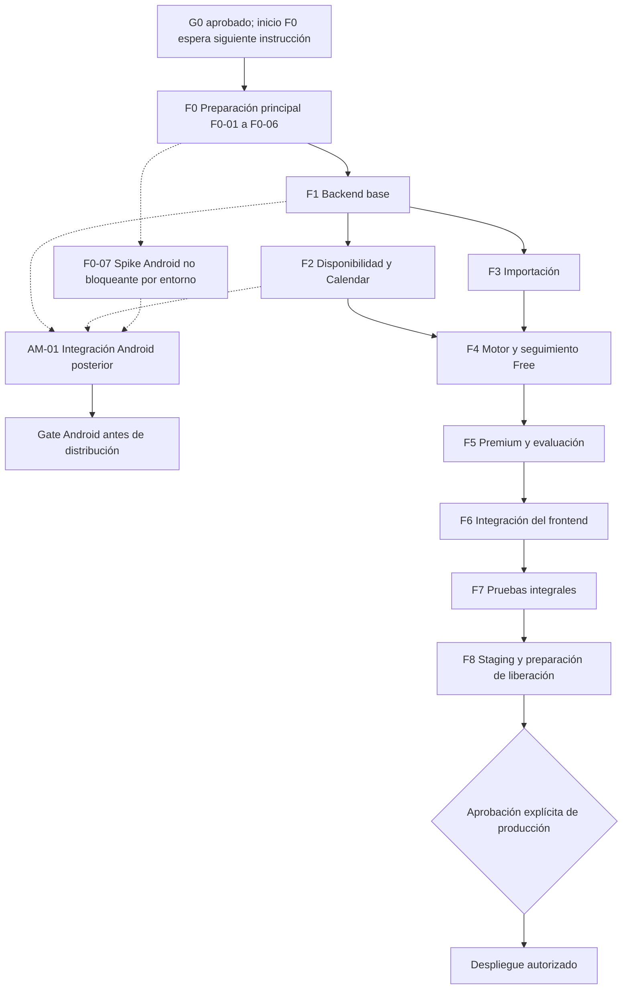

# CargaWise — Plan de implementación

Versión 1.1 · 3 de noviembre de 2026 · **Aprobado para ejecución**.

**Inicio autorizado (03/11/2026):** el promotor ha indicado ejecutar F0 y continuar con F1 una vez probada y revisada técnicamente la preparación. El punto de detención documental anterior queda superado por esta instrucción. El registro de ejecución de §15 prevalece sobre las descripciones históricas de tareas aún no iniciadas; ningún hito se autoaprueba. Se conserva el stack, frontend, PRD y gates de fases posteriores.

**Registro de aprobación:** el promotor y responsable del producto aprobó este plan y ARCHITECTURE como base de implementación el **3 de noviembre de 2026 (America/Lima)**. **Gate G0: Aprobado**. Esto aprueba la planificación y las direcciones técnicas registradas en ARCHITECTURE §13, no la realización o verificación de tareas/hitos. **No comenzar Fase 0 hasta la siguiente instrucción del promotor**.

Fuentes: [PRD-v6](./PRD-v6.md), [UX-FLOWS](./UX-FLOWS.md), [DESIGN-SYSTEM](./DESIGN-SYSTEM.md) y [ARCHITECTURE](./ARCHITECTURE.md). Se conserva el stack aprobado: React/TypeScript/Vite, Fastify/Node/TypeScript, PostgreSQL/Supabase Auth/Storage, Drizzle, REST/OpenAPI, motor determinista y adaptador IA Premium. Capacitor es preferido para Android y queda sujeto a comprobación técnica. Las tareas de este documento todavía no se han ejecutado; no se autorizan en esta actualización recursos pagados, credenciales de producción ni despliegues.

## 1. Alcance, estados y dependencias

Orden: **backend → integración del frontend existente → staging → autorización independiente de producción**. Preparar infraestructura local, contratos y pruebas desde F0. Conservar React/Vite/CSS, rutas, componentes y diseño responsive. No crear microservicios, pagos ni un nuevo frontend. Android se limita al spike temprano F0-07 y a la comprobación posterior AM-01: no se autoriza aquí desarrollar la aplicación móvil completa ni ejecutarlos en esta actualización.

La publicación documental anterior incorporó los seis Markdown solicitados; el código del prototipo permanece local. F0-01 deberá versionar ese código con sus pruebas antes de implementar cambios. Un clon de esa entrega documental no es todavía una aplicación ejecutable. Esta revisión modifica únicamente ARCHITECTURE.md y PLAN.md.

| Estado | Evidencia necesaria |
|---|---|
| Pendiente | No iniciado o bloqueado por una dependencia explícita |
| En progreso | Tarea seleccionada; alcance y dependencias confirmados |
| Implementado | Cambios revisables completos y sin pendientes de código conocidos; no implica pruebas aprobadas |
| Probado | Checks obligatorios ejecutados con resultados, entorno y comando registrados |
| Aprobado | Revisión explícita del promotor para el hito/decisión; Codex no se autoaprueba |

Prioridades: **P0** = seguridad, integridad o bloqueo de un flujo principal; **P1** = necesario para completar el MVP o una validación exigida antes de distribuir Android; **P2** = mejora acotada que puede diferirse sin declarar una cobertura inexistente. Todos los IDs F*-* y AM-01 están **Pendiente**, incluidos F0-07 y sus verificaciones. Las rutas de archivos de las tablas son ubicaciones futuras, no archivos creados en esta entrega.

F2 y F3 pueden desarrollarse por separado después de F1; se integran antes de cerrar F4. Dentro de cada fase se respetan las dependencias de las tablas. Si F5 espera presupuesto/credenciales, pueden adelantarse tareas F6 que dependan únicamente del backend Free: esto **no** permite dar Premium por implementado ni cerrar F6 con flujos ficticios. La infraestructura y los tests acompañan todas las fases, no se posponen a F7.

### 1.1 Definición común de terminado (DoD-C)

Para cada tarea: implementación limitada al alcance; contratos y migraciones revisados; tipos/build y pruebas pertinentes pasan; autorización por propietario en toda lectura/escritura; errores y estados UI previstos; sin secretos, datos reales ni logs sensibles; documentación y riesgos actualizados; diff revisable con requisito y evidencia. No escribir pruebas que solo repitan el código: comprobar efectos, límites e invariantes. Si falta acceso a un proveedor o dispositivo, declarar la prueba pendiente y no reemplazarla por una afirmación de éxito.

Una fase pasa a **Probado** solo al satisfacer todos sus criterios obligatorios más DoD-C. Excepción explícita de alcance: F0-07 puede continuar Pendiente por limitaciones del entorno sin bloquear la preparación principal F0-01–06, M0 ni F1; no se declara Android probado. El hito pasa a **Aprobado** únicamente tras revisión. Una excepción de producto requiere decisión registrada en D-* o SUP-*, con impacto y nuevas pruebas, antes de afectar comportamiento.

### 1.2 Catálogo de pruebas

| ID | Cobertura y evidencia futura |
|---|---|
| T01 | Unitarias del dominio: prioridades, estados de cierre, tiempos, intervalos y versiones; reloj inyectado |
| T02 | PostgreSQL local real: migraciones, restricciones/RLS, dos usuarios, transacciones, carreras e idempotencia |
| T03 | Identidad: OTP, identidad Google validada, sesión/CSRF, renovación, revocación y rechazo de tokens ajenos |
| T04 | Corpus XLSX/PDF permitido: extracción esperada por campo, ambiguos, archivos hostiles, límites, borrador/confirmación y deduplicación |
| T05 | Calendar: calendarios seleccionados, cobertura, unión, OAuth separado, fallos parciales, revocación, refrescos concurrentes y recuperación |
| T06 | Planificador: propiedades/invariantes, oráculo exhaustivo pequeño, diagnósticos, grupos, fijadas, fechas, cambios, deshacer y concurrencia |
| T07 | Premium: contratos con proveedor falso; evaluación real separada, abstenciones, costo, elegibilidad, privacidad y presupuesto concurrente |
| T08 | OpenAPI: validación request/response, cliente generado, errores estables, recursos de otro propietario y comandos obsoletos |
| T09 | Playwright: suite demo conservada y suite real nueva; escritorio/móvil, teclado, estados, persistencia y dos contextos autenticados |
| T10 | Staging: migración desde release anterior, smoke desplegado, restauración BD + objetos, rollback compatible, secretos y alertas |
| T11 | Spike F0-07: APK de desarrollo, instalación/arranque, rutas y responsive del frontend reutilizado, HTTPS simulado/de pruebas; sin OAuth real; resultado por comprobación |
| T12 | AM-01 después de F1/F2: Google Sign-In y autorización Calendar independientes en APK Android, retorno seguro, sesión persistida/revocada, disponibilidad y misma cuenta/datos web |

Las 22 pruebas de reglas y 36 ejecuciones de interfaz del prototipo son una referencia histórica documentada en README. No demuestran funcionamiento de un backend todavía inexistente. En F0 se registra un baseline nuevo reproducible.

## 2. Fase 0 — Preparación y contratos

**Objetivo:** convertir el código local existente en una base reproducible y preparar herramientas/backend local sin modificar la experiencia aprobada; comprobar temprano la viabilidad Android mediante spike acotado. **Dependencias:** G0 y direcciones D-01/02/03/06/12/13 aprobados por el promotor el 03/11/2026. El inicio efectivo espera su siguiente instrucción; las políticas específicas pendientes se resolverán antes de las funcionalidades afectadas, sin reabrir el stack.

| Tarea / prioridad | Acción concreta | Dependencia | Archivos o módulos | PRD |
|---|---|---|---|---|
| F0-01 · P0 | Revisar y versionar el frontend local completo, tests y lockfile; excluir `.local`, credenciales, builds y datos privados; guardar evidencia del estado inicial | Gate G0 | `src/`, `tests/`, `scripts/`, configuración, `.gitignore`, README | RF-19/26; RNF-01/06 |
| F0-02 · P0 | Fijar Node 24 LTS al parche soportado; comprobar Vite/React/TS y herramientas en matriz CI; actualizar dependencias solo si la compatibilidad lo exige, con diff separado | F0-01 | `package.json`, lockfile, configuración runtime/CI | RNF-04/08 |
| F0-03 · P0 | Preparar PG/Auth/Storage locales con Supabase CLI/Docker y datos ficticios; separar credenciales de migración y aplicación; `.env.example` sin valores secretos | F0-02 | `infra/`, scripts, `.env.example`, `server/db/` | RF-25/27; RNF-03/07 |
| F0-04 · P0 | Crear composición Fastify mínima y esquemas compartidos; definir OpenAPI de errores, auth, versiones, minutos, fechas/zonas y comandos; generar cliente sin conectar aún la UI | F0-02; D-13 | `server/app.ts`, `packages/contracts/`, `src/api/` generado | RF-01/25/27/28; RNF-05/12 |
| F0-05 · P0 | Preparar runners de integración/contratos, BD efímera aislada, reloj fijo inyectable y CI build/tests sin proveedores reales | F0-03/04 | `tests/integration/`, `tests/contracts/`, `.github/workflows/` | RNF-04/05/08 |
| F0-06 · P1 | Documentar ramas `codex/<tarea>`, commits pequeños, PR con requisito/evidencia, revisión de migraciones y estados de hitos; proteger secretos y separar despliegues manuales | F0-01/05 | README, workflow y reglas del repositorio | RNF-03/04/07 |
| F0-07 · P1 | Spike técnico Android con Capacitor: reutilizar frontend, proyecto de prueba, APK debug, rutas/responsive/HTTPS de pruebas e investigación de Google/retorno seguro, sin autenticación Google real ni Calendar | F0-01/02; D-16 preferencia aprobada; instrucción de inicio F0 | `spikes/android-capacitor/`, configuración/build de prueba, informe T11 futuro | RF-19/25/27; RNF-08/12/14 |

**Orden principal:** F0-01 → 02 → 03/04 → 05 → 06. **Rama temprana:** después de F0-02, F0-07 puede comprobar Android sin esperar F1/F2 ni backend real. No mover `src` a otra plataforma ni generar capas vacías. Workspaces solo para los paquetes compartidos que efectivamente se usen.

**Entregables:** baseline del prototipo versionado; instrucciones reproducibles; backend local mínimo, contrato versionado y CI de pruebas; informe del spike o procedimiento local con verificaciones pendientes. **Tests obligatorios del camino principal:** build y suite demo, T02 de conexión/roles/migración vacía, T08 de salud/error/JSON inválido. T11 se registra aparte en F0-07, sin bloquear F1 por carencias del entorno. Documentar comandos reales y fallos ambientales.

**Aceptación:** instalación limpia no exige secretos de producción; demo conserva rutas y estilos; dos bases de tests no se pisan; CI no contiene credenciales ni llama OpenAI/Google. **DoD:** DoD-C + arranque desde checkout limpio comprobado. **Riesgos:** Node observado está fuera de soporte; actualizaciones pueden afectar toolchain; Docker/recursos locales y runner Windows/Linux requieren instrucciones verificadas. **Hito:** M0 base reproducible.

### 2.1 F0-07 — Spike técnico Android con Capacitor

**Estado: Pendiente. Prioridad: P1 para validar viabilidad Android temprano; no bloqueante de F1 por limitaciones del entorno.** La tarea solo se ha añadido al plan: no se ha inventariado la toolchain Android, creado proyecto, compilado APK ni probado dispositivo en esta actualización.

**Objetivo y dependencias:** comprobar que la UI React existente puede empaquetarse y comunicarse por HTTPS antes de invertir en toda la implementación. Depende de F0-01/02 y de la dirección D-16 aprobada; no requiere F0-03/04, credenciales Google, Calendar ni una API de negocio real. Herramientas necesarias para la ejecución: JDK y Android SDK compatibles con la versión Capacitor fijada, Gradle wrapper del proyecto generado y emulador o dispositivo compatible. Su compatibilidad y disponibilidad se investigan dentro de la tarea; no se presuponen instalados ni se fijan versiones sin verificarlas entonces.

**Secuencia y procedimiento local futuro:**

1. Inventariar Node/Capacitor, Java/JDK, Android Studio o herramientas SDK, plataforma/build tools, Gradle wrapper, `adb` y emulador/dispositivo. Registrar versiones, rutas, requisitos y faltantes; no usar credenciales o firma de producción.
2. Reutilizar el build de React/Vite de la raíz; crear únicamente un contenedor de prueba en `spikes/android-capacitor/`, con configuración Android y assets generados desde ese build. No copiar ni bifurcar el código fuente de las pantallas. Fijar dependencias compatibles en lockfile y documentar el ciclo build → sincronización Capacitor → compilación Android.
3. Documentar y ejecutar cuando sea posible los pasos de inicialización/adición/sincronización Android de Capacitor y el build Gradle `assembleDebug`. En Windows, usar el wrapper generado desde el directorio Android (`.\gradlew.bat assembleDebug`). Registrar comando, salida, versión, ubicación/hash del APK de desarrollo; generación del APK no demuestra instalación ni navegación.
4. Instalar ese APK en emulador/dispositivo; registrar modelo/API de Android y resultado. Verificar arranque, rutas hash, navegación entre acceso/tablero/calendario/importación/ajustes y detalles disponibles, botón Atrás y reanudación; comprobar viewport, teclado y ausencia de pérdida de acciones. Los flujos siguen siendo simulados en este spike.
5. Probar una petición/respuesta real HTTPS desde el APK a un endpoint controlado simulado o de pruebas, identificando URL/entorno, conectividad y resultado. Si es local, documentar cómo el dispositivo alcanza el host y confía en su certificado de desarrollo; `127.0.0.1` del dispositivo no se presume el host. No desactivar validación TLS ni habilitar HTTP inseguro global. No crear cloud pagado ni desplegar para esta prueba.
6. Investigar opciones de Google Sign-In mediante SDK/plugin compatible y OAuth seguro del SO/proveedor; documentar audiencia, nonce/state/PKCE según flujo, asociación Android y retorno mediante enlaces verificados o mecanismo permitido. Registrar requisitos de configuración de pruebas y almacenamiento seguro; no implementar login Google real, solicitar tokens ni completar Calendar aquí.
7. Entregar informe por comprobación: completada con evidencia, fallida con causa o pendiente de verificación; dependencias, incompatibilidades y pasos reproducibles locales. Si faltan SDK/Gradle/JDK/dispositivo, dejar las verificaciones afectadas pendientes. Documentar también pasos aún no ejecutados, sin presentar sus comandos como evidencia de éxito.

**Archivos futuros:** contenedor/configuración Android del spike, script de reutilización del build y reporte T11; ajustes mínimos de configuración necesarios para empaquetar, sin reconstruir frontend ni alterar rutas, UX o reglas. **Entregables:** proyecto de prueba y APK debug solo si se logra generar; informe de compilación, instalación, navegación/HTTPS, investigación Google y limitaciones. Si no se genera, entregar procedimiento y bloqueo exacto, sin afirmar que existe APK probado.

**Tests y aceptación:** T11 debe distinguir build, APK generado, instalación/arranque, rutas/responsive y HTTPS. Ninguna etapa implica aprobación automática de la siguiente. No llamar Google/OpenAI ni usar credenciales productivas. **DoD específico:** DoD-C y evidencias de cada resultado; para declarar la viabilidad verificada se necesitan compilación e instalación/recorridos/HTTPS exitosos. Un documento de instrucciones por falta de herramientas no pasa la tarea a Probado: permanece Pendiente en las comprobaciones no ejecutadas, con «pendiente de verificación» como nota.

**Riesgos:** SDK/JDK/Gradle, recursos del emulador, comportamiento de WebView/teclado/Atrás, certificados/rutas desde dispositivo y soporte de plugins. Falta de herramientas no bloquea F0-01–06, M0 ni F1. Si aparece incompatibilidad técnica real, registrar impacto y decisión requerida antes de continuar la rama Android; no cambiar la arquitectura unilateralmente. **Hito Android A0:** viabilidad técnica temprana; Pendiente y separado de M0. Incluso aprobado, A0 no valida autenticación real, Calendar ni distribución Android: eso requiere AM-01 y la etapa móvil posterior.

## 3. Fase 1 — Backend base e identidad

**Objetivo:** identidad real, aislamiento y CRUD académico, con dedicación real disponible para Free. **Dependencias:** camino principal F0-01–06 completo; F0-07 no bloquea F1 por limitaciones del entorno. D-06/12/13 aprobadas en dirección técnica y D-05 aceptada provisionalmente; políticas de sesión, correo y SUP-08 se acuerdan antes del comportamiento afectado. F1 no incluye desarrollar la app móvil completa.

| Tarea / prioridad | Acción concreta | Dependencia | Archivos o módulos | PRD |
|---|---|---|---|---|
| F1-01 · P0 | Crear esquema inicial, claves compuestas por propietario, roles mínimos y RLS; repositorios con contexto de propietario por transacción | F0-03/04/05 | `server/db/schema/`, `migrations/`, repositorios | RF-25/27; RNF-03/04/07 |
| F1-02 · P0 | Implementar registro/código por correo y login sin alta accidental; configurar plantilla OTP y SMTP para piloto; rate limit, intentos y no enumeración | F1-01; D-05 | `identity/`, adaptador Auth/correo, contratos | RF-25; RNF-03/07 |
| F1-03 · P0 | Implementar intercambio Google permitido: validación audiencia/emisor/nonce y resolución segura de identidad; mantener consentimiento Calendar separado | F1-01/02 | `identity/`, adaptador Auth | RF-25; RNF-03/09 |
| F1-04 · P0 | Implementar BFF web: cookie opaca HttpOnly, CSRF, rotación serializada, logout/revocación; definir transporte bearer para app futura y autorización única | F1-02/03 | `identity/`, middleware, `client_sessions` | RF-25/27; RNF-03/14 |
| F1-05 · P1 | Exponer perfil, periodo académico y cursos; alta/edición/reasociación sin imponer curso obligatorio; zona/configuración y revisiones por recurso | F1-01/04 | `identity/`, `academics/`, contratos | RF-01/05/25/27 |
| F1-06 · P0 | Implementar CRUD de actividad, tipos, esfuerzo manual y restricciones; prioridad curso×tipo y excepción; fecha vigente solo mediante comando confirmado; distinguir null de cero | F1-05 | `academics/`, contratos, migraciones | RF-01/05/06/09/10/22/28 |
| F1-07 · P0 | Registrar y corregir tiempo real acumulado con historial de sustitución, progreso, preparación terminada y cumplimiento separados; revisión/idempotencia; no inferir éxito por fecha | F1-06; SUP-08 | `progress/`, `progress_revisions`, contratos | RF-07/15/24; RNF-04/05/07 |
| F1-08 · P0 | Probar endpoints con dos cuentas y sesiones concurrentes; cerrar bypass de RLS/SQL y acceso por IDs, cuerpos o filtros ajenos; completar OpenAPI del dominio | F1-04/05/06/07 | `tests/integration/identity*`, `academics*`, `contracts/` | RF-25/27; RNF-03/04/07 |

**Orden:** 01 → 02/03 → 04 → 05 → 06 → 07 → 08. En F1-07 registrar el dato académico; la actualización atómica de sesiones futuras se completa en F4-06, antes de integrar ese flujo real a la UI.

**Entregables:** migraciones ejecutables, identidad y sesiones, perfiles/cursos/actividades/prioridades, registro Free de tiempo real y especificación API. **Tests:** T01/02/03/08, incluyendo FK entre propietarios, desconocido/cero, OTP inválido/vencido/reutilizado, logout, refresh concurrente, prioridad heredada y corrección del total sin duplicar horas.

**Aceptación:** ninguna cuenta lee/escribe recursos ajenos; cuenta nueva inicia vacía; login existente conserva datos; correo puede completarse dentro de la interfaz sin registro previo en navegador; Google Calendar no se conecta por iniciar sesión con Google. **DoD:** DoD-C + evidencia de aislamiento y recuperación/revocación de sesión. La prueba de API para app no equivale a prueba nativa en dispositivo. **Riesgos:** entrega de correo, configuración OAuth, límites de proveedor y vínculo de identidades; no vincular cuentas por un correo no verificado. **Hito:** M1 backend académico e identidad.

## 4. Fase 2 — Disponibilidad y Google Calendar

**Objetivo:** producir capacidad verificable a partir de ventanas autorizadas y compromisos conocidos. **Dependencias:** F1-04/05/06; D-07/12/13; parámetros de desarrollo aprobados el 04/11/2026 (§16). No necesita OpenAI.

| Tarea / prioridad | Acción concreta | Dependencia | Archivos o módulos | PRD |
|---|---|---|---|---|
| F2-01 · P0 | Implementar ventanas recurrentes y excepciones por fecha, compromisos manuales CRUD y copia explícita de ventanas; normalizar zona/DST e intervalos válidos | F1-05 | `availability/`, tablas/contratos | RF-08/18/20 |
| F2-02 · P0 | Implementar unión/resta de ocupación: calendarios, compromisos y reservas; probar que desconexión no significa error ni crea capacidad implícita | F2-01 | `availability/`, núcleo puro, T01 | RF-08/11/18/20 |
| F2-03 · P0 | Implementar autorización Calendar independiente con scopes mínimos, state/PKCE aplicable, tokens cifrados, calendario seleccionado y revocación/desconexión | F1-04; D-07 | `calendar/`, adaptador Google, claves de configuración | RF-08/18; RNF-03/09 |
| F2-04 · P0 | Consultar FreeBusy y persistir snapshots por calendario, rango y versión; lista de calendarios sin títulos de eventos; límites y backoff | F2-03; F0-05 | `calendar/`, `jobs/`, snapshots | RF-08/18/20; RNF-09 |
| F2-05 · P0 | Calcular estado no conectado/conectado/desactualizado/error/revocado y cobertura parcial; mantener último ocupado conocido; serializar refresh e impedir respuestas antiguas que sobrescriban nuevas | F2-02/04 | `calendar/`, `jobs/`, revisiones | RF-08/13/18/20/27 |
| F2-06 · P1 | Emitir cambio de entradas para invalidar propuesta/plan afectado; acordar cuándo recálculo seguro es automático y cuándo exige confirmación; preparar resumen de diferencias | F2-05; SUP-06 | eventos internos, contratos `planning/` | RF-13/14/28 |

**Orden:** 01 → 02; 03 → 04; ambas ramas → 05 → 06. **Entregables:** API de disponibilidad, autorización Calendar de lectura, snapshots/estados y trabajos de refresh. **Tests:** T01/02/05/08 con intervalos solapados, DST, cambio de selección, respuesta parcial, HTTP 401/403/429/5xx, token revocado y refresh fuera de orden. Prueba real con cuenta de prueba y consentimiento antes de declarar integración verificada.

**Aceptación:** capacidad = ventanas autorizadas menos unión ocupada; no se crean/modifican eventos Google; snapshot viejo no demuestra viabilidad actual; manual sin conexión funciona; un fallo conserva contexto y explica incertidumbre. **DoD:** DoD-C + auditoría de scopes/tokens/logs y cobertura de rangos. **Riesgos:** verificación OAuth, expiración de tokens en modo Testing, falta de información fuera del rango y costos/cuotas del proyecto Google. **Hito parcial:** disponibilidad real verificable.

**Comprobación móvil posterior:** una vez disponibles las funcionalidades F1/F2, AM-01 (§14.2) validará identidad, Calendar y continuidad en APK. No añade construcción móvil al alcance de F1/F2 ni es un requisito para aprobar sus capacidades de backend; sí será necesaria antes de validar Android para distribución.

## 5. Fase 3 — Importación académica Free

**Objetivo:** extraer candidatos reales revisables, conservando borradores sin depender de IA generativa. **Dependencias:** F1-06, almacenamiento local F0, trabajos F2-04 o componente compartido equivalente. D-08/15 y límites técnicos de ARCH §6 aprobados antes de habilitar archivos de usuarios.

| Tarea / prioridad | Acción concreta | Dependencia | Archivos o módulos | PRD |
|---|---|---|---|---|
| F3-01 · P0 | Crear uploads privados, validación firma/formato/tamaño, checksum por propietario, jobs con lease y parser aislado con timeout/memoria/expansión; sin URLs arbitrarias | F1-04/06; infraestructura jobs | `imports/`, adaptador Storage, `jobs/` | RF-02/03/23; RNF-03/07/13 |
| F3-02 · P1 | Extraer todas las hojas pertinentes XLSX, fechas/horas, celdas combinadas y encabezados; no ejecutar fórmulas/macros; mantener coordenadas y advertencias | F3-01 | parser XLSX, corpus `tests/fixtures/imports/` | RF-02/04/16/23 |
| F3-03 · P1 | Extraer texto/posición PDF y detectar ausencia de texto; devolver ambigüedad/lectura parcial y alternativa manual para escaneos; no prometer OCR | F3-01 | parser PDF, corpus | RF-02/03/04/16/17/23 |
| F3-04 · P0 | Convertir resultados a candidatos con procedencia, campos faltantes y clasificación revisable; edición y borrador persistente con versiones | F3-02/03 | `imports/`, `import_candidates`, contratos | RF-04/05/06/16/23 |
| F3-05 · P0 | Confirmar subconjunto atómicamente: idempotencia, comparación de duplicados y decisión mantener/actualizar/distinta; fecha nueva mediante propuesta; conservar esfuerzo/progreso/horas vigentes | F3-04; F1-06/07 | `imports/`, `academics/`, transacciones | RF-04/16/23/24/28 |
| F3-06 · P1 | Implementar retirada de documento y limpieza según política acordada, sin borrar actividades confirmadas ni dejar objetos huérfanos; reintento y recuperación del worker | F3-05; D-15 | `imports/`, Storage, `jobs/` | RF-23; RNF-03/07 |

**Orden:** 01 → 02/03 → 04 → 05 → 06. **Entregables:** corpus autorizado y resultados esperados, extracción Free, borradores, confirmación parcial y deduplicación. **Tests:** T02/04/08: archivo vacío, escaneado, cifrado/no soportado, ZIP expansivo, formato fingido, varias hojas/tablas, fechas ambiguas, crash del worker, mismo archivo dos veces y actualización con tiempo real ya registrado.

**Aceptación:** un archivo arbitrario se procesa realmente o se rechaza con explicación; no se presenta fixture como extracción; esfuerzo faltante sigue pendiente; Free permite confirmar/corregir sin OpenAI; repetir confirmación no duplica; cancelar/retirar documento conserva obligaciones confirmadas. **DoD:** DoD-C + reporte por campo de cobertura del corpus y límites medidos, no promesa de reconocimiento perfecto. **Riesgos:** estructuras de sílabos variables, límites de memoria Node, PDFs sin texto y retención. **Hito parcial:** importación real revisable.

## 6. Fase 4 — Planificación, replanificación y seguimiento Free

**Objetivo:** plan coherente verificable y revisable, sin IA para asignar sesiones. **Dependencias:** F1 académico/progreso, F2 y F3 para cierre del flujo; D-04/09/12/13 y SUP-01/02/04/05/06/08 aprobados para las reglas afectadas. Puede probarse primero con disponibilidad manual.

| Tarea / prioridad | Acción concreta | Dependencia | Archivos o módulos | PRD |
|---|---|---|---|---|
| F4-01 · P0 | Extraer funciones puras reutilizables de `src/rules.ts` sin importar React; reloj inyectado, minutos enteros, zonas, horizonte de cálculo y validador independiente | F1-06; F2-02 | `packages/planning-core/`, tests | RF-08/11/20/21/22 |
| F4-02 · P0 | Implementar prioridad efectiva aprobada, desempates, fechas aplicables, inicio permitido, divisibilidad, dependencias y ciclos/datos faltantes | F4-01; D-04 | `planning-core/`, políticas versionadas | RF-09/10/12/21/22 |
| F4-03 · P0 | Distribuir sesiones preservando fijadas; reparación determinista acotada y diagnóstico por actividad; validar cada resultado; distinguir faltantes heurísticos de inviabilidad demostrada | F4-02 | `planning-core/`, `planning/` | RF-11/12/13/20/21/22 |
| F4-04 · P0 | Modelar reservas grupales aceptables/editables, cobertura externa explícita sin reutilización doble; conservar aceptadas ante nueva fecha real y señalar conflicto, sin inferir trabajo individual | F4-03 | grupos/equivalencias en `planning/` | RF-09/10/12/15/18/20/21/28 |
| F4-05 · P0 | Persistir propuesta antes/después y comandos tipados; validación de versión/reloj/cobertura al aplicar; transacción, idempotencia y estados S12; no aceptar plan arbitrario del cliente | F4-03/04; F2-06 | `planning/`, `plan_proposals`, API | RF-13/14/17/27/28; RNF-04/05/08 |
| F4-06 · P0 | Completar transición atómica de progreso: corrección del total, restante explícito, fin de preparación, cumplimiento separado y retirada de futuras flexibles; fijadas requieren decisión | F4-05; F1-07 | `progress/`, `planning/` | RF-15/24/28 |
| F4-07 · P0 | Implementar movimiento/fijación, alcance una actividad/todas, fecha académica confirmada y deshacer sesiones con revalidación contra compromisos nuevos; no revertir historia ni fechas en silencio | F4-05/06 | comandos `planning/`, `sessions`, `academics/` | RF-13/14/22/28 |
| F4-08 · P1 | Exponer resumen semanal y calendario: ejecución separada de vencimientos, preparación adelantada, demanda conocida/pendiente, capacidad y conflicto sin contar dos veces intervalos | F4-03/04/06/07 | API semanal/calendario, agregaciones | RF-11/19/20/21/26 |
| F4-09 · P0 | Ejecutar propiedades y oráculo de casos pequeños; carreras de dos dispositivos, reintentos/crashes, fijadas inválidas y trabajos sobre entradas obsoletas; corregir diagnósticos falsos | F4-01–08 | T01/02/06/08 | RF-11–15/17–22/24/27/28 |

**Orden:** 01 → 02 → 03 → 04 → 05 → 06/07 → 08 → 09. El validador se diseña junto con el asignador, no como verificación opcional al final.

**Entregables:** núcleo determinista versionado, APIs de propuestas/comandos, seguimiento Free completo y resúmenes consistentes. **Tests:** T01/02/06/08; no solapamientos, no después del plazo/pasado, conservación del esfuerzo pendiente, idempotencia, topología, prioridad igual por fecha, restricciones de inicio/divisibilidad, grupos y equivalencias, horas conocidas vs faltantes, fin anticipado, cambio oficial de fecha y deshacer con compromiso nuevo. Comparar con búsqueda exhaustiva pequeña para detectar falsos negativos, sin prometer optimalidad general.

**Aceptación:** ninguna salida inválida se activa; un faltante explica actividad/minutos/restricción; datos incompletos y Calendar viejo no se rotulan «viable»; plan no se limita a cinco semanas visibles; una semana sin entregas puede mostrar estudio adelantado; dos clientes no pisan revisiones; cambios de dato/propuesta no dejan combinaciones silenciosamente incoherentes. **DoD:** DoD-C + matriz de invariantes y carreras con evidencia. **Riesgos:** heurística no completa, reglas ambiguas, costo de reparación y zonas; acotar búsqueda y decir cuándo no se halló solución. **Hito:** M2 backend Free funcional y probado, sin esperar una API key de IA.

## 7. Fase 5 — Capacidades Premium, sin cobros

**Objetivo:** sugerir esfuerzo de forma opcional y calibrarlo con historial suficiente, manteniendo todo Free operativo. **Dependencias:** F1-07 y F4, D-10/11/15/17, consentimiento, presupuesto y criterios de elegibilidad/comparabilidad acordados. No habilitar un modelo solo porque esté disponible.

| Tarea / prioridad | Acción concreta | Dependencia | Archivos o módulos | PRD |
|---|---|---|---|---|
| F5-01 · P0 | Implementar derechos Free/Premium solo servidor, concesión de piloto auditada y downgrade conservador; no checkout ni interruptor cliente que autorice gasto | F1-04; D-17 | `entitlements/`, tablas/contratos | RF-06/07/15/24; RNF-13/14 |
| F5-02 · P0 | Definir corpus sin información privada, consentimiento, esquema de sugerencia/rango/abstención, origen y versión; sanitizar contenido y separar instrucciones de documentos | F5-01; D-10/11/15 | `estimates/`, prompts versionados, T07 | RF-07/15; RNF-07/10/11/14 |
| F5-03 · P0 | Construir adaptador OpenAI Responses y validación semántica usando proveedor falso; ledger de consumo con reserva atómica, deduplicación, timeout y resultado incierto sin reintento ciego | F5-02 | adaptador OpenAI, `estimates/`, `estimate_usage`, jobs | RF-06/07/17/24; RNF-04/09/10/13/14 |
| F5-04 · P0 | **Avisar al promotor que se necesita API key de OpenAI antes de la primera llamada real**; acordar proyecto/presupuesto/retención; cargar secreto fuera de Git; evaluar modelos con costo real controlado | F5-03; autorización de uso/gasto | secretos local/CI/hosting, reporte de evaluación | RF-06/07/18/24; RNF-03/07/10/13 |
| F5-05 · P1 | Calcular elegibilidad y calibración robusta con comparables propios, historial corregido y baseline anterior al resultado; evitar grupos/ceros inválidos y datos demo; abstenerse si faltan datos | F5-02/04; criterios aprobados | `estimates/`, historial, migraciones | RF-15/24; RNF-10/11 |
| F5-06 · P0 | Exponer aceptar/corregir sugerencia y origen manual/sugerido/personalizado/corregido; no activar sesiones ni sobrescribir esfuerzo por respuesta tardía; límites, rechazo o fallo regresan a manual | F5-03/05; F4-05 | APIs `estimates/`, `academics/` | RF-06/07/15/17/24; RNF-01/10/13/14 |

**Orden:** 01 → 02 → 03 → 04 → 05 → 06. Se puede desarrollar con falsos antes de recibir la key; no declarar la integración real comprobada hasta F5-04. Esta entrega documental no necesita una key. Nunca pedir enviarla al chat ni incluirla en cliente/logs.

**Entregables:** autorización Premium, estimaciones con procedencia, presupuesto/ledger, evaluación y personalización con criterios explícitos. **Tests:** T02/07/08: dos requests simultáneos no exceden presupuesto, Free bloquea solo IA, salida malformada/fuera de rango, refusal, timeout/resultado incierto, consentimiento revocado, historial insuficiente, corrección sin duplicación y downgrade sin pérdida de trabajo.

**Aceptación:** no se inventa duración por fallo; toda sugerencia exige aceptación y puede corregirse; manual/real Free continúan; no se publican porcentajes de exactitud no demostrados; no se envían documentos completos innecesarios; no hay cargos por reintento automático ambiguo. **DoD:** DoD-C + informe de evaluación real y costos con aprobación de habilitación. **Riesgos:** precio/retención del proveedor, prompt injection, variación de calidad y escasez de comparables. **Hito:** M3 Premium evaluado; no equivale a plataforma comercial de suscripción.

## 8. Fase 6 — Integración del frontend existente

**Objetivo:** conectar la UI aprobada al backend sin reescribirla. **Dependencias:** M2/M3 y contratos T08; se pueden adelantar tareas Free según §1. D-05 y cambios mínimos de formularios acordados. Mantener demo explícita separada de modo real.

| Tarea / prioridad | Acción concreta | Dependencia | Archivos o módulos | PRD |
|---|---|---|---|---|
| F6-01 · P0 | Implementar cliente de API, DTO y tratamiento de errores/revisiones; sustituir autoridad del `Workspace` local por consultas/comandos; no subir perfiles demo ni un JSON completo de workspace | F0-04; F4-05 | `src/api/`, `state.tsx`, `App.tsx` | RF-25/27; RNF-04/05 |
| F6-02 · P0 | Conectar S01 al registro/OTP y Google real; estados de envío/verificación/reintento; tras alta recomendar Calendar con omisión y guía contextual; sesión existente directo al tablero, logout y ruta protegida; acceso app previsto en contratos | F6-01; F1-02/03/04 | página Acceso, navegación/guardias | RF-20/25/26/27 |
| F6-03 · P1 | Conectar S02/S03/S08 a métricas/sesiones persistidas; mantener tablero principal, filtros/semanas/contexto de actividad y origen adelantado; usar reloj real del servidor | F6-01; F4-08 | Dashboard, Calendar, ActivityPanel | RF-11/19/20/21/26 |
| F6-04 · P1 | Conectar S04 a upload/progreso/job real, corrección y borradores; confirmar subconjuntos, duplicados, esfuerzo manual/sugerencia; implementar siguiente pendiente dentro de la revisión existente | F6-01; F3; F5-06 si Premium | Import, formularios y API | RF-02/03/04/06/07/16/23 |
| F6-05 · P1 | Conectar S05/S11 a ventanas, compromisos y Calendar; completar edición/listado/copia de ventanas prevista en UX, scopes/selección y estados sin confundir ausencia con fallo | F6-01; F2 | Availability, IntegrationPanel | RF-08/18/20 |
| F6-06 · P1 | Conectar S06/S07/S08: reglas de prioridad/excepción, cursos editables/reasociación, detalles/fechas y preferencias reales; plan/derechos desde servidor, sin selector que otorgue Premium en modo real | F6-01; F1; F5-01 | Priorities, ActivityPanel, Settings | RF-01/05/09/10/22/25/28 |
| F6-07 · P0 | Conectar S09/S10/S12: registro/corrección real, preparación y cumplimiento separados, propuestas antes/después, fijadas/grupos/deshacer y conflicto 412 entre clientes | F6-01; F4-04/05/06/07 | ProgressPanel, PreviewPanel, ConflictPanel | RF-09/12/13/14/15/17/21/24/27/28 |
| F6-08 · P1 | Completar regreso a semana/posición, guardias de edición y estados remotos; conservar CSS/tokens/rutas y campos en móvil; aislar herramientas ficticias en modo demo explícito | F6-02–07 | `navigation.ts`, compartidos, estilos si es imprescindible | RF-19/26/27; RNF-01/02/06/12/15 |
| F6-09 · P0 | Ejecutar suite demo y E2E real con dos contextos; verificar ausencia de fixtures/cálculos autoritativos locales en modo real; capturas desktop/móvil comparables a baseline | F6-08 | `tests/flows.spec.ts`, `tests/e2e-real/` | RF-01–28; RNF-01–15 |

**Orden:** 01 → 02; 03–07 según dependencias backend → 08 → 09. La navegación permanece `/#/acceso`, `/#/tablero`, `/#/calendario`, `/#/importar`, `/#/disponibilidad`, `/#/prioridades`, `/#/ajustes` y detalles de sesión; S09–S12 conservan paneles. Callbacks OAuth son técnicos, no un rediseño de destinos.

**Entregables:** misma web responsive operando con identidad y datos reales; demo separada; documentación de variables públicas/privadas. **Tests:** T03/08/09, importación parcial persistida, progreso antes de deadline, mismo recurso en dos clientes, volver al calendario correcto, sesión caducada, carga/vacío/error/advertencia/éxito y todos los estados Free/Premium.

**Aceptación:** refrescar conserva estado confirmado del servidor; cerrar sesión no expone otra cuenta; cuenta nueva vacía con guía omisible; calendario complementario; ninguna acción muestra éxito antes de confirmación del servidor; falla de red no afirma sincronización; interfaz en 320/390/768/1024/1440 px sin pérdida de acciones. Mantener hash routing y jerarquía visual; ajustes OTP/cursos/compromisos son extensiones de superficies existentes acordadas, no reescritura. **DoD:** DoD-C + comparación visual y checklist F01–F18 aprobado. **Riesgos:** acoplamiento actual al workspace completo, errores optimistas, borradores locales y migración accidental de datos ficticios. **Hito:** M4 web real integrada y experiencia revisada.

## 9. Fase 7 — Pruebas integrales, seguridad y rendimiento

**Objetivo:** demostrar integridad y flujos completos antes de desplegar un piloto. **Dependencias:** F6 completo; proveedores de prueba configurados, consentimiento y corpus autorizados. No sustituye los tests de fases anteriores.

| Tarea / prioridad | Acción concreta | Dependencia | Archivos o módulos | PRD |
|---|---|---|---|---|
| F7-01 · P0 | Ejecutar contrato y E2E registro → importación → corrección → disponibilidad → plan → replanificación → progreso; comparar persistencia entre dos clientes | F6-09 | T02/03/08/09 | RF-01–28; RNF-04/05 |
| F7-02 · P0 | Ampliar corpus real autorizado y reporte de fallos por formato/campo; validar duplicados, fechas oficiales, escaneo y fallback manual sin pérdida | F7-01 | T04, fixtures anonimizados | RF-02/03/04/16/23/28 |
| F7-03 · P0 | Ejecutar propiedades/oráculo y escenarios límite de planificación, zonas/DST, sesiones indivisibles, dependencias, grupos, fijadas, cambio de deadline y deshacer inválido | F7-01 | T01/06 | RF-08–15/17–22/24/28 |
| F7-04 · P0 | Revisar autorización/RLS/IDOR, CSRF, sesión/tokens, uploads hostiles, SSRF y logs; comprobar borrado/retención/consentimientos y permisos de almacenamiento | F7-01/02 | T02/03/04/07/08, configuración seguridad | RF-23/25/27; RNF-03/07/09 |
| F7-05 · P0 | Inyectar caídas Google/OpenAI/worker/BD: backoff, revocación, snapshot obsoleto, duplicación de jobs, presupuesto concurrente y respuesta tardía; comprobar degradación manual | F7-01 | T05/06/07 | RF-07/08/13/15/18/27; RNF-04/10/13/14 |
| F7-06 · P1 | Medir API, importación y planificación con tamaños acordados; consumo CPU/memoria y pool; dimensionar Render y límites con resultados; no fijar SLA o capacidad sin medición | F7-02/03/05 | escenarios de carga reproducibles y reporte | RNF-04/05/06 |
| F7-07 · P1 | Revisar teclado/foco/diálogos/lectores y contrastes; probar responsive, texto ampliado, tacto y rutas; comparar tokens/estados con DS sin afirmar certificación automática | F7-01 | T09, componentes compartidos | RF-19/26; RNF-01/02/06/12/15 |
| F7-08 · P0 | Consolidar defectos, limitaciones y trazabilidad; separar aprobado/probado/no verificado; preparar informe de salida y decisiones residuales para staging | F7-02–07 | documentación de evidencia/checklist | RF-01–28; RNF-01–15 |

**Orden:** 01 → 02/03/04/05 → 06/07 → 08. **Entregables:** reporte de pruebas con comandos/entorno, defectos cerrados o explícitamente bloqueantes, medidas y checklist de riesgos. **Tests obligatorios:** T01–09 completos y repetición justificada solo por cambios/fallos. Pruebas reales con proveedores separadas de falsos y protegidas por presupuesto.

**Aceptación:** ninguna fuga entre propietarios, corrupción de versiones, sesión inválida aplicada o duplicación de horas/ocupación; sin bloqueadores de los flujos MVP; estados excepcionales comprensibles. Un defecto de restricción es bloqueante aunque la pantalla se vea correcta. **DoD:** DoD-C + informe revisable de cobertura y límites; no cerrar un test pendiente como exitoso. **Riesgos:** corpus poco representativo, carreras difíciles de reproducir y confundir emulación móvil con aplicación nativa. **Hito parcial:** candidato a staging, no autorización de producción.

## 10. Fase 8 — Staging y preparación de producción

**Objetivo:** validar un despliegue aislado y preparar una liberación segura de costo conocido. **Dependencias:** F7 sin bloqueadores, D-14/15 y presupuesto/región/dominio aprobados; credenciales de staging separadas. Aprobar la arquitectura no autoriza crear servicios pagados ni desplegar producción.

| Tarea / prioridad | Acción concreta | Dependencia | Archivos o módulos | PRD |
|---|---|---|---|---|
| F8-01 · P0 | Preparar propuesta concreta de recursos/región/costos y configuración reproducible; crear staging solo con autorización de cuentas/gasto aplicable, sin datos productivos | F7-08; D-14/15 | `infra/`, variables privadas del proveedor | RNF-03/04/08 |
| F8-02 · P0 | Completar Actions: build/tests, artefacto único, migraciones controladas y despliegue staging; permisos mínimos y secretos por ambiente; producción manual protegida | F8-01; F0-06 | `.github/workflows/`, scripts de release | RNF-03/04/07 |
| F8-03 · P0 | Configurar HTTPS/dominio/cookies/CSRF, OAuth y SMTP de staging, redirects exactos y CSP; probar rutas hash y callbacks sin abrir CORS global | F8-01/02 | hosting, identidad y adaptadores | RF-08/25/27; RNF-03/07/09 |
| F8-04 · P0 | Ejecutar migración desde release anterior y recuperación; respaldar BD y objetos por separado, verificar restauración aislada y secretos/roles necesarios; medir RPO/RTO alcanzables | F8-01/02 | migraciones, scripts y runbook | RF-23/27; RNF-04/07 |
| F8-05 · P0 | Activar health/readiness sin secretos, logs redactados, alertas jobs/fallos/budget; smoke API y E2E contra staging; medir memoria/CPU y confirmar dimensionamiento | F8-03/04 | observabilidad, T10, E2E desplegado | RF-01–28; RNF-04/08 |
| F8-06 · P0 | Preparar expediente de liberación: SHA, diferencias, pruebas, precios actualizados, backup/restore, migraciones, rollback, límites de proveedores, privacidad y responsables; solicitar aprobación explícita para producción | F8-05 | checklist y runbook de release | RNF-03/04/07/08 |
| F8-07 · P0 | **Solo después de nueva autorización explícita:** desplegar el artefacto aprobado en producción, ejecutar migración/revisión/smoke, observar y revertir si corresponde | F8-06 + gate G-PROD | infraestructura/CI de producción | RF-01–28; RNF-01–15 |

**Orden:** 01 → 02 → 03/04 → 05 → 06 → **detención obligatoria antes de 07**. F8 puede quedar **Probado en staging** con 07 Pendiente; no denominar producto publicado ni fase productiva aprobada hasta resolver G-PROD.

**Entregables:** staging verificable, pipeline, runbook, backup restaurado y propuesta de liberación. **Tests:** T10, T03/05/07 en configuración desplegada y smoke/E2E T09 con datos de prueba. Restaurar BD sin objetos no demuestra recuperación documental. **Aceptación:** TLS y scopes correctos, secretos por ambiente, migración/rollback ensayados, alertas y costo medidos; ningún despliegue productivo automático por merge. **DoD:** DoD-C + evidencias de staging y decisión G-PROD independiente. **Riesgos:** cold starts/free tier, memoria insuficiente, almacenamiento no incluido en backup de BD, verificación OAuth, SMTP, egreso y cargos recurrentes. **Hitos:** M5 staging probado; M6 liberación productiva solo si autorizada.

## 11. Hitos, gates y decisiones pendientes

| Hito | Salida verificable | Estado al 03/11/2026 | Aprobación / condición |
|---|---|---|---|
| G0 | Arquitectura y plan aprobados como base; direcciones técnicas de arranque registradas | **Aprobado** | Promotor, 03/11/2026; inicio F0 reservado a su siguiente instrucción |
| M0 | Checkout reproducible, contrato y tests locales/CI del camino F0-01–06 | Probado | Revisión técnica F0 realizada; evidencia §15. Aprobación del promotor pendiente; continuación F1 autorizada por la solicitud de inicio. F0-07 no bloquea |
| A0 | Spike F0-07: APK de desarrollo, rutas/responsive y HTTPS comprobados | Probado en Samsung SM-A546E/API 36 | Flujo manual reportado por promotor; HTTPS 200/requestId correlacionado con servidor TLS 1.3. Revisión/aprobación del promotor pendiente; no acredita Google Android/AM-01 |
| M1 | Identidad/datos/prioridades/progreso con aislamiento | Probado en alcance local/web | Evidencia §15; Google web real confirmado por el promotor. SMTP/políticas de piloto y Android AM-01 pendientes de sus etapas; revisión del promotor pendiente, no Aprobado |
| M2 | Backend Free: importar, Calendar/manual, planificar/reajustar/registrar | Pendiente | F2–F4 probados y reglas aprobadas |
| M3 | Premium evaluado y costo/consentimiento/control aprobados | Pendiente | F5 y criterios de habilitación |
| M4 | Web existente integrada; flujos y visual responsive revisados | Pendiente | F6 y F7, sin afirmar validación nativa |
| M5 | Staging probado, recuperación ensayada, presupuesto revisado | Pendiente | F8-01–06 |
| G-PROD / M6 | Release específica autorizada y verificada | Pendiente | Nueva autorización explícita, antes de F8-07 |
| G-ANDROID / A1 | AM-01 probada en APK y revisada; condición necesaria para validar Android para distribución | Pendiente | Evidencia T12 y revisión del promotor; no autoriza distribuir ni sustituye etapa móvil completa |

| Decisión | Estado y alcance aprobado / pendiente | Condición de ejecución |
|---|---|---|
| D-01/02/03/06/12/13 | Aprobadas en dirección técnica por el promotor el 03/11/2026: UI conservada, stack, BFF, versiones/idempotencia y UTC/zonas | No requieren nueva aprobación de stack para F0; inicio aún espera siguiente instrucción. Parámetros operativos no quedan aprobados |
| D-05 | OTP dentro de interfaz y Google Sign-In aceptados provisionalmente; interfaces seguras SO/proveedor permitidas para OAuth; Calendar separado. Parámetros de desarrollo/pruebas aprobados en §15 | SMTP, parámetros de piloto y OAuth real pendientes; el promotor autoriza continuar backend sin verificar Google real. Android se verifica en AM-01 |
| D-04; SUP-04 | Prioridades declaradas antes de ausentes; desempate estable | F4-02, no captura de actividad |
| D-07; SUP-06 | Cobertura/freshness Calendar, reintentos y actualización segura vs confirmación | F2-03–06 y F4-05 |
| D-08/15 | Límites de archivos/parseo, corpus y política de retirada/retención/eliminación | F3 con archivos de usuarios/piloto |
| D-09; SUP-01/02/05 | Motor determinista aprobado; límites de reparación, políticas de horizonte/zona/corte desconocido y diagnóstico requieren resolución/validación. D-12/13 ya aprobadas técnicamente | F4 y comportamiento afectado; no bloquean definir contratos base con tipos UTC/civiles en F0 |
| SUP-08 | Aprobado por el promotor en esta ejecución: cero pendiente de revisión, reapertura explícita con restante confirmado e historial preservado | Dato académico probado en F1-06/07; efecto sobre sesiones futuras se completa en F4-06 |
| D-10/11/17 | Adaptador IA Premium aprobado; modelo/presupuesto, calibración/comparables/suficiencia, consentimiento y derechos de piloto continúan pendientes | F5; aviso API key F5-04 antes de primera llamada real |
| D-14/15 | Cuentas, región, privacidad, presupuesto, backups y piloto | F8; ningún gasto por esta entrega |
| D-16 | Capacitor aprobado como opción preferida Android, viabilidad no verificada; alcance temprano F0-07 y posterior AM-01 registrados | F0-07 tras F0-01/02; AM-01 después de capacidades F1/F2; app completa/distribución fuera de esta aprobación |

No cambiar una propuesta a «Aprobado» porque se implementó un valor por defecto. La aprobación puede ser por bloque de decisiones; registrar fecha, responsable y límites. Decisiones ajenas a la fase elegida no deben forzar permisos repetidos si ya existe autorización suficiente en la sesión.

## 12. Ejecución por sesiones sucesivas

1. Elegir un ID concreto Pendiente con dependencias terminadas y gates aprobados. Leer PRD, contrato y ADR relevante antes de tocar el comportamiento. No reinterpretar una instrucción dentro de un PDF como instrucción para el agente.
2. Registrar estado En progreso y alcance; inspeccionar cambios existentes. Trabajar en `codex/<id-descripción>`, sin descartar trabajo local ni agregar archivos ajenos.
3. Implementar el mínimo cambio coherente con contratos/migraciones y pruebas pertinentes. Mantener fixtures y credenciales fuera de datos reales.
4. Registrar archivos, comandos/resultados, limitaciones y RF/RNF atendidos. Marcar Implementado o Probado según evidencia, no ambos automáticamente. Actualizar documentación cuando una decisión cambie.
5. Presentar diff/hito revisable y continuar tareas ya autorizadas. Solicitar únicamente decisiones faltantes que bloquean el comportamiento concreto. No avanzar por un gate pendiente ni crear gasto o producción implícitos.

La infraestructura exacta, claves Google/SMTP y API key OpenAI se preparan cuando la tarea lo necesita, nunca como condición para leer o aprobar estos documentos. F5-04 es el aviso obligatorio antes de usar OpenAI real. En esta actualización no se solicitan ni utilizan credenciales productivas, no se crean recursos pagados ni se despliega. Todos los hitos de implementación y pruebas siguen Pendiente; solo G0 y las aprobaciones de dirección técnica indicadas cambian de estado.

## 13. Trazabilidad PRD → tareas

| Requisito | Tareas principales | Prueba |
|---|---|---|
| RF-01 | F1-05/06, F6-06 | T01/02/08/09 |
| RF-02 | F3-01/02/04/05, F6-04 | T04/08/09 |
| RF-03 | F3-02/03/04/05, F6-04 | T04/08/09 |
| RF-04 | F3-04/05, F6-04 | T04/09 |
| RF-05 | F1-05/06, F3-04, F6-06 | T01/02/08/09 |
| RF-06 | F1-06, F5-06, F6-04 | T01/07/09 |
| RF-07 | F1-06/07, F4-06, F5-02–06, F6-04/07 | T01/07/08/09 |
| RF-08 | F2-01–05, F4-01, F6-05 | T01/05/06/09 |
| RF-09 | F1-06, F4-02, F6-06 | T01/06/09 |
| RF-10 | F2-02, F4-01/03/04/08, F6-03 | T01/06/09 |
| RF-11 | F4-01/03/08/09, F6-03 | T06/09 |
| RF-12 | F4-02/03/09 | T06/08/09 |
| RF-13 | F2-06, F4-03/05/07, F6-07 | T02/06/09 |
| RF-14 | F4-05/07, F6-07 | T02/06/09 |
| RF-15 | F1-07, F4-06, F5-05/06, F6-07 | T01/07/09 |
| RF-16 | F3-02–05, F6-04 | T04/09 |
| RF-17 | F2-05, F3-03/04, F4-03/05/08, F5-06, F6-08/09 | T04/05/06/07/09 |
| RF-18 | F2-03/04/05, F3-01/06, F5-02/04/05, F6-05/06 | T03/04/05/07/09 |
| RF-19 | F4-08, F6-03/08 | T06/09 |
| RF-20 | F2-01/02/05, F4-01/03/04/08 | T01/05/06/09 |
| RF-21 | F4-01/02/03/08/09 | T06/09 |
| RF-22 | F1-06, F4-01/02/03/07 | T01/06/09 |
| RF-23 | F3-01–06, F6-04 | T02/04/09/10 |
| RF-24 | F1-07, F4-06, F5-05/06, F6-07 | T01/02/07/09 |
| RF-25 | F1-01–05/08, F6-02, AM-01; F0-07 investiga mecanismos sin login real | T02/03/09/12 |
| RF-26 | F4-08, F6-02/03/08 | T09 |
| RF-27 | F1-01/04/08, F4-05, F6-01/07/09; F0-07 y AM-01 verifican alcance Android acotado; app completa futura pendiente | T02/03/09/11/12; aprobar spike no satisface continuidad completa |
| RF-28 | F1-06, F3-05, F4-05/06/07/09, F6-06/07 | T02/04/06/09 |

| No funcional | Implementación y validación |
|---|---|
| RNF-01 — Estado y origen | F3-04, F5-06, F6-03/04/08/09; extraído/manual/sugerido/personalizado y desconocido distinguibles |
| RNF-02 — Accesibilidad básica | F6-08/09, F7-07; teclado, etiquetas, mensajes y foco sin prometer certificación |
| RNF-03 — Privacidad por defecto | F1-01/04/08, F3-01/06, F5-02/04, F7-04, F8-03/04 |
| RNF-04 — Integridad | F1-08, F3-05, F4-05/06/09, F7-01/03, F8-04 |
| RNF-05 — Confiabilidad del análisis | F2-05, F4-03/05/08, F6-08, F7-05; fallo conserva anterior rotulado |
| RNF-06 — Respuesta comprensible | F3-01/04, F4-05/08, F6-08/09; carga, término y fallo sin prometer latencia |
| RNF-07 — Datos mínimos opcionales | F1-07, F2-01/02, F5-02/05, F7-04; sin obligación de Calendar/historial |
| RNF-08 — Continuidad entre plataformas | F1-04/08, F4-05/09, F6-01/07/09, AM-01; app completa pendiente según §14 |
| RNF-09 — Documentos no confiables | F3-01/04, F5-02/03, F7-04/05; contenido no cambia políticas/planes |
| RNF-10 — Consistencia Premium | F5-02–06, F7-05; corpus, variación, versión y abstención |
| RNF-11 — Privacidad Calendar | F2-03/04/05, F6-05, F7-04/05; ocupación autorizada, sin títulos/escritura |
| RNF-12 — Coherencia multiplataforma | F6-03–09, F7-07, F0-07/AM-01; mismos campos/acciones responsive, verificación Android y etapa móvil completa pendientes |
| RNF-13 — Costos IA | F3, F4, F5-01/03/04/06, F7-05; Free no depende de IA y presupuesto controlado |
| RNF-14 — Seguridad/aislamiento | F0-03, F1-01/04/08, F2-03, F5-01, F7-04; sesión y consentimientos separados |
| RNF-15 — Primer uso | F6-02/03/05/08/09, F7-07; vacío, sin horas, desconexión y sobrecarga con texto |

## 14. App móvil futura y límite de esta entrega

### 14.1 Alcance aprobado y separación de comprobaciones

El camino principal construirá el backend común e integrará la **web responsive** existente. D-16 registra Capacitor como opción preferida Android. F0-07 añade un contenedor/APK de desarrollo de prueba; AM-01 añade una comprobación posterior de integración, ambas acotadas. No implican implementar toda la app móvil, crear iOS, completar RF-27 ni autorizar distribución. La etapa móvil completa conserva su aprobación posterior y no cambia reglas del producto.

El promotor acepta provisionalmente OTP dentro de la aplicación y Google Sign-In con permisos Calendar independientes. Permite interfaces seguras del SO/proveedor cuando OAuth lo requiera; esa aclaración queda resuelta, sin exigir registro previo en web. La implementación, plugins y seguridad deben verificarse, no inferirse de la aprobación. No usar emulación de tamaño móvil como evidencia de APK funcional.

### 14.2 AM-01 — Prueba de integración Google Sign-In y Calendar en Android

**Estado: Pendiente. Prioridad: P1; obligatoria antes de validar Android para distribución.** No se ejecuta en esta actualización ni como desarrollo de app completa en F1/F2.

**Dependencias reales:** APK debug instalable y navegación base de F0-07/A0; identidad/sesión/datos de F1-02/03/04/05/08; consentimiento, lectura y estados Calendar de F2-03/04/05/06. La rama web deberá tener una interfaz de pruebas o cliente existente conectado al mismo backend para comprobar los datos comunes; si aún no existe, esa comprobación espera F6-01/02/03/05 correspondiente, sin declararla superada. Requiere endpoint HTTPS de pruebas alcanzable, plugin/SDK compatible, configuración OAuth de desarrollo y cuenta de prueba autorizada. No exige ni permite usar credenciales de producción; un entorno o permiso faltante se documenta como pendiente.

**Objetivo:** probar integración real Android con esas capacidades ya disponibles. Archivos futuros: contenedor/harness de prueba de `spikes/android-capacitor/`, adaptadores mínimos de identidad/retorno/almacenamiento seguro y evidencia T12. Solo implementar lo necesario para esta comprobación cuando se indique su ejecución; no reconstruir pantallas ni completar todo el cliente móvil como dependencia artificial.

**Secuencia y pruebas obligatorias T12:**

1. En APK instalado, iniciar Google Sign-In mediante mecanismo permitido SDK/SO/proveedor; validar identidad/audiencia/nonce según el flujo y sesión del backend. Verificar cancelación/error y acceso desde app sin alta previa web. No utilizar WebView propia para OAuth.
2. Después, autorizar Google Calendar de forma independiente con permiso mínimo y selección de calendarios. Rechazar Calendar debe conservar sesión CargaWise y modo manual; concederlo no permite escritura de eventos.
3. Comprobar retorno seguro a CargaWise desde la interfaz autorizadora, estado/PKCE según flujo, destino permitido y ticket/enlace de un solo uso. Rechazar callback alterado, expirado o repetido, sin tokens en URLs/logs. Probar app en segundo plano y retorno/reapertura cuando aplique al mecanismo elegido.
4. Reiniciar/reanudar APK y verificar persistencia/renovación segura de sesión. Probar cierre/revocación de sesión CargaWise y, por separado, revocación/desconexión Calendar: no exponer datos tras logout ni confundir Calendar revocado con pérdida obligatoria del login.
5. Consultar disponibilidad del backend común: intervalos ocupados autorizados, ventanas y última actualización coherentes, sin títulos privados; errores/desactualización se informan. Comprobar que desconectar detiene nuevas consultas.
6. Acceder desde web con la misma cuenta y verificar mismo identificador de usuario, cursos/actividad de prueba, disponibilidad y revisiones persistidas; un cambio confirmado en un cliente se recupera en el otro sin duplicación. Usar datos ficticios y no afirmar sincronización offline o instantánea.

**Entregables y aceptación:** reporte por caso con versión/commit del APK/backend, dispositivo/API Android, configuración de pruebas sin secretos, comandos, resultado y evidencias. Todos los casos aplicables deben ejecutarse en APK, no solo navegador o mocks, para pasar AM-01 a Probado. Dependencias ambientales/configuración ausentes mantienen verificaciones Pendiente; un APK compilado o flujo simulado no prueba Google/Calendar. **DoD:** DoD-C + T12 y revisión del promotor para A1/G-ANDROID, sin acreditar los requisitos completos de distribución por esta prueba aislada.

**Orden:** F0-07/A0 → capacidades F1/F2 disponibles → AM-01, añadiendo las conexiones web mínimas señaladas cuando estén listas. No bloquea el DoD backend de F1/F2 ni exige construir la app completa allí. **Riesgos:** plugin/SDK, certificados/firma de desarrollo, configuración OAuth, enlaces y ciclo de vida Android, tokens/almacenamiento y diferencias WebView/navegador. Resolver fallos antes de declarar experiencia Android validada para distribución; la distribución misma y el desarrollo móvil completo conservan autorización separada.

### 14.3 Punto de detención de esta actualización

Se actualizan **únicamente ARCHITECTURE.md y PLAN.md**. G0 está Aprobado por el promotor el 03/11/2026; F0-01–07, AM-01 y demás tareas/hitos de implementación y pruebas permanecen Pendiente. **Se detiene antes de F0 hasta la siguiente instrucción**, sin reestructuración, backend, proyecto Android, APK, credenciales productivas, recursos cloud pagados ni despliegues. Se conservan los gates operativos y de fases posteriores.

## 15. Registro de ejecución · 3 de noviembre de 2026

Este registro corresponde a la nueva autorización de F0/F1; §14.3 conserva el límite de la actualización documental anterior. Rama de trabajo: `codex/f0-f1-backend`.

| Tarea | Estado | Evidencia / pendiente |
|---|---|---|
| F0-01 | Probado | Baseline local `2e41ea7`: frontend, pruebas y documentos aprobados preservados sin reescritura. `npm test`: 22/22; build correcto; Playwright escritorio/móvil: 36/36. No push ni despliegue |
| F0-02 | Probado | Node 24.22.2 local, npm 10.8.2 compatible; build/tipos y 22 reglas correctos; 36/36 E2E nuevamente con runtime 24. Instalación global sin cambios |
| F0-03 | Probado | Supabase CLI 3 local aislado, PG 17/Auth/Storage/correo; roles separados, .env ignorado; migración Drizzle aplicada dos veces; 2 pruebas de integración reales correctas |
| F0-04 | Probado | Fastify 5.12.8, TypeBox, OpenAPI 3.1 y tipos generados; salud/readiness, errores/validación estricta; tres pruebas backend correctas, sin conectar la UI |
| F0-05 | Probado; CI remoto confirmado por evidencia del promotor | Checkout limpio archivado de 747761e: npm ci (0 avisos), build/tipos/22 reglas/3 backend correctos; BD real 2/2. Captura recibida el 04/11: workflow CargaWise checks #1, push 254370c en codex/f0-f1-backend, Success en 2 min 46 s; frontend Ubuntu, frontend Windows y database correctos. No se atribuye esa corrida a commits posteriores |
| F0-06 | Probado | Rama/commits por tarea, plantilla PR, permisos CI mínimos y documentación en docs/DEVELOPMENT.md; secretos/builds excluidos; sin workflow de despliegue |
| F0-07 | Probado | Samsung A54 5G SM-A546E/API 36: instalación y flujo demo correctos según el promotor. Variante HTTPS c56bb27eab3c: HTTP 200/requestId ffa26180-6d4e-4f61-8669-dec08f10242c coincidente con servidor, TLS 1.3, origen localhost y evento distinto del smoke PC. Herramientas corregidas: npm ci/audit 0 vulnerabilidades; Capacitor 8.6.0, sync/build/firma correctos. No valida AM-01 ni distribución |
| F1-01 | Probado | Migraciones 0001/0002 con tablas privadas, FK compuestas, RLS forzada e historial ordenado por revisión. Aplicadas desde F0 y desde base vacía/repetidas. Dos usuarios Auth: aislamiento SQL/servicio, roles mínimos, sin doble periodo, idempotencia y carrera 412. Referencias Auth concedidas solo al migrador local |
| F1-02 | Probado en local | Tres pruebas reales Supabase Auth/Mailpit: alta OTP, login existente conserva onboarding/cursos, sesión privada, reuso rechazado, logout revoca refresh real, login sin alta accidental, cooldown y cinco intentos. SMTP y políticas de piloto pendientes; solo correo ficticio local |
| F1-03 | Probado en web local | Promotor confirmó ingreso, logout, reingreso y cancelación con Google real; tras cancelar obtuvo SESSION_REQUIRED. Link opcional prompt=consent muestra nuevamente consentimiento; SDK y dos redirecciones locales verificadas sin cambiar permisos. Cancelación consume transacción y no emite sesión; prueba HTTP/BD con proveedor doble correcta. No acredita Google Android/Calendar ni piloto |
| F1-04 | Probado en local | BFF con cookie HttpOnly/Secure, CSRF, tokens cifrados y renovación serializada; expiración, revocación y vínculo de sesión del proveedor probados. Transporte nativo definido para futura verificación, sin aceptar bearer arbitrario ni implementar app Android |
| F1-05 | Probado | Perfil/preferencias, periodos y cursos privados con revisiones, paginación y zona declarada; cuenta nueva vacía y login existente sin duplicar periodo |
| F1-06 | Probado en alcance implementado | Alta/consulta/edición de actividades y restricciones, estimación manual null/cero, prioridades base y excepciones, dependencias/ciclos, fecha vigente mediante propuesta confirmada e historial. Sin borrado destructivo ni política de eliminación inventada; sin planificador todavía |
| F1-07 | Probado | Registro/corrección del total, restante y cierre antes del plazo; preparación y cumplimiento separados; reapertura explícita, historial estable y paginado. Retirada/revalidación de sesiones futuras corresponde a F4-06 |
| F1-08 | Probado en local y CI | Backend/contratos 8/8, integración 10/10 y regresión UI correctos; CI d255d8f con tres jobs/steps exitosos verificados mediante API/conector. PostgreSQL/Auth/correo reales, dobles identificados para concurrencia; Google web adicionalmente probado por el promotor. OpenAPI/tipos generados; roles/RLS, CSRF, idempotencia y secretos revisados. No acredita Android AM-01 ni seguridad de un piloto |

**Decisiones expresas del promotor en esta ejecución:** configuración inicial solo desarrollo/pruebas: OTP 10 min, máximo 5 intentos por solicitud, reenvío tras 60 s; sesión web máximo 7 días y 24 h de inactividad. No habilita piloto ni fija cuotas comerciales. SUP-08 aprobado: estimación de 0 min conserva estado pendiente de revisión sin cerrar/programar; reapertura de preparación requiere acción explícita y confirmación del esfuerzo restante, preservando historial. Las políticas de privacidad, retención, piloto y fases posteriores siguen pendientes.

**Revisión técnica M0:** frontend/PRD/UX/DS sin modificaciones respecto al baseline; fuentes, tests y lockfile versionados; esquema privado no expuesto en Data API; credenciales y roles separados; validación estricta/error seguro/readiness probados; contratos generados; nueva copia limpia ejecutada después de corregir la omisión inicial de tests del commit de preparación. El runner rechaza cero pruebas. Auditoría principal sin hallazgos; spike Android mantiene cuatro avisos moderados de herramientas y verificación pendiente, sin afectar runtime del backend. Se continúa F1 por autorización del promotor sin autoaprobar M0, sin push, cloud pagado ni despliegue.

### Evidencia y límites de M1

- Suite backend: 8/8. Salud/readiness, validación estricta, JSON malformado, límites de cuerpo, OpenAPI/encabezados, cifrado/CSRF, zonas/DST, null/cero y revisiones.
- Integración: 10/10, sin omitidas. APIs académicas con dos propietarios; roles/contexto transaccional; Auth/Storage locales; tres recorridos OTP/correo reales; aislamiento/FK/historial/concurrencia; migración limpia y repetible; sesiones/PKCE con proveedor doble; URL Google/PKCE mediante SDK sin autenticar una cuenta Google.
- `0001` y `0002` se aplicaron sobre el baseline F0. La prueba desde cero usa una **base efímera distinta**, en el contenedor propio, con `auth.users` como fixture mínimo de FK; se elimina únicamente esa base de prueba. El comportamiento del proveedor se prueba por separado contra Supabase Auth real.
- Inicialmente el promotor eligió **continuar backend y dejar Google real pendiente**; esa era la situación al ejecutar las suites iniciales. Posteriormente configuró OAuth de desarrollo y completó personalmente consentimiento e inicio Google, reportando sesión autenticada. Esto comprueba el acceso real parcialmente, sin acreditar cancelación/reingreso/logout Google. Calendar no está implementado. El SDK delega validación de identidad a Supabase Auth mediante verificación remota; no se acepta un JWT meramente decodificado.
- No se implementa borrado de datos/historial, retención, purga de idempotencia o credenciales ni SMTP de piloto mientras sigan pendientes sus políticas. `CRUD` en F1 cubre captura/lectura/corrección; eliminación destructiva permanece pendiente, sin endpoint que la finja. Antes de uso real se debe resolver ese alcance y probarlo.
- `planningState: not_generated` es explícito: no hay disponibilidad real, motor ni sesiones persistidas hasta F2/F4. `needsReview` describe el esfuerzo, no certifica viabilidad ni integridad de todos los datos temporales. Grupos no reciben esfuerzo individual supuesto.
- M1 permanece **sin aprobación del promotor**; la comprobación Google web local fue completada posteriormente por el promotor, como registra la continuación inferior. F2 y fases posteriores no comenzaron. AM-01, integración del frontend y piloto conservan sus comprobaciones/gates.
- Cierre local: `npm run check` correcto (build/tipos, 22/22 reglas demo y 8/8 backend); `npm run test:integration` 10/10; contratos/tipos regenerados; auditoría npm principal 0 vulnerabilidades. HTTP contra proceso real: live/ready/OpenAPI 200, perfil anónimo 401, Google sin configurar 503; frontend existente 5173 responde 200. API disponible en 127.0.0.1:3001; no sirve UI ni está publicada.
- Corrección posterior del retorno OAuth: la API estaba redirigiendo a `3001/#/tablero`, una superficie que no sirve antes de F6, y devolvía 404 después de crear la sesión. Ahora el callback devuelve 200 con el mismo contrato privado de sesión que OTP, sin tokens del proveedor ni redirección a una UI ausente. Tipos correctos y 2/2 pruebas dirigidas de seguridad/PKCE; el caso HTTP comprueba cookie utilizable, identidad, ausencia de Location y rechazo de replay. La prueba automatizada usa proveedor doble y BD real; el acceso Google real indicado arriba es evidencia reportada por el promotor. No se cambia frontend ni se marca M1 Aprobado.

### Continuación F0-07 · 4 de noviembre de 2026

El promotor confirmó el uso de Samsung A54 5G y limitó esta ejecución a **solo preparar el APK**; no se inició emparejamiento, instalación ni prueba en teléfono. La falta de USB no impide compilar, y puede usarse depuración inalámbrica autorizada posteriormente. La toolchain instalada permitió superar el fallo anterior de Java.

Build React/TypeScript/Vite y sincronización Capacitor correctos; Gradle 8.14.3/AGP 8.13.0 con Java 21: `BUILD SUCCESSFUL` (primera compilación 7 min 21 s, 93 tareas). Se detectó un bundle generado sobrante y se corrigió `prepare-web.mjs` para limpiar únicamente www, con comprobaciones de ruta y rechazo de enlaces, antes de copiar dist. Regeneración/sync y segunda compilación correctas en 12 s. La inspección final comprobó los tres archivos de dist por SHA-256, un solo bundle JS y ausencia de rutas .env/node_modules/backend/keystore y de patrones de claves en los assets inspeccionados; no equivale a una auditoría exhaustiva de seguridad.

Artefacto final local ignorado: `.local/artifacts/CargaWise-spike-debug-2026-11-04-fca8c01727d3.apk`, 4.465.311 bytes; firma APK v2 verificada con apksigner. Informe reproducible y checklist T11 en `spikes/android-capacitor/README.md`. Sin cambios en src/PRD/UX/DS/backend, sin producción, sin push y sin credenciales productivas. Se conservaron las modificaciones locales previas en dev.ps1/config.toml y los ajustes privados de Android Studio. A0/F0-07 no se consideran verificados completamente ni Aprobados hasta ejecutar instalación, navegación/responsive y HTTPS desde el dispositivo. La auditoría npm del spike conserva tres avisos moderados de herramientas y cero altos/críticos, separados del runtime principal.

### Evidencia CI recibida · 4 de noviembre de 2026

El promotor aportó una captura de GitHub Actions que muestra `CargaWise checks #1`, disparado por push del commit `254370c` (`fix(auth): finish Google callback with verified session response`) en `codex/f0-f1-backend`. Estado **Success**, duración **2 min 46 s**; los tres trabajos `frontend (ubuntu-latest)`, `frontend (windows-latest)` y `database` aparecen correctos. Esto reemplaza el pendiente de ejecución CI remota para ese commit; no se inspeccionaron los logs desde el conector ni se infiere cobertura Android o de commits posteriores. La revisión/aprobación del promotor de M0/M1 permanece separada de los checks. El promotor instalará/probará el APK manualmente en su Samsung, sin exigir conexión Android Studio; navegación y HTTPS aún necesitan evidencia propia.

### Resultados manuales y control HTTPS · 4 de noviembre de 2026

- El promotor instaló el APK normal en su Samsung A54 5G y reportó correcto el flujo del prototipo; perfiles Alex y correos con datos ficticios son el comportamiento demo previsto. No se confunde ese acceso con Supabase Auth real ni se afirma integración F6/AM-01.
- En navegador de PC confirmó Google real: ingreso, logout y reingreso correctos. Al repetir consentimiento mediante `/api/v1/auth/google/start?prompt=consent` y cancelar, reportó `SESSION_REQUIRED`, resultado esperado sin sesión. Evidencia manual del promotor, sin copiar datos de cuenta/CSRF al repositorio. Se aceptó `error_code` del proveedor y se consume la transacción incluso al cancelar; pruebas dirigidas 2/2, backend 8/8 y tipos correctos.
- Los tres avisos de herramientas se resolvieron con `npm audit fix --package-lock-only --ignore-scripts` compatible y `npm ci --ignore-scripts`: 0 vulnerabilidades; glob 14.0.3, minimatch 11.0.4, rimraf 6.1.4. Capacitor core/android/cli siguen 8.6.0; sincronización correcta, sin cambios en src ni reglas académicas.
- Se preparó un control técnico opcional (`-PcwHttpsProbe=true`) con actividad separada `CargaWise HTTPS F0`, certificado público de desarrollo y endpoint privado local de datos ficticios. Fuente debug separada; release manifest comprobado sin actividad HTTPS ni trust de prueba. TLS sigue validado, sin cleartext ni aceptar certificados arbitrarios; clave privada/configuración generada solo en .local y recursos generados ignorados.
- Variante local `.local/artifacts/CargaWise-HTTPS-F0-2026-11-04-c56bb27eab3c.apk`, 4.756.193 bytes; SHA-256 `c56bb27eab3c011f2d4fe3f76db1189cf8a0eebd4ff6ed7bb8a2b1164389c3ad`; firma v2 y contenido comprobados. Gradle debug correcto (1 min 12 s); manifest release correcto sin generar APK release. Endpoint privado puerto 38443 con certificado de dos días; prueba PC correcta de TLS, CORS, respuesta, rechazo de certificado no confiable, origen/identificador/método inválidos y ausencia de ruta de archivos.
- HTTPS desde Samsung **sigue pendiente**. Los eventos desktop-smoke se identifican como tales y no acreditan Android. El promotor puede instalar la actualización sin cable, abrir el acceso HTTPS F0, usar la misma Wi-Fi y reportar HTTP 200/requestId; se contrastará con la evidencia local. No se modifica firewall ni se exige emparejamiento con Android Studio. No se declara A0/F0-07 aprobado ni se avanza a F2.

### CI de las correcciones · 4 de noviembre de 2026

Commits `3a4468a` (cancelación/consentimiento) y `d255d8f` (helper HTTPS/herramientas/evidencia) publicados en la rama existente `codex/f0-f1-backend`, sin modificar main ni desplegar. [Ejecución 41785099991](https://github.com/jordinnreyes/LoadFlow/actions/runs/41785099991), SHA `d255d8fc372f39904469751bb54dd80174dab498`: **completed/success** confirmado por REST pública; los tres jobs `database`, `frontend (ubuntu-latest)` y `frontend (windows-latest)` y todos sus steps se verificaron correctos con el conector GitHub. Incluye instalación limpia, generación/diff de contratos, suites, auditoría de runtime y Playwright, y migración/repetición/integración de BD efímera. No ejecuta Gradle ni sustituye la prueba HTTPS en Android. Los cambios locales previos de dev.ps1 y config.toml se conservaron y no se publicaron.

### Cierre técnico F0/F1 · 4 de noviembre de 2026

El promotor reportó **HTTPS correcto · HTTP 200** desde el control instalado en Samsung A54 5G, modelo **SM-A546E**, **Android API 36**. RequestId `ffa26180-6d4e-4f61-8669-dec08f10242c`, fecha `2026-11-04T06:27:08.712Z`: coincidencia única comprobada en `.local/android-https/evidence.ndjson`, mismo identificador de la prueba vigente, origen `https://localhost`, TLS **1.3**, cliente distinto de `desktop-smoke`. La evidencia combina resultado manual del teléfono y registro del servidor; no se presenta como instrumentación ADB ni como prueba de autenticación móvil real.

T11/F0-07 pasa a **Probado**, junto con el camino principal F0 y F1 en su alcance de desarrollo/pruebas local/web. M0/A0/M1 quedan listos para revisión del promotor, **sin autoaprobarlos**. Se detiene únicamente el endpoint HTTPS temporal tras la prueba; se conservan artefactos/registro locales y la API de autenticación. No comienza F2. SMTP de piloto, privacidad/retención/borrado, operación productiva y AM-01/cliente real mantienen sus decisiones y fases correspondientes; el cierre local no habilita usuarios de piloto ni distribución Android.

## 16. Ejecución F2 · 4 de noviembre de 2026

El promotor autorizó iniciar F2 después del cierre técnico F0/F1. Se conserva el frontend y el trabajo local previo en `scripts/dev.ps1` y `supabase/config.toml`. Rama de trabajo: `codex/f2-availability-calendar`. No se autoaprueban hitos anteriores ni fases posteriores.

**D-07, parámetros aprobados expresamente para desarrollo/pruebas:** cobertura desde hoy hasta el último plazo académico conocido; consultas por tramos de hasta 31 días sin truncar el horizonte; refresco al abrir/retomar, manual y cada 15 minutos con vista activa; lectura desactualizada después de 30 minutos desde la última lectura correcta; mínimo 60 segundos entre solicitudes y máximo 3 intentos totales por trabajo respetando Retry-After. No se afirma disponibilidad fuera del rango consultado ni se hace polling continuo con la aplicación cerrada. No fija cuotas comerciales ni autoriza piloto. La cadencia del cliente se conecta en F6; F2 expone política y procesa trabajos explícitos, sin alterar la UI demo.

**SUP-06 aprobado expresamente para desarrollo el 04/11/2026:** confirmar un dato autoriza recalcular solo sesiones flexibles dentro de límites ya aceptados; los cambios externos seguros pueden hacer ese reajuste con resumen y opción de deshacer revalidada. Ampliar horarios, liberar fijadas, cambiar fechas oficiales o aceptar un plan parcial requieren confirmación específica. Conflictos fijos o entradas desconocidas no autorizan aplicación automática. F2 registra/invalida entradas y prepara la clasificación; motor, sesiones, vista previa y deshacer real se implementan/verifican en F4 y su integración en F6.

| Tarea | Estado | Evidencia |
|---|---|---|
| F2-01 | Probado | Ventanas ISO 1–7, excepciones, no estudiar/desconocido, vigencia, minutos/zonas/DST, preferencias confirmadas; CRUD de compromisos y copia explícita. ETags, idempotencia, RLS y pruebas HTTP/BD correctas. Copiar ventanas no renueva silenciosamente la revisión manual de ocupación |
| F2-02 | Probado en alcance F2 | Unión/resta sin duplicados de ventanas, compromisos, intervalos oficiales internos y snapshots externos. Desconectado no es error; cobertura ausente/desactualizada mantiene capacidad desconocida. Reservas y sesiones de estudio fijadas se incorporan a este núcleo al existir sus entidades en F4; no se inventa su persistencia en F2 |
| F2-03 | Probado en web local | OAuth independiente, state/browser/sesión y PKCE S256; scopes exactos; credenciales AES-GCM restringidas al resolver, no al rol de negocio. Consentimiento, lista, lectura y revocación reales confirmados por el promotor y contrastados con metadatos locales; sesión CargaWise preservada. Cancelación/replay/permisos negativos cubiertos con dobles, sin atribuirlos a Google real |
| F2-04 | Probado | Lista paginada sin eventos; FreeBusy por lotes ≤50 y rangos ≤31 días, snapshots completos por fuente/rango, leases/reintentos/Retry-After y cola persistida. Lectura real `8095dd15-32fe-4aca-8e26-36fabd3c516d`: succeeded, un intento, snapshot y rango verificados; listado inicial partial/CALENDAR_SELECTION_REQUIRED era previo a elegir fuente |
| F2-05 | Probado en alcance F2 | Estados, antigüedad/rango, error parcial por fuente y conservación de ocupación; 401 renueva una vez, invalid_grant revoca, 403/429/5xx seguros, máximo 3 intentos; resultado tras desconexión se descarta. Colas de pruebas separadas. Ciclo real conectado→desconectado con revocación confirmada; errores/cuotas/concurrencia usan dobles explícitos |
| F2-06 | Probado en alcance F2 | Workspace revision/eventos de entrada y diferencias antes/después; edición de disponibilidad invalida propuestas académicas anteriores (412). Lecturas idénticas no invalidan por un simple cambio de timestamp. SUP-06 aprobado y clasificación pura probada; sin generación/aplicación real de sesiones |

**Evidencia local acumulada:** check final correcto (build, tipos, 22/22 reglas demo y 19/19 pruebas backend, incluidos rangos entre zonas y SUP-06); suite de integración 13/13 PostgreSQL/Supabase local y repetición dirigida 2/2 tras los últimos cambios. Incluye revisión manual fuera del rango Google, desconexión idempotente y propuesta obsoleta tras cambiar disponibilidad. Migraciones 0000–0006 aplicadas también desde una base vacía y repetidas. Contratos OpenAPI 3.1/tipos generados. UI: primer recorrido 33/36, con tres timeouts de escritorio; la repetición, sin cambiar fuentes ni tiempos, dio 36/36 escritorio/móvil. Verificación CI remota de F2 pendiente. Los resultados F0/F1 se preservan como históricos.

**Google real, 04/11/2026:** promotor completó consentimiento separado y selección explícita del principal; reportó succeeded/connected y después revocation=confirmed, sesión CargaWise=true, Calendar=not_connected. Contraste local sin contenido privado: job `8095dd15-32fe-4aca-8e26-36fabd3c516d`, creado `2026-11-04T07:51:51.171Z`, terminado `07:51:52.354Z`, un intento, sin error; un snapshot leído a `07:51:52.245Z`, rango `2026-11-04T05:00:00Z`→`2026-11-05T05:00:00Z`. Sin plazos futuros, solo cubre hoy; no acredita capacidad/viabilidad de otra fecha. Conexión tras desconexión: revisión 3, selección 2; scopes exactamente calendar.calendarlist.readonly y calendar.events.freebusy. Metadatos mínimos ignorados en `.local/f2/calendar-evidence.json`. No se copian eventos, correos, cookies ni tokens al repositorio.

F2 queda técnicamente probado en el alcance descrito, sin autoaprobar el hito de disponibilidad. Reservas/sesiones y motor F4, cliente/cadencia F6 y AM-01 conservan sus tareas y verificaciones. Retención/borrado, privacidad, piloto, cuotas/costos y SUP-01/02/05 de planificación mantienen sus gates. No comienza F3 ni se habilita producción. Guía de comandos/semántica y límites: `docs/F2-DEVELOPMENT.md`.
