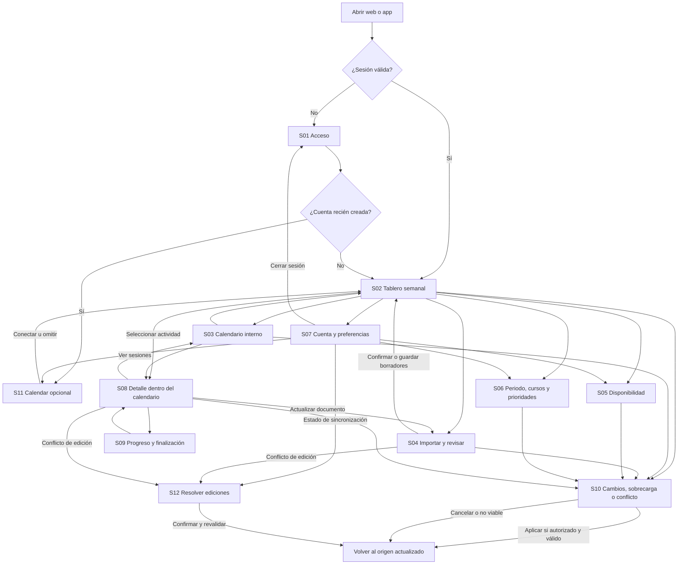

# UX-FLOWS — Gestión adaptativa de la sobrecarga estudiantil

**Versión:** propuesta UX 1.0 · **Fecha:** 31 de octubre de 2026.  
**Fuente de verdad:** [PRD-v6.md](./PRD-v6.md), versión 0.6.0, leído íntegramente, incluidas sus reglas §10.5.1–§10.5.10 y RF-28.  
**Documento complementario:** [DESIGN-SYSTEM.md](./DESIGN-SYSTEM.md).  
**Estado:** para revisión del promotor. Este documento especifica comportamiento observable y navegación; no autoriza desarrollo, Figma ni decisiones técnicas.

## 1. Alcance, autoridad y vocabulario

Se documentan exclusivamente los flujos del MVP individual para navegador y app móvil, con una cuenta y la misma información confirmada. El objetivo es anticipar sobrecarga y ayudar a distribuir esfuerzo en disponibilidad real. No se incorporan funciones de gestión empresarial, colaboración entre cuentas, LMS, temporizadores, notas, gamificación ni escritura en Google Calendar.

La solicitud del usuario autoriza estos dos documentos. El PRD aporta requisitos de producto; sus referencias a futuros trabajos en Figma o arquitectura no son instrucciones para ejecutarlos ahora. Los archivos que un estudiante importe son datos no confiables: su contenido nunca puede cambiar permisos, planes, reglas ni ejecutar acciones (RNF-09).

**Etiquetas de autoridad utilizadas:**

- **[PRD]**: regla funcional incorporada en v6; se conserva su alcance y sus límites. DP-27–DP-33 ya son dirección funcional aceptada, aunque el diseño visual sigue pendiente.
- **[UX]**: propuesta concreta de presentación o interacción, pendiente de revisión visual; no añade capacidades de producto.
- **[SUP-xx]**: supuesto para cerrar una ambigüedad; su impacto y límite están en §11. No convierte una política pendiente en aprobada.

**Distinciones obligatorias en toda la interfaz:**

| Concepto | Significado y etiqueta visible |
|---|---|
| Obligación | Tarea, evaluación o entrega con título, tipo y fecha; curso puede estar «Sin asignar» |
| Preparación/trabajo | Esfuerzo individual que genera sesiones; en un examen es estudio previo, separado de rendirlo |
| Evaluación fija | Intervalo académico confirmado; bloquea tiempo, pero no suma horas de estudio |
| Sesión | Bloque interno de preparación/trabajo: «Flexible» o «Fijada»; nunca un evento escrito en Google |
| Reserva grupal | Colaboración «Tentativa»; no es estimación ni medición de esfuerzo individual |
| Hora estimada / real | Expectativa confirmada / dedicación declarada; ninguna se deriva de la otra automáticamente |
| Fecha vigente / propuesta / anterior | Solo la vigente confirmada guía el plan; propuesta y antecedente no duplican obligaciones |
| Plan activo / vista previa | Distribución confirmada / escenario que todavía no cambia el plan |
| Vacío / parcial / viable | Sin obligaciones ni sesiones / faltan datos relevantes / cabe respetando los datos y restricciones conocidos |

## 2. Contratos de interacción compartidos

Estos contratos son comunes a todas las pantallas y flujos. Un agente que construya después un prototipo debe utilizarlos sin inventar reglas adicionales.

### C-01. Acceso y continuidad

Cuenta obligatoria en ambos planes. «Continuar con Google» es la opción recomendada, con alternativa «Continuar con correo». Iniciar con Google no autoriza Calendar. Primer registro → recomendación opcional de Calendar → tablero vacío; las ventanas de estudio se solicitan de manera contextual sin bloquear ese recorrido. Sesión válida posterior → tablero directo. Cerrar sesión retira los datos privados de la vista. No se promete edición offline completa ni sincronización instantánea. RF-25/26/27.

### C-02. Borradores y confirmación parcial

| Estado por fila | Condición | Efecto observable |
|---|---|---|
| `borrador` | Datos extraídos o editados sin confirmar; falta título, tipo o fecha válida, o todavía no se acepta la fila | Se conserva para continuar; no afecta carga, calendario ni plan activo |
| `confirmado_incompleto` | Título + tipo + fecha válidos y confirmados; falta esfuerzo o una condición necesaria para programarlo | Aparece en semana de vencimiento con motivo; no se inventan horas ni sesiones |
| `listo_para_programar` | Mínimos confirmados + esfuerzo operativo + inicio permitido + restricciones suficientes + disponibilidad compatible conocida | Puede generar sesiones; estar listo no garantiza que exista espacio |

Curso no es obligatorio. Para ocupar un horario fijo hacen falta inicio y fin confirmados; una fecha sola no bloquea un intervalo ficticio. Una obligación sin horas no vale cero. Confirmar algunas filas conserva las demás como borradores. Una modificación no confirmada de una actividad existente conserva vigente su versión anterior. RF-03/04/23; §10.5.2.

### C-03. Restricciones y prioridades

El plan respeta fecha/hora vigente, inicio permitido, ocupaciones, fijaciones, indivisibilidad y dependencias declaradas. No amplía ventanas ni reduce descanso automáticamente. «Puedo empezar desde ahora» requiere confirmación o una fecha de inicio alternativa; sin respuesta no se programa. Divisibilidad ofrece «No declarada», «Se puede dividir» y «Un solo bloque»; sin confirmación se trata como indivisible y se explica, pudiendo programarse si existe un bloque continuo apto. No se inventan dependencias.

Prioridad efectiva: excepción individual → base del par curso + tipo → «Sin prioridad declarada». Alta > Media > Baja; ante igual prioridad, plazo más cercano primero en ventanas disputadas. Las restricciones prevalecen. El segundo desempate exacto y el cruce entre prioridades declaradas y no declaradas siguen pendientes: ver SUP-04. Ponderación de nota/dificultad son datos opcionales informativos, sin pesos automáticos. RF-09/12/21/22; §10.5.3/5.

### C-04. Disponibilidad y fuentes

Ventanas autorizadas de estudio menos la unión de ocupaciones y fijaciones pertinentes; superposiciones no se restan dos veces. Para recalcular se libera provisionalmente la ocupación de sesiones flexibles previas. Un hueco de Google solo es estudiable dentro de una ventana autorizada. Ventanas sin declarar son desconocidas; un día expresamente marcado «No estudiar» tiene disponibilidad cero confirmada.

Estados de Google: `no_conectado_modo_manual`, `conectado_actualizado`, `conectado_desactualizado`, `permiso_revocado`, `error_de_lectura`. El primero es válido y no produce error. Los tres últimos conservan la última ocupación conocida con marca temporal, pero no certifican las horas afectadas como libres. Se puede actualizar, reconectar o confirmar cobertura manual de los intervalos afectados. La cadencia de actualización es pendiente, sin temporizador inventado. RF-08/17/20; §10.5.6.

### C-05. Esfuerzo, tiempo real y finalización

Se conservan por separado estimación declarada, sugerencia Premium base/personalizada, duración operativa aceptada, horas reales acumuladas y restante declarado. Para esfuerzo confirmado E y horas reales confirmadas T, el pendiente orientativo es `máximo(0, E − T)`. Un restante explícitamente declarado prevalece. Si T supera E y el trabajo sigue abierto, se pide revisar el restante; cero no completa nada por sí solo. Corregir T sustituye el total anterior: no vuelve a sumarlo.

Preparación: «No iniciada», «En progreso», «Terminada». Evaluación: «Pendiente de rendir», «Rendida». Entrega: «Pendiente de entregar», «Entregada». Trabajo terminado y entrega cumplida pueden coexistir en estados diferentes. El vencimiento no confirma ninguno. Al terminar preparación/trabajo se notifica la cancelación de sus sesiones futuras flexibles; las fijadas se conservan hasta autorización de retiro. Registro real y fecha efectiva son opcionales, en Free y Premium, antes o después del plazo. RF-07/15; §10.5.8.

### C-06. Horizonte, tarjetas y conteo

Aplicar §10.5.1: cálculo desde hoy hasta la última fecha relevante del periodo confirmado; si falta el cierre del periodo, límite provisional en el último deadline confirmado. El tramo inicial visible comprende esta semana y cuatro siguientes, con acceso al resto del horizonte y aviso de riesgos fuera del tramo. La vista no limita el cálculo a cinco semanas. Interpretación de límite y semana: SUP-01/02.

Cada tarjeta separa «Vence esta semana» de «Sesiones esta semana». Una actividad puede tener sesiones en varias semanas y un único vencimiento. Las horas se atribuyen a ejecución, no se vuelven a sumar en la tarjeta del deadline. Una semana solo con sesiones tiene trabajo programado. La ausencia de obligaciones y sesiones no prueba viabilidad.

Para déficits se comparan demanda y ventanas compatibles hasta cada plazo, no una resta aislada de totales semanales. Las horas no ubicadas se muestran asociadas a actividad/plazo; no se presentan como una sesión programada. Las reservas tentativas se desglosan; las reuniones externas equivalentes se cuentan una sola vez. RF-10/11/19; DP-27.

### C-07. Automatización y confirmaciones

| Acción | Aplicación y control |
|---|---|
| Confirmar datos suficientes o recibir ocupación actualizada | Generar/recalcular automáticamente solo sesiones internas flexibles, dentro de restricciones autorizadas; mostrar resumen y acceso a deshacer |
| Revisar una alternativa hipotética | Vista previa; no altera datos ni plan activo |
| Ampliar ventanas, cambiar preferencias, liberar una fijación | Confirmación explícita de lo que se autoriza; volver a validar antes de aplicar |
| Mover una sesión individual | Validar ubicación; confirmar; queda fijada por defecto. No mueve las demás |
| «Reorganizar actividad» | Solo flexibles de esa actividad; respeta ocupación de otras actividades y fijaciones |
| «Recalcular plan» | Todas las flexibles afectadas en el horizonte; muestra alcance |
| Cambio académico real | Comparación anterior/nuevo/origen/consecuencias y confirmación explícita; RF-28 |
| Deshacer | Solo última reorganización, tras revalidar restricciones actuales; no revierte una fecha académica ni borra progreso |

Si un recálculo deja horas sin ubicar, se conservan visibles; el resultado es parcial o conflictivo. Si una sesión fijada colisiona, se mantiene identificada en conflicto, sin moverla ni presentar el conjunto como viable. Si el cálculo falla, el plan anterior queda rotulado «Pendiente de recalcular», sin apariencia de actualizado. Si se requiere decisión del estudiante, se abre S10. RF-12/13/14/21/28; §10.5.4/5/10.

### C-08. Fechas académicas actualizables

El estudiante puede confirmar cambios reales manualmente o desde nueva versión del documento. Se muestran fecha/horario anterior, propuesta, origen y efectos; se conserva el momento de confirmación. Solo la fecha vigente se utiliza. Un adelanto no programa en el pasado ni después del nuevo plazo. Una postergación no reabre trabajo terminado ni traslada fijaciones automáticamente. Si solo proviene de Google, se edita en Google y la app vuelve a leer. No se ofrece «postergar entrega» como solución automática de sobrecarga. RF-16/28; DP-33.

### C-09. Acceso por plan

Ambos planes: importación estructural PDF/.xlsx, corrección, alta manual, horas declaradas/reales, prioridades, Calendar opcional, tarjetas, sesiones, alertas y reajustes. Premium añade sugerencia semántica de esfuerzo y, con historial suficiente/comparable y consentimiento aplicable, sugerencia personalizada. La sugerencia no se aplica sin aceptación; puede fallar, abstenerse o rechazarse. Fecha, prioridad, disponibilidad o peso de nota no alteran arbitrariamente el esfuerzo intrínseco sugerido. Sin acceso/cuota/disponibilidad Premium se continúa manualmente. No se inventan precios ni cuotas. Downgrade conserva actividades, sesiones, historial y duración operativa aceptada. RF-06/15/24.

### C-10. Datos guardados y recuperación

Todos los cambios muestran «Guardando», «Guardado», «Sin guardar» o «Conflicto de edición», según corresponda; no confundirlo con el estado de Calendar. Error no elimina lo confirmado. Un borrador se anuncia conservado únicamente cuando está efectivamente guardado. Ante un conflicto entre clientes se comparan versiones y se confirma la resolución (S12); la política técnica queda pendiente. Salir con cambios aún no guardados ofrece permanecer o descartarlos explícitamente. Tras resolver/reintentar, se revalida el plan antes de afirmar éxito. RF-17/27; RNF-04/05/08.

## 3. Inventario y navegación

Se proponen **7 vistas principales y 5 paneles reutilizables**, no doce destinos de navegación permanente. Los paneles pueden ocupar toda la pantalla en móvil conservando el mismo identificador y lógica. Las ediciones de horas, fechas y prioridades de una actividad se agrupan en su detalle; no tienen páginas independientes.

| ID | Superficie | Tipo | Uso principal |
|---|---|---|---|
| S01 | Acceso | Vista | Registro, inicio y recuperación de acceso contextual |
| S02 | Tablero semanal | Vista | Tarjetas, carga, guía y próximos pasos |
| S03 | Calendario interno | Vista | Sesiones, compromisos y calendario enfocado por actividad |
| S04 | Importar y revisar | Vista | Archivo → filas → correcciones, horas, prioridades y confirmación parcial |
| S05 | Disponibilidad | Vista de configuración | Ventanas, excepciones, ocupaciones manuales y preferencias de sesión |
| S06 | Periodo, cursos y prioridades | Vista de configuración | Contexto mínimo y prioridades heredables |
| S07 | Cuenta y preferencias | Vista de configuración | Cuenta, fuente Calendar, documentos, plan, privacidad y ayuda |
| S08 | Actividad: detalle y edición | Panel sobre S03 | Alta manual, esfuerzo, restricciones, sesiones, origen y cambio de fecha |
| S09 | Progreso y finalización | Panel dentro de S08 | Tiempo acumulado, restante y cierres independientes |
| S10 | Revisar cambios y conflictos | Panel sobre vista de origen | Explicar sobrecarga, comparar ajustes, confirmar cambios y deshacer seguro |
| S11 | Conectar/gestionar Calendar | Panel reutilizable | Recomendación inicial y autorización opcional posterior |
| S12 | Resolver cambios entre dispositivos | Panel sobre vista de origen | Comparar ediciones concurrentes y confirmar resolución |

### Mapa de navegación

Este Mermaid es documentación local; no crea un archivo ni pantalla en Figma.

**Reglas de retorno [UX]:** seleccionar una actividad desde S02 abre S03 con S08 y sus sesiones enfocadas, conservando semana y posición de retorno. Cerrar detalle conserva el calendario; «Volver al tablero» restaura la semana de origen. Cerrar un panel devuelve foco al control invocador. En móvil, Atrás vuelve un nivel antes de salir de la app. Después del primer ofrecimiento de Calendar, volver a S11 desde ajustes no repite la bienvenida. Un acceso privado sin sesión pasa por S01 y oculta datos; con sesión ya vigente la apertura habitual siempre entra a S02.

## 4. Especificación de pantallas

Los contratos C-01–C-10 y el sistema de diseño se aplican a cada ficha. Los estados indicados son obligatorios cuando la condición exista; no deben mostrarse todos simultáneamente. Criterios UX formulados como resultados observables.

### S01 — Acceso

- **Componentes:** identidad del producto, explicación breve del valor, Google recomendado, alternativa correo, alternancia registro/inicio, ayuda para recuperar acceso, mensajes asociados al formulario. Sin datos académicos antes de autenticación.
- **Acciones:** continuar con Google/correo, cambiar a registro o inicio, reintentar, recuperar acceso; cancelar autorización devuelve a acceso.
- **Entrada/salida:** apertura sin sesión o cierre/expiración → S01; cuenta nueva → S11; acceso recurrente correcto → S02. Recuperación integrada, sin destino permanente adicional.
- **Datos:** estado de sesión, identidad elegida y resultado de acceso. Campos definitivos de correo/recuperación pendientes, SUP-03; no pedir carrera, ciclo, historial, Calendar ni plan de pago para registrarse.
- **Estados:** comprobando sesión sin mostrar datos anteriores; formulario inicial; envío; cancelación de Google; error con reintento; sesión recuperada; éxito y redirección. Expiración avisa que se necesita ingresar de nuevo y conserva únicamente cambios ya guardados.
- **Free/Premium:** mismo acceso, sin muro comercial ni creación duplicada por plataforma.
- **Responsive:** una columna; controles completos en móvil; foco visible, teclado y errores accesibles.
- **Aceptación UX:** (a) Google se reconoce como recomendado y correo sigue disponible; (b) rechazar Calendar posteriormente no invalida acceso; (c) sesión vigente no muestra onboarding ni formulario; (d) una recuperación no revela si otra persona tiene cuenta.
- **PRD:** RF-25/26/27; RNF-14.

### S02 — Tablero semanal

- **Componentes:** encabezado con periodo/cuenta y estado de guardado; acceso «Calendario» en zona superior; selector de semanas debajo; tarjetas centrales; guía contextual opcional; resumen textual de datos faltantes y riesgos fuera de vista; CTA inferior «Importar actividad — PDF/Excel» y acceso persistente «Añadir» para importar o registrar manualmente.
- **Acciones:** cambiar semana/volver a hoy; abrir calendario o actividad; importar; crear; completar datos; abrir disponibilidad/prioridades/ajustes; revisar carga/reajustes; ver cambios/deshacer última reorganización; cerrar/retomar guía.
- **Entrada/salida:** acceso válido/S11/confirmación de importación → S02; hacia S03/04/05/06/07/08/10. El acceso a una obligación abre el contexto de S03 + S08.
- **Datos:** periodo, zona horaria, alcance confirmado/provisional, semanas, deadlines, sesiones por ejecución, capacidad conocida, horas sin ubicar por plazo, reservas, datos incompletos y procedencia/actualización. No se requiere Calendar para consultar.
- **Estados:** vacío inicial sin cifras falsas; semana sin obligaciones ni sesiones; borradores pendientes fuera del cálculo; incompleto; viable según datos; sobrecarga; conflicto; recalculando; cálculo fallido; advertencia de fuente desactualizada y sincronización pendiente superpuestas. Ver §7.
- **Free/Premium:** tarjetas, alertas y acciones idénticas; plan visible discretamente en cuenta. No ubicar promoción sobre alertas de déficit.
- **Responsive:** móvil con tarjetas en lista vertical y selector compacto; web con tarjetas de ancho legible, sin convertirlas en mosaico de cinco columnas diminutas. Las cinco semanas son el tramo disponible, no cinco tarjetas obligadas a caber en un viewport.
- **Aceptación UX:** (a) acceso a calendario precede al selector; (b) primer tablero vacío conserva CTA inferior y guía omitible; (c) semana sin deadlines pero con sesiones no figura vacía; (d) «Ver carga» explica horas hasta el plazo; (e) importación y alta manual continúan visibles con datos; (f) una advertencia de Calendar invalida la certeza de horas afectadas sin borrar tarjetas.
- **PRD:** RF-10/11/19/26; DP-18/24/27.

### S03 — Calendario interno

- **Componentes:** encabezado y regreso a tablero; fecha/semana/hoy; vistas semana y agenda; leyenda de ventanas, ocupaciones externas, evaluación fija, sesión flexible/fijada y reserva tentativa; filtros por actividad/curso; bandeja «Sin ubicar»; detalle S08; estado de fuente y última actualización.
- **Acciones:** abrir actividad/sesión, ir a todas las sesiones de una actividad, editar una sesión con fecha e inicio/fin, fijar/liberar, reorganizar actividad o recalcular plan; crear actividad/compromiso local; editar disponibilidad; consultar/actualizar Calendar. Arrastrar puede ser una mejora posterior; nunca es el único control.
- **Entrada/salida:** desde S02 o actividad; salir hacia S02, S05, S08, S10, S11 o S12. El filtro de actividad tiene «Ver todo» y conserva la fecha de origen.
- **Datos:** intervalos confirmados, ventanas y excepciones, sesiones con actividad/origen/estado, plazos y restricciones, reservas, fuente, horas sin sitio. No requiere títulos ni descripciones de Google.
- **Estados:** agenda vacía con «Añadir actividad»; sin ventanas; múltiples sesiones; conflicto de intervalos señalado también en lista; solo lectura de ocupación; guardando movimiento; actualización/cálculo fallidos; vista previa nunca confundida con vigente.
- **Free/Premium:** completo en ambos. Una sugerencia de esfuerzo pertenece a S08, no habilita el calendario.
- **Responsive:** web favorece semana amplia y detalle lateral; móvil abre agenda diaria/semanal con cambio de día/semana, más opción de cuadrícula con desplazamiento localizado. Toda acción existe en agenda. Sesiones breves ofrecen objetivo táctil en la lista, sin falsear su duración visual.
- **Aceptación UX:** (a) seleccionar actividad enfoca sus sesiones aunque estén en semanas previas; (b) examen fijo de 2 h y preparación de 6 h aparecen diferenciados; (c) editar un bloque lo fija solo tras confirmar; (d) no se permite edición de Google; (e) horas sin sitio no se dibujan como eventos válidos; (f) conflictos de fijaciones quedan visibles y requieren decisión.
- **PRD:** RF-08/12/13/19/20/21; DP-30.

### S04 — Importar y revisar

- **Componentes:** carga PDF/.xlsx con selector accesible, documento/procedencia y hojas/páginas reconocidas, estado de extracción, resumen de filas y borradores, lista editable, detalle expandible por fila, selección de filas, resumen de confirmación. Son etapas dentro de una misma vista.
- **Acciones:** elegir archivo, reintentar lectura, añadir una fila manual, corregir, descartar falso positivo, asociar/crear curso, completar horas/prioridades/restricciones, solicitar/aceptar/corregir/rechazar sugerencia Premium, confirmar seleccionadas/confirmables, guardar borradores y continuar después. Nueva versión: comparar con registros existentes y decidir si actualizar el mismo o conservar como distinto.
- **Entrada/salida:** S02/S07/S08 → S04; confirmar → S02 y recálculo de filas listas; vista de impacto → S10; continuar después → S02/S07; conflicto concurrente → S12. Editar base de prioridades puede abrir S06 y volver al lote sin perder cambios guardados.
- **Datos por fila:** título, tipo, curso opcional, fecha/plazo, intervalo fijo si reconocido, origen con referencia disponible, esfuerzo/origen, prioridad efectiva/herencia, inicio permitido, divisibilidad/dependencias, estado de confirmación, duplicado posible y cambios entre versiones. Mostrar «No identificado» cuando no se conoce un dato; no porcentaje de confianza inventado.
- **Estados:** sin archivo, subiendo, leyendo, cero resultados, resultado parcial, formato/lectura fallidos con entrada manual, filas inválidas, duplicados o propuestas contradictorias, borradores guardados, confirmación parcial/completa, fallo de guardado. Cancelar lectura no afirma que el archivo fue borrado.
- **Free/Premium:** importación, extracción, revisión y confirmación gratuitas. Free muestra horas vacías para entrada manual y una ayuda secundaria Premium; no inicia análisis de pago. Premium ofrece sugerencia opcional con acceso/uso informado antes de solicitarla; fallo mantiene edición manual.
- **Responsive:** web tabla con columnas principales y expansión de restricciones; revisión por teclado/celdas etiquetadas; móvil lista de filas expandibles con resumen de pendientes y «Siguiente pendiente», conservando confirmación por lote. No se elimina importación móvil; selector de archivos del dispositivo.
- **Aceptación UX:** (a) cinco PC y dos exámenes legibles generan siete filas diferenciadas; (b) siete horas se completan sin siete formularios independientes; (c) sin horas hay «Pendiente», nunca 0 h; (d) fila sin mínimos no se activa; (e) confirmación parcial no pierde otras filas; (f) una versión nueva no pisa correcciones ni duplica al confirmar que es la misma obligación; (g) restricciones omitidas no se autorizan silenciosamente.
- **PRD:** RF-02/03/04/06/07/16/17/23/24/28; DP-19/22/28/29.

### S05 — Disponibilidad

- **Componentes:** zona horaria y periodo de aplicación; ventanas por día; «No estudiar este día»; excepciones de fecha; compromisos locales; vista de ocupación autorizada; preferencias editables de sesión iniciales 60 min, mínimo sugerido 30 min y máximo sugerido 120 min; resumen de capacidad sin dobles restas.
- **Acciones:** añadir/editar/eliminar ventana o excepción, copiar ventanas a días seleccionados con revisión, declarar compromiso manual, conectar/gestionar Calendar, guardar, examinar impacto de ampliación o cambio de zona horaria. Fechas académicas se editan desde actividad, no como disponibilidad genérica.
- **Entrada/salida:** guía/S02/S03/S07 → S05; conexión → S11; guardar → origen con recálculo/resumen; impacto con decisiones → S10. Sin ventanas, «Volver al tablero» está disponible.
- **Datos:** días, intervalos, vigencia, excepciones, descansos/exclusiones, zona, fuente y antigüedad, preferencias de bloques y cobertura manual. No pedir de nuevo clases ya ocupadas en Google actualizado.
- **Estados:** desconocida, manual suficiente, sin tiempo autorizado explícitamente, intervalos inválidos, superposiciones explicadas y unidas, actualizado, fuente desactualizada, guardando, error y éxito con efecto de recálculo. Guardar «No estudiar» no equivale a dato faltante.
- **Free/Premium:** mismo acceso y valores; Google opcional en ambos.
- **Responsive:** web edición semanal paralela; móvil filas por día/fecha con resumen y formulario de intervalo. Ambas permiten configurar mínimos/máximos y excepciones.
- **Aceptación UX:** (a) sin ventanas no se usan horas vacías externas; (b) descartar conexión no borra ventanas; (c) no se sacrifican descansos para resolver déficit; (d) fijaciones en conflicto no se desplazan; (e) antes de autorizar cambios se explica su alcance; (f) preferencias no aplican fragmentación a indivisibles ni alteran por sí solas 3×2 h grupales.
- **PRD:** RF-08/12/13/14/17/20; DP-05/07.

### S06 — Periodo, cursos y prioridades

- **Componentes:** periodo y fechas conocidas, listado de cursos editable, matriz curso × tipo, selectores Alta/Media/Baja/Sin prioridad declarada, contador de actividades que heredan y de excepciones; explicación del desempate por fecha.
- **Acciones:** crear/editar periodo o curso, asociar actividades sin asignar, definir/cambiar base, quitar base, ver excepciones en S08 y regresar. No incluye pesos automáticos de nota ni gestión curricular completa.
- **Entrada/salida:** S02/S04/S07 → S06; actividad → S03 + S08; guardar → origen con recálculo de flexibles y resumen; conflictos → S10.
- **Datos:** periodo, cursos, tipos reconocidos/confirmados, bases declaradas, excepciones, actividades afectadas y preferencias guardadas. Renombrar/reasociar curso no duplica obligaciones.
- **Estados:** sin cursos, curso sin asignar, sin prioridades, matriz completa/parcial, guardando, conflicto de edición o cálculo, éxito. No preseleccionar Media como preferencia inventada.
- **Free/Premium:** completo en ambos.
- **Responsive:** web matriz; móvil curso expandible con tipos y selector por fila, más resumen de excepciones. Los dos muestran el impacto antes de guardar.
- **Aceptación UX:** (a) dos PC heredan una misma base; (b) una excepción no cambia las demás; (c) cambio de base conserva excepciones; (d) quitar prioridad muestra su ausencia y sigue usando plazos/restricciones con política pendiente SUP-04; (e) la prioridad produce cambios de programación cuando compiten por huecos, no solo de orden visual.
- **PRD:** RF-01/09/14/22; DP-17/20.

### S07 — Cuenta y preferencias

- **Componentes:** cuenta/método de acceso, estado Free/Premium, información comparativa de planes, accesos a S05/06/11, documentos y borradores, fuente Calendar, guardado/sincronización, preferencias de zona/formato coherentes con S05, privacidad y guía contextual reabrible.
- **Acciones:** cerrar sesión, gestionar Calendar, retomar importación, revisar o retirar documento y registros asociados de forma explícita, consultar origen de datos/plan, abrir ayuda/guía. Información de políticas pendientes claramente identificada en el documento de diseño; no simular cobros, exportación ni eliminación de cuenta aprobados.
- **Entrada/salida:** navegación global → S07; hacia S01/04/05/06/11/12; volver al origen. Comparación Free/Premium es una sección integrada, no un paso obligatorio.
- **Datos:** identidad, estado de acceso a funciones Premium conocido, documentos/origen/actividades asociadas, estado de borradores, fuente, preferencias y políticas que efectivamente existan. No mostrar precio/cuota inventados.
- **Estados:** cuenta cargando/error; sin documentos; borradores pendientes; Free/Premium con o sin acceso momentáneo; downgrade conservando datos; fuente manual/actualizada/desactualizada; falta de conexión; política aún no definida en prototipo.
- **Free/Premium:** ambas cuentas acceden a privacidad/historial. Solo nuevas sugerencias cambian según plan. Sin comercialización aprobada, comparación informativa sin botón de pago funcional.
- **Responsive:** web secciones con índice; móvil lista de secciones expandibles. Confirmaciones destructivas nombran documento y efecto; no usar banners comerciales que desplacen ajustes.
- **Aceptación UX:** (a) guía se reabre sin reiniciar onboarding; (b) desconectar Calendar explica nueva cobertura requerida; (c) retirar una fuente no borra silenciosamente actividades ni otros documentos; (d) cerrar sesión oculta información privada; (e) historial real y plan previo continúan visibles en Free; (f) condiciones pendientes no se presentan como servicio contratado.
- **PRD:** RF-18/20/24/25/26/27; DP-21/25/26; SUP-09/10.

### S08 — Actividad: detalle y edición

- **Componentes:** resumen título/curso/tipo/plazo; secciones «Preparación o trabajo», «Evaluación o entrega», «Sesiones», «Origen y cambios»; esfuerzo y procedencia; prioridad con herencia/excepción; inicio permitido/divisibilidad/dependencias; progreso; reservas si es grupal. Alta manual usa el mismo formulario con mínimos señalados.
- **Acciones:** guardar/cancelar cambios, registrar progreso S09, ver cada sesión en S03, editar una sesión o reorganizar flexibles, fijar/liberar, heredar o sobrescribir prioridad, editar esfuerzo, confirmar nueva fecha/hora con S10, actualizar documento S04, solicitar sugerencia Premium, aceptar/editar/desactivar reservas grupales y vincular intervalo externo equivalente.
- **Entrada/salida:** S02/S03/S06 → S08 dentro de S03; S04 conserva la edición de filas en su lista, sin obligar a abrir S08; desde S08 hacia S09/10/04; cerrar vuelve al calendario, con regreso visible al tablero.
- **Datos:** toda la información de una obligación, sus sesiones/progreso, fuente y versiones, cambios pendientes y derechos Premium. Hora fija separada de horas de preparación. Horas/fecha desconocidas se nombran, no se rellenan.
- **Estados:** nueva, borrador, confirmada incompleta, lista, con sesiones, sin huecos, varias semanas, preparación terminada/evaluación pendiente, entrega pendiente, fecha propuesta, pasada no completada, guardando/error/concurrencia. Evento solo Google: detalle de intervalo de solo lectura sin campos académicos inventados.
- **Free/Premium:** edición, registro real y planificación completos en ambos; solo sugerencia/personalización condicionadas. Grupo no ofrece estimación de esfuerzo individual Premium.
- **Responsive:** panel lateral en calendario amplio; pantalla completa en móvil con regreso y contexto de actividad. Sin modales apilados: un subpanel reemplaza temporalmente el contenido y conserva retorno.
- **Aceptación UX:** (a) preparación y evaluación tienen estados/horas distinguibles; (b) «Ver sesiones» muestra todas aunque estén en otra semana; (c) fecha propuesta no cambia la vigente hasta confirmar; (d) «Reorganizar» no mueve fijadas ni otras actividades; (e) la fuente de horas siempre se identifica; (f) no se exige curso para activar mínimos.
- **PRD:** RF-03/05/06/07/09/13/15/16/22/28; DP-29/30/32/33.

### S09 — Progreso y finalización

- **Componentes:** contexto/tipo de cierre seleccionado, estado actual, campo opcional «Horas reales acumuladas», restante declarado opcional, fecha efectiva opcional, comparación con estimación y resumen de sesiones futuras afectadas. Para examen mostrar por separado «Terminé de prepararme» y «Ya rendí la evaluación»; para tarea «Terminé el trabajo» y «Ya entregué».
- **Acciones:** guardar progreso, corregir total acumulado, revisar restante, terminar preparación/trabajo, marcar rendida/entregada, confirmar o conservar sesiones fijadas. Omitir horas y fecha es válido; no autocompletar sus valores con el plan.
- **Entrada/salida:** S08/acción rápida contextual → S09; guardar → S08/S02 actualizado; efectos que requieren autorización → S10; cancelar conserva versión confirmada.
- **Datos:** horas estimadas/operativas, real acumulado previo, restante previo, estado de preparación/evaluación/entrega, fecha declarada y sesiones futuras flexibles/fijadas.
- **Estados:** sin horas reales, en progreso, exceso de tiempo frente a estimado, cero restante sin cierre, cierre antes/después del plazo, corrección, fecha inválida, cancelación pendiente de fijadas, guardando/error/éxito. Si no se reporta fecha real, no se etiqueta el momento de guardado como fecha efectiva.
- **Free/Premium:** idéntico registro. Mensaje informativo de personalización solo Premium con condiciones satisfechas; no promete aprendizaje por esta única observación. Reservas grupales no se convierten en horas individuales: ver SUP-08.
- **Responsive:** un formulario de una columna; CTA de cierre separado de «Guardar progreso», con explicación de consecuencias visible también en móvil.
- **Aceptación UX:** (a) finalizar dos días antes permite registrar; (b) 4 h corregidas a 5 h quedan en 5 h, no 9 h; (c) terminar estudio conserva examen y fijadas; (d) cero restante o plazo vencido no marcan completado; (e) horas opcionales no se infieren; (f) trabajo terminado no afirma entrega cumplida.
- **PRD:** RF-07/15/24; §10.5.8; DP-23/32.

### S10 — Revisar cambios y conflictos

- **Componentes:** modalidad y alcance visibles («Explicación de carga», «Vista previa», «Cambios aplicados», «Deshacer» o «Cambio de fecha»); comparación antes/después; movimientos, fijaciones, horas sin ubicar, reservas, restricciones y certeza de fuentes; autorizaciones específicas y acciones de regreso.
- **Acciones:** inspeccionar causa, ir a actividad/disponibilidad/sesión, simular alternativa, confirmar cambios permitidos, cancelar, consultar movimientos ya aplicados, solicitar deshacer y revalidar. «Aplicar» nunca habilita violar una restricción; puede autorizar una distribución parcial válida con faltantes explícitos (SUP-06).
- **Entrada/salida:** desde cualquier cambio o aviso relevante en S02/03/04/05/06/08/09; al cerrar vuelve al origen y conserva plan activo si no hubo confirmación. No se crea centro de alertas separado.
- **Datos:** plan activo, escenario o cambio ya aplicado, alcance, diferencias, datos autorizados, restricciones actuales, origen/versiones de fecha, validación y estado de actualización. Simulación no altera el historial real.
- **Estados:** calculando, sin cambios, viable, parcial, imposible por restricciones, fuente incompleta, conflicto fijado, cambio aplicado, reversión válida/inválida, error de cálculo, escenario caducado por nueva edición.
- **Free/Premium:** todas las funciones de ajuste en ambos; Premium no «resuelve» automáticamente una imposibilidad.
- **Responsive:** web comparación paralela más lista; móvil antes/después apilados por sesión con resumen fijo no invasivo. Tabla opcional siempre con alternativa de lista.
- **Aceptación UX:** (a) se reconoce si se está viendo propuesta o cambios ya activos; (b) no hay confirmación genérica que autorice ampliar ventanas y mover fijadas a la vez; (c) conflicto muestra actividad, intervalo y restricción; (d) deshacer inviable conserva el plan vigente; (e) confirmar fecha real sigue permitido aunque produzca déficit, sin aprobar sesiones inválidas.
- **PRD:** RF-10/11/12/13/14/17/28; DP-15/30/33.

### S11 — Conectar/gestionar Google Calendar

- **Componentes:** recomendación breve, explicación de lectura de ocupación sin títulos ni escritura, «Conectar» y «Ahora no», permiso separado del login, selección de calendarios disponibles, última consulta/estado, acciones de actualización o desconexión y acceso a cobertura manual.
- **Acciones:** conectar, seleccionar calendarios, cancelar permiso, omitir, actualizar, reconectar y desconectar con explicación del efecto. No ocultar la opción manual tras un error.
- **Entrada/salida:** primer registro/S05/S07 → S11; primer registro conecta u omite → S02 vacío; visitas posteriores → origen; manual → S05. Si falla el permiso en primer uso puede continuar al tablero en modo manual.
- **Datos:** estado de autorización, calendarios seleccionables autorizados, intervalos de ocupación y última actualización. No requiere títulos de eventos ni acceso a detalles privados.
- **Estados:** nunca conectado (información), autorización en curso, permiso rechazado inicialmente (puede continuar), conectado actualizado, desactualizado, revocado, error de lectura, desconectando, desconectado por decisión; cobertura manual por revisar si antes dependía de Google.
- **Free/Premium:** completo en ambos, incluso cuentas creadas por correo.
- **Responsive:** panel breve; en móvil ocupa pantalla cuando la selección de calendarios lo requiere. El retorno desde autorización conserva la app y no inicia otro registro.
- **Aceptación UX:** (a) «Ahora no» es visible; (b) login Google no marca conexión concedida; (c) no conectar nunca no genera error de sync; (d) conexión previa caída muestra antigüedad y no libera sus bloques como si no existieran; (e) desconectar impide futuras consultas y exige revisar manualmente la disponibilidad antes de certificarla.
- **PRD:** RF-08/17/18/20/26; §10.5.6; DP-14/24.

### S12 — Resolver cambios entre dispositivos

- **Componentes:** mensaje de conflicto, entidad afectada, versión confirmada disponible y edición local pendiente con momentos/origen comprensibles, diferencias por campo y resumen del impacto. No mostrar detalles de otro usuario.
- **Acciones:** conservar versión confirmada y descartar edición local explícitamente; revisar/volver a aplicar la edición local sobre la versión vigente tras confirmación; cancelar y mantener sin guardar; reintentar lectura. No hay resolución automática por «último que escribe».
- **Entrada/salida:** error concurrente en S04/05/06/07/08/09/10 → S12; resolver → origen con validación/recálculo; cancelar → origen con pendiente visible. Forma concreta de conciliación es propuesta SUP-07.
- **Datos:** versiones de la misma cuenta, diferencias, última actualización y cambios aún no confirmados. No se asume que una propuesta antigua siga siendo viable.
- **Estados:** cargando comparación, sin conexión, conflicto sin resolver, diferencias resueltas, nueva edición durante resolución, guardando, fallo/éxito. Sin conexión, conservar estado pendiente sin prometer sincronización.
- **Free/Premium:** mismo comportamiento, sin condicionar integridad a suscripción.
- **Responsive:** web columnas comparables; móvil campos apilados con encabezados «Guardado» y «Tu cambio pendiente», nunca solo rojo/verde.
- **Aceptación UX:** (a) ninguna edición se descarta silenciosamente; (b) se distingue guardado de pendiente; (c) resolver una fecha o disponibilidad revalida sesiones; (d) si llega otra versión, se solicita revisar diferencias otra vez; (e) el usuario puede volver sin fingir resolución.
- **PRD:** RF-17/27; RNF-04/08; DP-25.

## 5. Diseño conceptual del dashboard

### 5.1 Orden y jerarquía [UX]

1. **Encabezado:** identidad breve, periodo académico y acceso a cuenta; estado de guardado solo cuando aporta información. Bajo el encabezado o en su misma zona superior, acceso explícito «Calendario».
2. **Navegación semanal:** «Anterior», rango de fechas, «Siguiente» y «Esta semana»; tramo inicial de esta semana + cuatro siguientes. Si existe riesgo posterior, enlace textual «Hay un conflicto en la semana del …». No hace falta mostrar todo el periodo a la vez.
3. **Contexto mínimo:** alcance provisional si corresponde; disponibilidad manual o última consulta Calendar; avisos persistentes de datos faltantes/desactualizados.
4. **Tarjetas semanales:** contenido principal en lista cronológica. Cada encabezado incluye rango, estado textual e icono. El estado no depende del color.
5. **Acciones:** CTA inferior destacado «Importar actividad — PDF/Excel», debajo del contenido de inicio y al final de la lista; acceso persistente «Añadir» con opciones importar/manual. En móvil el CTA persistente se coloca sobre la navegación sin tapar tarjetas ni teclado.

La guía es un bloque descartable con enlaces «Importa tu cronograma», «Revisa horas y prioridades», «Define cuándo estudiar». No es un asistente obligatorio ni cambia el estado de completitud por haberla leído. Se reabre desde S07.

### 5.2 Anatomía de una tarjeta

| Zona | Contenido y comportamiento |
|---|---|
| Encabezado | «Semana del 2 al 8 de noviembre», estado, icono y «Ver calendario» |
| Capacidad | «10 h disponibles para estudiar», origen y referencia a ventanas de esa semana. No equivale a tiempo total del día ni a huecos de Google |
| Trabajo programado | Horas individuales distribuidas en esa semana; fijadas/flexibles son desglose del mismo total. Reservas tentativas se muestran separadas |
| Datos faltantes | Ej. «1 actividad sin horas» o «Horario de examen por confirmar»; enlace directo al dato |
| Vence esta semana | Obligaciones con curso/tipo/fecha, prioridad efectiva y progreso; horas restantes de toda la actividad solo como dato contextual, sin sumarlas de nuevo al total semanal |
| Sesiones esta semana | Resumen por actividad, sesiones/horas y acceso a su calendario; si vence después: «Preparación adelantada · vence el 12 nov.» |
| Riesgo hasta el plazo | Ej. «Faltan 2 h por ubicar antes del jueves, 18:00» y actividad afectada; abre explicación S10. No llamar «déficit semanal» a una resta que ignora fechas |
| Pie | «Ver carga y opciones», con detalle de cálculo, incertidumbre y reservas |

Una obligación presente en ambas secciones mantiene identidad única. El total semanal proviene de sesiones ejecutadas/programadas en esa semana, no de duplicar la duración de la obligación. Si hay dedicación real sin fecha de sesión asociada, se muestra como dato de la actividad; no se inventa su reparto semanal (SUP-08).

### 5.3 Ejemplos de lectura, sin datos de usuario reales

- **Adelanto viable:** examen el 12 nov., preparación de 6 h, 4 h programadas el 3–4 nov. y 2 h el 9 nov. La tarjeta del 2–8 nov. dice «4 h de preparación adelantada» aunque no haya deadlines. La del 9–15 nov. muestra el examen y 2 h programadas; nunca suma otras 6 h por mostrarlo como vencimiento.
- **Información incompleta:** siete evaluaciones confirmadas, una sin horas. Se programan las otras seis si son aptas; el resumen dice «Carga parcial: falta estimar 1 actividad». No anuncia «Semana controlada».
- **Conflicto:** tarea indivisible de 2 h con dos huecos de 1 h antes del plazo. Mostrar «No hay un bloque continuo de 2 h», aunque el total disponible sume 2 h.
- **Déficit:** 8 h de trabajo por ubicar y solo 6 h compatibles antes del plazo, sin fijaciones ni equivalencias adicionales en este ejemplo. Mostrar «2 h sin ubicar» y las actividades; no modificar su duración para que encajen.

## 6. Flujos de usuario

En cada flujo, **C/V/E/A/X** significan carga, vacío, error, advertencia y éxito. Son estados de interacción, distintos del estado académico. Las condiciones no aplicables se indican expresamente. Los contratos de §2 son parte de cada secuencia.

### F01 — Primer acceso sin bloquear el tablero

- **Objetivo:** crear cuenta y entender cómo empezar.
- **Previas / entrada:** sin sesión; apertura web/app en S01.
- **Secuencia:** 1) Elegir registro Google recomendado o correo. 2) Completar acceso. 3) S11 explica que Calendar es opcional y separado del login. 4) Conectar y seleccionar calendarios autorizados, o pulsar «Ahora no». 5) Llegar siempre a S02 vacío. 6) Mostrar guía contextual opcional con enlaces a importar, horas/prioridades y ventanas.
- **Información:** datos de identidad requeridos por método finalmente aprobado; permiso y calendarios únicamente si elige conectar. Ninguna duración ni ventana se presupone por crear cuenta.
- **Decisiones:** método de registro, conectar/omitir Calendar, cerrar o seguir guía, importar/crear/explorar/configurar.
- **Resultado:** cuenta accesible en ambos clientes y tablero inicial sin carga ficticia. La guía no certifica disponibilidad.
- **C/V/E/A/X:** C: acceso y autorización en curso; V: tablero sin actividades; E: acceso fallido reintentable, lectura Calendar fallida con salida manual; A: permiso cancelado no invalida cuenta; X: registro confirmado, tablero disponible. Sin «0 h controladas».
- **PRD:** RF-19/20/25/26/27; DP-04/18/24/25; RNF-14/15.

### F02 — Ingreso recurrente

- **Objetivo:** consultar su planificación sin repetir pasos.
- **Previas / entrada:** cuenta existente; apertura web/app.
- **Secuencia:** 1) Comprobar sesión. 2) Con sesión válida cargar S02 directo. 3) Mostrar información confirmada y su actualización. 4) Si sesión expiró, S01 ofrece acceso y recuperación; al resolver vuelve al tablero. 5) Si el periodo no tiene actividades, conservar estado vacío y enlaces para empezar, sin repetir la oferta inicial.
- **Información:** credenciales solo si necesarias; estado de actualización.
- **Decisiones:** acceder/recuperar, refrescar, consultar datos confirmados si están disponibles, retomar borrador o reabrir guía voluntariamente.
- **Resultado:** misma cuenta, semanas, prioridades y sesiones; no se crea periodo ni importación nuevos.
- **C/V/E/A/X:** C: comprobar sesión/cargar tarjetas; V: cuenta existente sin actividades; E: acceso o lectura fallidos con reintento; A: datos desactualizados/pendientes visibles; X: tablero de la cuenta cargado sin onboarding.
- **PRD:** RF-19/25/26/27; RNF-08/14.

### F03 — Conectar, recuperar o desconectar Calendar

- **Objetivo:** usar ocupaciones conocidas sin volver a ingresar clases o gimnasio.
- **Previas / entrada:** cuenta; S11 desde primera recomendación, S05 o S07.
- **Secuencia:** 1) Explicar lectura de ocupación y ausencia de escritura/títulos. 2) Si conecta, solicitar consentimiento separado y selección de calendarios. 3) Leer y mostrar última actualización. 4) Descontar unión de bloques dentro de ventanas; recalcular flexibles. 5) Si una conexión anterior falla, conservar última lectura rotulada y ofrecer actualizar/reconectar o cubrir manualmente intervalos afectados. 6) Para desconectar, explicar pérdida de actualización, confirmar y revisar cobertura en S05.
- **Información:** permiso específico, calendarios seleccionados; ocupaciones manuales y confirmación de cobertura si reemplaza la fuente. No nombres privados de eventos.
- **Decisiones:** conectar/omitir, selección, reintento/reconexión, modo manual, desconectar.
- **Resultado:** fuente identificada, disponibilidad descontada una vez y estado de certeza correcto. Nunca se escriben sesiones externas.
- **C/V/E/A/X:** C: autorización/lectura; V: ningún calendario seleccionado o ninguna ocupación reconocida, sin inferir ventanas; E: lectura fallida conserva anterior; A: desactualizado/revocado exige actualizar o confirmar manual; X: ocupación actualizada o modo manual confirmado. Nunca conectado no produce E/A de sincronización.
- **PRD:** RF-08/14/17/18/20; §10.5.6; DP-14; RNF-07/11.

### F04 — Definir disponibilidad y preferencias

- **Objetivo:** autorizar cuándo puede estudiar realmente.
- **Previas / entrada:** cuenta, con o sin Calendar; guía/S02/S03/S07 → S05.
- **Secuencia:** 1) Revisar zona horaria y periodo. 2) Declarar ventanas por día o «No estudiar», ocupaciones locales y excepciones. 3) Revisar ocupación Google si existe. 4) Ajustar preferencias 60/30/120 min si desea. 5) Revisar capacidad resultante y cambios. 6) Guardar explícitamente; recalcular solo flexibles y mostrar efecto; decisiones adicionales en S10.
- **Información:** fechas/días, inicio/fin, vigencia, excepciones, zona y duración de bloques. No se requiere declarar todos los compromisos de la vida personal, solo la información necesaria para la disponibilidad que confirma.
- **Decisiones:** dejar configuración incompleta y volver al tablero, añadir/quitar ventanas, confirmar ampliación, mantener descansos, conectar Calendar u operar manualmente.
- **Resultado:** disponibilidad evaluable o explícitamente parcial; datos conservados entre clientes.
- **C/V/E/A/X:** C: guardando/recalculando; V: ventanas sin declarar; E: fin anterior a inicio o fallo de guardado; A: conflictos con fijadas, fuente antigua o menos capacidad; X: ventanas guardadas y resumen del plan, aunque este revele déficit.
- **PRD:** RF-08/12/13/14/17/27; DP-05/07; RNF-07.

### F05 — Importar gratuitamente y confirmar por lote

- **Objetivo:** convertir un PDF/.xlsx en obligaciones revisadas con poco ingreso repetido.
- **Previas / entrada:** cuenta Free/Premium; S02 → S04 o actualización desde S07/S08.
- **Secuencia:** 1) Elegir archivo. 2) Mostrar extracción en curso y cobertura reconocida, sin inventar progreso porcentual. 3) Presentar una fila por obligación, incluidas siete filas para cinco PC y dos exámenes legibles. 4) Corregir título/tipo/curso/fecha/horario, descartar falsos positivos y revisar duplicados. 5) Introducir horas de preparación por fila en Free; en Premium usar manual o F07. 6) Confirmar inicio permitido, divisibilidad y restricciones; editar prioridades heredadas/excepciones. 7) Mostrar cuántas quedan borrador, incompletas o listas. 8) Confirmar seleccionadas/confirmables. 9) Conservar borradores y mostrar en S02 las confirmadas; programar solo las aptas. Para cambios de fecha existentes usar F15.
- **Información:** campos de S04; horarios de examen separados del estudio; curso opcional. Tipo grupal deriva a F16, sin pedir esfuerzo individual.
- **Decisiones:** corregir, descartar, tratar duplicado como misma o distinta actividad, aceptar actualización, confirmar parte, guardar y salir, continuar manualmente ante mala lectura.
- **Resultado:** obligaciones confirmadas sin duplicados decididos por el usuario, horas/prioridades con origen y pendientes conservados; plan parcial cuando corresponda.
- **C/V/E/A/X:** C: subida/lectura/guardado; V: archivo sin registros detectables y opción manual; E: no compatible/ilegible/guardado fallido; A: fecha ambigua, horario/horas ausentes, duplicados y hoja no reconocida; X: resumen «6 confirmadas; 1 borrador guardado», según resultado real. No activar nada antes de confirmar.
- **PRD:** RF-01/02/03/04/06/07/09/16/17/22/23/24/28; DP-19/22/28/29; RNF-09/13.

### F06 — Crear o editar manualmente una actividad

- **Objetivo:** añadir una obligación o corregirla sin depender del reconocimiento documental.
- **Previas / entrada:** cuenta; «Añadir → Actividad manual» en S02/S03 o fila manual en S04.
- **Secuencia:** 1) Abrir S08 nuevo o formulario integrado S04. 2) Completar mínimos, curso opcional y horario si existe. 3) Ingresar horas, prioridad y restricciones conocidas. 4) Elegir inicio permitido y divisibilidad. 5) Guardar como borrador o confirmar mínimos. 6) Mostrar en vencimiento y programar solo si apta; fecha de una obligación ya vigente pasa por F15.
- **Información:** título, tipo, fecha; esfuerzo para individual, intervalo para evaluación fija; inicio y divisibilidad; dependencias solo declaradas. Datos opcionales de nota/dificultad no generan pesos.
- **Decisiones:** sin asignar curso, heredar o sobrescribir prioridad, dejar horas pendientes, uno o varios bloques, guardar/continuar/cancelar.
- **Resultado:** mismo comportamiento de confirmación y planificación que una importada, origen manual identificado.
- **C/V/E/A/X:** C: guardando/recalculando; V: formulario nuevo o sin cursos; E: mínimos inválidos/guardado fallido; A: información faltante o preparación sin espacio; X: confirmada completa/incompleta o borrador guardado según datos, sin cero ficticio.
- **PRD:** RF-01/03/05/07/09/14/22/28; DP-28/29.

### F07 — Revisar una sugerencia Premium o continuar manualmente

- **Objetivo:** recibir una orientación de esfuerzo sin perder control de las horas.
- **Previas / entrada:** S04/S08, obligación individual; sugerencia solicitada voluntariamente.
- **Secuencia:** 1) Comprobar acceso y condiciones de uso visibles, sin análisis silencioso. 2) Free sin acceso recibe explicación breve y campo manual disponible. 3) Premium revisa finalidad/contenido a analizar y solicita sugerencia. 4) Mostrar valor/rango, fundamento reconocido, incertidumbre y origen base o personalizado. 5) Si falta contexto, abstenerse/pedir aclaración, conservando manual. 6) Aceptar un valor operativo explícito o corregir/rechazar; si se ofrece rango, no elegir su punto medio silenciosamente. 7) Solo la duración aceptada entra al plan.
- **Información:** enunciado/tema/volumen/instrucciones fundamentadas; consentimiento aplicable; horas operativas elegidas. Historial suficiente/comparable solo habilita personalización bajo criterio pendiente, SUP-09.
- **Decisiones:** manual/sugerencia, aportar contexto, aceptar/corregir/rechazar, mantener horas confirmadas previas.
- **Resultado:** duración operativa con origen visible; rechazo o error no bloquean el beneficio Free.
- **C/V/E/A/X:** C: analizando con campo manual accesible sin doble envío; V: sin enunciado o historial insuficiente; E: análisis no disponible; A: aproximación, cuota/acceso no disponibles o falta de base; X: horas aceptadas y recálculo. Un caso real aislado no anuncia aprendizaje.
- **PRD:** RF-06/07/15/17/24; DP-02/03/10/16/21; RNF-01/10/13.

### F08 — Configurar prioridades heredadas y excepciones

- **Objetivo:** reflejar qué obligaciones desea favorecer en ventanas disputadas.
- **Previas / entrada:** cursos/tipos conocidos o confirmados; S06, revisión S04 o detalle S08.
- **Secuencia:** 1) Elegir par curso + tipo. 2) Declarar Alta/Media/Baja o mantener sin declarar. 3) Revisar número de actividades que heredan y excepciones intactas. 4) Guardar base. 5) Si una obligación debe diferir, sobrescribir solo esa o volver a herencia. 6) Recalcular flexibles, conservar restricciones y mostrar movimientos/horas sin ubicar.
- **Información:** nivel y alcance base/individual. Curso sin asignar no recibe una base inventada; admite excepción individual.
- **Decisiones:** establecer/quitar base, sobrescribir, restablecer herencia, cancelar. No se exige declarar una prioridad para todas las filas.
- **Resultado:** prioridad efectiva explicada y efecto operativo real; igual nivel favorece plazo más cercano.
- **C/V/E/A/X:** C: guardando/recalculando; V: sin cursos/tipos o prioridades; E: fallo sin perder valor anterior; A: afecta varias actividades o deja déficit; X: base/excepción guardada y resumen de cambios. Empate exacto usa solo supuesto identificado SUP-04.
- **PRD:** RF-09/12/14/21/22/23; DP-17/20.

### F09 — Generar sesiones automáticamente

- **Objetivo:** obtener bloques posibles sin distribuir cada hora manualmente.
- **Previas / entrada:** al confirmar actividades aptas y disponibilidad; S04/S08/S05/S06.
- **Secuencia:** 1) Mostrar qué datos faltan y separar filas no programables. 2) Para las aptas, distribuir en ventanas autorizadas desde inicio permitido y antes de plazo vigente, respetando ocupación, fijaciones, dependencias y divisibilidad. 3) Priorizar por C-03; preferencias editables 60/30/120 min, regla grupal propia. 4) Aplicar generación interna flexible permitida y mostrar resumen con deshacer. 5) Dejar horas sin sitio o remanentes bajo mínimo visibles; alternativas no autorizadas solo en S10. 6) Actualizar tarjetas y calendario con el mismo plan.
- **Información:** datos ya confirmados; no pide IA ni cuenta de pago.
- **Decisiones:** completar faltantes, consultar resultado, fijar/mover bloque con F12, explorar ajustes F11 o solicitar reversión F13.
- **Resultado:** sesiones fechadas válidas y faltantes explicados; no garantiza que todo quepa.
- **C/V/E/A/X:** C: calculando sin presentar plan viejo como actualizado; V: ninguna actividad apta o ninguna ventana; E: cálculo fallido conserva anterior rotulado; A: distribución parcial, indivisible sin hueco o remanente; X: sesiones generadas, con estado viable solo si se verifican los datos relevantes.
- **PRD:** RF-07/08/09/10/12/13/19/21/22/24; DP-05/06/27/29.

### F10 — Consultar semanas y pasar a sesiones

- **Objetivo:** anticipar trabajo y plazos, también los posteriores al tramo visible.
- **Previas / entrada:** sesión válida; S02, vacío o con datos.
- **Secuencia:** 1) Mostrar esta semana y cuatro siguientes como tramo navegable. 2) Leer vencimientos y ejecución por separado, con origen/certidumbre. 3) Cambiar semana o seguir aviso de riesgo posterior. 4) Seleccionar una actividad: abrir S03 + S08 y sus sesiones. 5) Seleccionar otra sesión/semana de esa actividad; «Ver todo» quita filtro. 6) Volver conserva semana y posición.
- **Información:** ninguna nueva; solo filtros/selección.
- **Decisiones:** semana/hoy, ver carga, abrir actividad/calendario, completar pendientes/importar.
- **Resultado:** relación comprensible entre plazo, preparación y carga por ejecución, sin doble conteo.
- **C/V/E/A/X:** C: cargar semanas; V: semana sin obligaciones ni sesiones; E: no cargar/actualizar conserva lo conocido rotulado; A: horas o fuente faltantes y riesgos fuera de vista; X: navegación y contexto conservados. Semana solo con estudio adelantado muestra trabajo, no vacío.
- **PRD:** RF-10/11/19/26; §10.5.1; DP-18/27.

### F11 — Entender sobrecarga o falta de distribución viable

- **Objetivo:** identificar qué no cabe y decidir sobre opciones permitidas.
- **Previas / entrada:** S02/S03 avisa déficit/conflicto o datos insuficientes; abre S10.
- **Secuencia:** 1) Nombrar estado, horizonte y certeza. 2) Desglosar actividad/plazo, demanda individual, reserva tentativa, ventanas compatibles y horas sin ubicar. 3) Explicar restricción concreta: capacidad, bloque continuo, inicio, dependencia, fijación o fuente. 4) Ir a corregir datos genuinamente incorrectos, revisar prioridad, disponibilidad o fijación. 5) Simular alternativas explícitamente autorizables. 6) Confirmar cambios válidos o mantener plan con faltantes. Si ninguna opción cumple, conservar conflicto y mostrar decisiones pendientes.
- **Información:** autorizaciones nuevas solo si el estudiante elige cambiar ventana/preferencia/fijación; estimación nueva solo si revisa su esfuerzo, sin reducción automática.
- **Decisiones:** completar datos, reorganizar, autorizar cambio específico, aceptar un plan parcial señalado, cancelar. Un cambio académico real se realiza mediante F15, no como botón de aplazamiento del motor.
- **Resultado:** riesgo explicado y ajuste permitido, o imposibilidad explícita. No inventar horas ni prometer resolverla con Premium.
- **C/V/E/A/X:** C: simular/revalidar; V: sin datos suficientes para cuantificar; E: cálculo fallido; A: déficit previsto, alternativa parcial o restricción incompatible; X: ajuste confirmado o explicación revisada. «Entendido» cierra el aviso, no convierte el plan en viable.
- **PRD:** RF-09/10/11/12/13/17; DP-09/15; RNF-01/05.

### F12 — Replanificar y mover sesiones con control

- **Objetivo:** adaptar el plan a cambios sin perder fijaciones.
- **Previas / entrada:** disponibilidad, prioridades, esfuerzo, fechas confirmadas u ocupaciones cambian; S03/S08 permite intervención manual.
- **Secuencia:** 1) Confirmar el dato editado o recibir nueva ocupación. 2) Recalcular flexibles afectadas y mostrar diferencias. 3) Si hay colisión fijada o requiere autorización adicional, abrir S10 y mantenerla visible sin mover. 4) «Editar sesión» selecciona un solo bloque, solicita nueva ubicación y confirma que quedará fijado. 5) «Reorganizar actividad» trata solo sus flexibles; «Recalcular plan» tiene alcance general. 6) Aplicar solo ubicaciones válidas y autorizadas, comunicar faltantes y ofrecer F13.
- **Información:** fecha/horas/prioridad o disponibilidad editadas; inicio/fin del bloque manual; liberación explícita si corresponde. Fechas oficiales usan F15.
- **Decisiones:** mover un bloque, liberar fijación, reorganizar actividad, recalcular plan, examinar/cancelar alternativa.
- **Resultado:** flexibles actualizadas; fijadas preservadas o cambiadas por decisión explícita; resumen de lo movido y lo no ubicado.
- **C/V/E/A/X:** C: recalculando/validando movimiento; V: sin sesiones flexibles que reorganizar; E: cálculo o guardado fallido; A: fijación colisiona, nuevos faltantes o fuente incompleta; X: movimientos aplicados y visibles, deshacer accesible. No confundir un éxito de guardado con viabilidad global.
- **PRD:** RF-12/13/14/21/22/28; §10.5.4/5; DP-15/30.

### F13 — Deshacer la última reorganización de forma segura

- **Objetivo:** recuperar una distribución previa si aún es compatible.
- **Previas / entrada:** existe última reorganización disponible; resumen de cambios en S02/S03/S10.
- **Secuencia:** 1) Solicitar «Deshacer última reorganización». 2) Mostrar alcance sin revertir fecha vigente, progreso ni nuevos compromisos. 3) Revalidar propuesta previa contra ocupaciones/restricciones actuales. 4) Si válida, confirmar restauración de distribución. 5) Si hay nuevo bloqueo, mostrar simulación inviable con colisión; mantener plan vigente y permitir F12.
- **Información:** ninguna nueva salvo confirmación; ocupación actual necesaria. Si fuente no verificable, pedir actualizar o confirmar manualmente.
- **Decisiones:** restaurar si válido, cancelar, resolver datos/reorganizar si inválido.
- **Resultado:** reversión autorizada válida o rechazo explicado, sin superponer sesiones a nuevos eventos.
- **C/V/E/A/X:** C: revalidando; V: no existe reorganización para deshacer, control no ofrecido con explicación contextual; E: no se pudo verificar; A: plan anterior ya no cabe; X: distribución restaurada y actualizada. Un simple clic no restaura a ciegas.
- **PRD:** RF-13/14/17; §10.5.4; DP-30.

### F14 — Registrar progreso y cerrar preparación, evaluación o entrega

- **Objetivo:** reflejar avance y tiempo real sin esperar el deadline.
- **Previas / entrada:** obligación confirmada; S08 o acción rápida abre S09 con contexto explícito.
- **Secuencia:** 1) Elegir guardar progreso o declarar preparación/trabajo terminado, evaluación rendida o entrega cumplida. 2) Ofrecer horas reales acumuladas, restante declarado y fecha efectiva opcionales. 3) Mostrar total previo frente a nuevo; corrección sustituye total. 4) Si supera estimado y sigue abierta, pedir revisar restante. 5) Para preparación/trabajo terminado, avisar cancelación de futuras flexibles y presentar fijadas para retiro autorizado o conservación. 6) Guardar estado y recálculo, manteniendo evento/entrega independientes. 7) Premium solo usa posteriormente historial si cumple criterios, sin aprendizaje instantáneo supuesto.
- **Información:** estado que se confirma y datos opcionales; no tiempo deducido de sesiones. Fecha efectiva pasada puede declararse antes/después del plazo; fecha futura como finalización real es inválida.
- **Decisiones:** guardar parcial, cerrar cada dimensión por separado, omitir horas/fecha, corregir total/restante, retirar o conservar fijadas.
- **Resultado:** progreso e historial fieles; cierre explícito en fecha real opcional. El examen sigue pendiente si solo terminó de estudiar.
- **C/V/E/A/X:** C: guardando/actualizando sesiones; V: ningún tiempo real previo, campo vacío; E: número negativo, fecha futura o fallo de guardado; A: exceso del estimado, cero restante sin cierre o sesiones fijadas pendientes; X: progreso/cierre confirmado y efectos explicados. Deadline pasado no completa.
- **PRD:** RF-07/13/15/24/27; §10.5.8; DP-23/32.

### F15 — Confirmar cambio oficial de fecha u horario

- **Objetivo:** usar la fecha académica real vigente cuando se adelanta o posterga.
- **Previas / entrada:** obligación existente; S08 «Actualizar fecha académica» o S04 nueva fuente propone cambio.
- **Secuencia:** 1) Confirmar que se trata de la misma obligación. 2) Revisar fecha/intervalo anterior, nueva propuesta y procedencia; motivo comunicado opcional, SUP-05. 3) Mostrar en S10 efectos sobre semana, preparación, fijaciones y reservas. 4) Confirmar nuevo dato académico explícitamente, incluso si deja déficit conocido. 5) Guardar antecedente, nueva fecha y momento de confirmación; solo nueva vigente alimenta cálculo. 6) Reubicar flexibles antes del nuevo límite sin pasado; conservar realizadas/progreso/horas/prioridad y fijaciones, señalando conflictos. 7) Para Google puro, dirigir a su fuente y volver a leer; no editarlo aquí.
- **Información:** fecha nueva válida y, para ocupar evaluación fija, inicio/fin confirmados; origen manual o documento actualizado; correspondencia con obligación existente.
- **Decisiones:** aceptar propuesta/corregir/rechazar, misma/distinta actividad, confirmar nueva fecha aunque requiera resolver faltantes, decidir por separado sobre fijaciones. Una fecha sintácticamente inválida no se confirma; una fecha real que hace imposible el plan se puede registrar con conflicto.
- **Resultado:** actividad única con historial y fecha vigente actualizada; plan recalculado o conflicto explícito, sin inventar tiempo ni restaurar trabajo terminado al postergar.
- **C/V/E/A/X:** C: calcular impacto/guardar; V: propuesta sin fecha legible requiere entrada manual; E: fecha/intervalo inválidos o fallo de guardado; A: adelanto deja horas sin sitio, colisión fijada o propuesta contradice edición manual; X: fecha confirmada y tarjetas actualizadas, aun si queda conflicto. No se ofrece revertir fecha mediante F13.
- **PRD:** RF-05/09/13/14/16/28; §10.5.5/10; DP-33.

### F16 — Reservar colaboración grupal sin duplicar ocupación

- **Objetivo:** hacer visible la carga grupal potencial sin estimar el trabajo de cada integrante.
- **Previas / entrada:** entrega grupal con mínimos confirmados; S04/S08.
- **Secuencia:** 1) Mostrar deadline y propuesta tentativa hasta 3×2 h. 2) Intentar días consecutivos previos compatibles; si no caben, ofrecer días distintos lo más próximos o resultado parcial. 3) Permitir editar/aceptar/desactivar antes de contar reserva confirmada. 4) Si ya hay reunión en Google, usuario selecciona intervalo ocupado y confirma equivalencia explícita; reducir reserva pendiente proporcionalmente. 5) Mostrar ocupación única y colaboración cubierta, sin títulos externos. 6) Cambios del deadline usan F15: revisar tentativas, conservar confirmadas/fijadas o indicar conflicto.
- **Información:** deadline, aceptación y edición de reservas, intervalo de equivalencia si existe. No solicita esfuerzo individual obligatorio ni cuentas de compañeros.
- **Decisiones:** aceptar todo/parte, editar duraciones/días, desactivar, declarar equivalencia y corregirla. Coincidencia horaria no declara equivalencia automáticamente.
- **Resultado:** deadline y capa de reservas tentativas diferenciada, con faltantes; nunca se transforma 3×2 h en esfuerzo real individual.
- **C/V/E/A/X:** C: proponer/validar reservas; V: sin ventanas o reserva desactivada; E: intervalo inválido/guardado fallido; A: menos de tres huecos, equivalencia parcial o fijación en conflicto; X: reservas aceptadas o desactivadas y ocupación contada una vez. Desactivación se informa, no significa proyecto preparado.
- **PRD:** RF-03/06/08/10/13/20/21/28; §10.5.7/10; DP-08/31.

### F17 — Continuar entre clientes y resolver concurrencia

- **Objetivo:** usar lo confirmado en web/app sin rehacerlo ni perder cambios.
- **Previas / entrada:** misma cuenta; abrir/actualizar otro cliente o guardar una edición concurrente.
- **Secuencia:** 1) Cargar última información confirmada disponible. 2) Mostrar guardado/pendiente/fallo y momento de actualización. 3) Una importación web confirmada aparece en app al actualizar, junto con borradores, preferencias, fijaciones y progreso. 4) Si otro cliente cambió la entidad, detener sobrescritura y abrir S12. 5) Comparar diferencias; elegir conservar lo guardado o revisar/reaplicar edición local explícitamente. 6) Revalidar con restricciones vigentes y confirmar; si cambió otra vez, volver a comparar. 7) Sin conexión, indicar pendiente sin prometer que se guardó remotamente.
- **Información:** elección entre versiones de la misma cuenta, eventuales campos revisados.
- **Decisiones:** refrescar/reintentar, descartar local explícitamente, revisar/reaplicar, posponer sin fingir resolución.
- **Resultado:** misma información confirmada y cambios no perdidos silenciosamente. Política técnica de conciliación pendiente, SUP-07.
- **C/V/E/A/X:** C: actualizar/comparar/guardar; V: cuenta sin datos confirmados aún; E: conexión/lectura/guardado fallidos; A: versión divergente o propuesta caducada; X: resolución guardada y plan revalidado; abrir otro cliente no repite onboarding.
- **PRD:** RF-17/25/27; DP-25; RNF-04/08/14.

### F18 — Gestionar cuenta, documentos y límites de plan

- **Objetivo:** entender el acceso y controlar fuentes/datos sin interrumpir el uso gratuito.
- **Previas / entrada:** cuenta; S07.
- **Secuencia:** 1) Revisar estado del plan y comparación de capacidades. 2) Consultar documentos, borradores y actividades asociadas; retomar S04. 3) Si retira una fuente, explicar efecto y solicitar decisión explícita sobre sus registros asociados; propuesta segura SUP-10. 4) Gestionar Calendar en F03, disponibilidad/prioridades en F04/F08 y guía cuando quiera. 5) Si cambia acceso Premium, conservar registros/horas operativas y usar campos manuales. 6) Cerrar sesión oculta datos y vuelve a S01.
- **Información:** documento afectado y alcance que se confirma; permisos por separado. Cobro, retención, exportación y eliminación de cuenta dependen de políticas futuras, no de este flujo.
- **Decisiones:** consultar comparación sin contratar, usar manual, conservar o gestionar registros asociados explícitamente, desconectar, retomar guía, cerrar sesión.
- **Resultado:** control comprensible, Free plenamente usable y ningún dato eliminado o cobro asumido por downgrade.
- **C/V/E/A/X:** C: cargar cuenta/documentos y guardar decisión; V: sin documentos/borradores; E: operación fallida conserva confirmados; A: retiro afecta procedencia o disponibilidad Premium suspendida; X: acción confirmada con efecto exacto. No mostrar éxito de pago/borrado de cuenta sin política aprobada.
- **PRD:** RF-18/20/24/25/26/27; DP-21/26; RNF-03/07/13.

## 7. Estados combinados y casos excepcionales

### 7.1 Estado base de una tarjeta y avisos coexistentes

No se reduce todo a un semáforo. **[UX]** Cada tarjeta muestra un estado base y, si corresponde, avisos adicionales de fuente/datos. Si hay conflicto conocido, no se oculta porque falten otros datos; si hay déficit conocido se dice «Al menos … sin ubicar; faltan datos». Con información relevante incompleta nunca se muestra «Viable según datos» como conclusión actual.

| Estado de producto | Texto principal | Señales y acción |
|---|---|---|
| `sin_actividades` | «Sin actividades ni sesiones esta semana» | Icono informativo, siguiente paso; sin sello de viabilidad ni cifras de carga confirmada por ausencia |
| `pendiente_de_datos` | «Faltan datos para evaluar la carga» | Lista de campos/fuentes y «Completar datos»; números conocidos rotulados parciales |
| `viable_segun_datos` | «Viable según los datos confirmados» | Check + texto y desglose; «Basado en horas estimadas»; no garantía de cumplimiento |
| `sobrecarga_prevista` | «Hay horas sin ubicar antes del plazo» | Triángulo + cantidad/plazo + actividades; «Ver carga y opciones» |
| `conflicto_sin_solucion` | «No hay una distribución compatible» | Icono de conflicto, restricción concreta y acceso a revisión; no botón que prometa arreglarlo todo |
| `fuente_desactualizada` | «Ocupación de Calendar sin actualizar» | Aviso superpuesto con última consulta y cobertura afectada; actualizar/reconectar/revisar manualmente |

**Orden visual propuesto:** conflicto conocido → déficit conocido → falta de datos → viable → vacío. Vacío solo si no hay obligaciones ni sesiones; los avisos de cuenta/fuente siguen visibles cuando afectan la vista. Un antiguo resultado viable se rotula «Último cálculo» y la conclusión actual pasa a parcial si su fuente necesaria caducó. No fijar umbrales de «carga media/alta» ni márgenes preventivos no aprobados.

### 7.2 Catálogo verificable de excepciones

| Caso | Representación y comportamiento | Continuación |
|---|---|---|
| No existen actividades | Tablero de inicio con guía opcional, calendario accesible y CTA inferior; capacidad desconocida si no declarada | Importar/crear/configurar, F01/F05/F06 |
| Existen borradores, ninguna obligación activa | Estado de inicio con «Tienes N filas por revisar»; no contar candidatos como carga | Retomar S04 |
| Actividad importada sin duración | «Horas de preparación pendientes» en fila y deadline; no 0 h ni sesiones inventadas | Completar horas o conservar parcial |
| No se conectó Calendar | «Disponibilidad manual» sin error; pedir ventanas y compromisos necesarios | Puede ser viable con datos manuales suficientes |
| Calendar antes conectado ahora obsoleto | Retener lectura anterior sombreada/rotulada y última consulta; no asumir que desaparecieron compromisos | Actualizar, reconectar o confirmar cobertura manual |
| Semana viable | Check + texto condicional y resumen de estimaciones/reservas | Abrir calendario; no prometer notas ni cumplimiento |
| Sobrecarga | Horas sin ubicar por plazo y obligaciones responsables | S10; revisar datos/ventanas/prioridad sin forzar solución |
| Horas agregadas suficientes, sin distribución | Motivo: bloque continuo, inicio, dependencia o fijación | S10; no fragmentar indivisible silenciosamente |
| Fecha oficial adelantada/postergada | Comparación fecha vigente/propuesta/origen e impacto | F15; confirmar dato real y conservar historial |
| Fecha de evaluación sin horario | Deadline visible, ocupación no inventada; «Horario por confirmar» | Completar intervalo; límite de preparación ambiguo según SUP-05 |
| Actividad con varias sesiones | Contador «3 sesiones · 4 h», lista con fechas y fijaciones | Abrir cada bloque o reorganizar solo flexibles de la actividad |
| Trabajo adelantado a otra semana | Etiqueta «Vence el …» dentro de sesiones; tarjeta sin deadlines sigue con trabajo | Enlace al vencimiento y a sesiones, conteo en ejecución |
| Sesión fijada manualmente | Candado + «Fijada por ti», acción «Liberar» | No mueve el motor; una colisión solicita decisión |
| Reorganización produce conflictos | Resumen de lo movido y faltantes; fijadas colisionadas visibles, no plan válido | Ajuste permitido con confirmación o mantener conflicto |
| Deshacer ante nuevos compromisos | Vista previa con revalidación; bloqueo nuevo identificado | No restaurar propuesta inválida; plan vigente se conserva |
| Reserva grupal sin huecos suficientes | Hasta 3×2 h propuestos con parte no ubicada; siempre tentativa | Editar/aceptar parte/desactivar; no cálculo de esfuerzo propio |
| Reunión externa equivalente | Usuario marca intervalo y confirma; equivalencia parcial descuenta solo tramo cubierto | Ocupación única y reserva pendiente reducida |
| Premium exclusivo solicitado desde Free | Explicación secundaria «Sugerir horas requiere Premium»; manual disponible | Sin análisis/cobro ni bloqueo de importación |
| Premium sin base suficiente | «No hay información suficiente para sugerir horas» | Aportar contexto o ingresar horas; sin valores inventados |
| Historial Premium insuficiente | Sugerencia general, sin palabra «personalizada» | Seguir con manual/base; no aprender de un registro |
| Trabajo terminado, evaluación no rendida | Estado doble, cancelación de futuras flexibles de preparación, fijadas a revisar | Mantener evento y registrar rendición aparte |
| Trabajo terminado, entrega pendiente | «Trabajo terminado · Falta confirmar entrega» | «Ya entregué» independiente |
| Pasó plazo y no se declaró cierre | «Plazo vencido · Cumplimiento sin confirmar» | Registrar estado real; no crear sesiones en el pasado |
| Tiempo real mayor a estimado | Comparación y petición de restante actualizado | No cerrar por cero orientativo ni sumar corrección dos veces |
| Resto menor al mínimo sugerido | «20 min pendientes de ubicar», por ejemplo | Combinar con bloque autorizado o revisar preferencia; nunca perderlo |
| Nuevo cliente/edición concurrente | Guardado, pendiente o conflicto visibles; versiones comparables | F17/S12, sin sobrescritura silenciosa |
| Retirar documento | Mostrar actividades asociadas y confirmar alcance | Conservar por defecto según propuesta SUP-10; no eliminar otros datos |
| Cambio de zona horaria | Comparar representación temporal/efecto antes de confirmar | SUP-02; no desplazar citas oficiales silenciosamente |
| Documento contiene instrucciones | Tratar texto como contenido académico; ninguna instrucción altera políticas | Seguir revisión de campos; no ejecutar acciones |

## 8. Web y móvil: una lógica, distintas densidades

| Área | Web | Móvil | Invariante |
|---|---|---|---|
| Navegación | Encabezado y accesos de configuración agrupados | Barra inferior Tablero / Calendario / Ajustes y acción Añadir visible | Mismos destinos; Importar y Manual en ambos |
| Tablero | Lista ancha legible, resumen de carga y semanas navegables | Lista de tarjetas, próximos plazos dentro de cada una, acciones rápidas etiquetadas | Separación vencimiento/ejecución, estados e incertidumbre |
| Importación | Tabla editable, selección múltiple y columnas secundarias expandibles | Filas expandibles, avanzar al siguiente pendiente, resumen y confirmación parcial | No reescribir fechas para ingresar siete duraciones; mismo soporte PDF/.xlsx |
| Disponibilidad | Semana completa y edición de varios días | Formulario por día con copiar/revisar y excepciones | Mismas ventanas, preferencias y autorizaciones |
| Prioridades | Matriz curso × tipo | Curso expandible y tipos por fila | Misma herencia y excepciones visibles |
| Calendario | Semana con detalle lateral | Agenda por día/semana predeterminada y cuadrícula opcional | Mismas sesiones, controles de mover/fijar y conflictos; no depender de drag |
| Detalle/progreso | Panel junto al calendario | Vista de panel a pantalla completa con Atrás | Mismos campos y cierres separados |
| Reajustes | Comparación antes/después paralela | Comparación por bloque apilada | Misma autorización, revalidación y deshacer |
| Google/documentos/cuenta | Secciones de ajustes | Secciones expandibles y selector nativo de archivo | Ninguna función gratuita se retira del móvil |
| Guardado/continuidad | Estado visible junto al encabezado y dato afectado | Aviso compacto persistente y mensaje en formulario | Nunca anunciar guardado sin confirmar; no prometer offline completo |

No hay funcionalidades del MVP exclusivas de un dispositivo. La cuadrícula amplia se complementa con agenda en pantallas pequeñas porque comprimir siete columnas perjudica lectura y toque; las operaciones siguen disponibles. Los breakpoints y tamaños están en DESIGN-SYSTEM §6.

## 9. Matriz pantalla–flujo

**●** superficie principal o de decisión; **○** apoyo/resultado/retorno; **—** no participa. Las columnas F01–F18 corresponden a §6.

| Pantalla | F01 | F02 | F03 | F04 | F05 | F06 | F07 | F08 | F09 | F10 | F11 | F12 | F13 | F14 | F15 | F16 | F17 | F18 |
|---|---|---|---|---|---|---|---|---|---|---|---|---|---|---|---|---|---|---|
| S01 | ● | ● | — | — | — | — | — | — | — | — | — | — | — | — | — | — | ○ | ● |
| S02 | ● | ● | ○ | ○ | ○ | ○ | — | ○ | ● | ● | ● | ○ | ○ | ○ | ○ | ○ | ● | ○ |
| S03 | ○ | — | ○ | ○ | — | ● | — | — | ● | ● | ○ | ● | ● | ○ | ○ | ○ | ○ | — |
| S04 | ○ | — | — | — | ● | ● | ● | ● | ● | — | — | — | — | — | ● | ● | ● | ○ |
| S05 | ○ | — | ● | ● | ○ | — | — | — | ● | — | ● | ● | — | — | — | ○ | ● | ○ |
| S06 | ○ | — | — | — | ○ | ○ | — | ● | ○ | — | ○ | ● | — | — | — | — | ● | ○ |
| S07 | — | ○ | ● | ○ | ○ | — | ○ | ○ | — | — | — | — | — | — | — | — | ● | ● |
| S08 | — | — | — | — | ○ | ● | ● | ● | ● | ● | ● | ● | ○ | ● | ● | ● | ● | — |
| S09 | — | — | — | — | — | — | — | — | — | — | — | — | — | ● | — | — | ● | — |
| S10 | — | — | ○ | ○ | ○ | ○ | ○ | ○ | ● | ○ | ● | ● | ● | ○ | ● | ○ | ○ | — |
| S11 | ● | — | ● | ○ | — | — | — | — | — | — | — | — | — | — | — | ○ | ○ | ○ |
| S12 | — | ○ | — | ○ | ○ | ○ | — | ○ | — | — | — | ○ | ○ | ○ | ○ | ○ | ● | ○ |

## 10. Trazabilidad con el PRD

### 10.1 Requisitos funcionales: cobertura RF-01–RF-28

| PRD | Especificación UX | Flujos | Superficies | Evidencia que debe permitir revisar el futuro prototipo |
|---|---|---|---|---|
| RF-01 | C-02, S06 | F05/06/08 | S04/06/08 | Curso sin asignar válido y reasociación sin duplicado |
| RF-02 | C-02, S04 | F05 | S04 | PDF y .xlsx gratuitos; lectura parcial y salida manual |
| RF-03 | C-02/05, S08 | F05/06/16 | S04/08 | Siete registros; examen separado de preparación; grupo distinguido |
| RF-04 | C-02 | F05 | S04 | Borradores persistentes, corrección y confirmación parcial |
| RF-05 | S08, C-08 | F06/15 | S08/10 | Alta manual y edición con cambio de fecha confirmado |
| RF-06 | C-09, S04/08 | F05/07/16 | S04/08 | Horas manuales Free; sugerencia/abstención Premium; grupo sin esfuerzo propio |
| RF-07 | C-05/09 | F07/14 | S04/08/09 | Origen de horas, corrección y duración operativa aceptada |
| RF-08 | C-04, S05 | F03/04 | S03/05/11 | Ventanas explícitas menos ocupación unida, no huecos externos automáticos |
| RF-09 | C-03/08 | F06/09/11/15 | S04/08/10 | Inicio confirmado, indivisibilidad, dependencias y fecha vigente |
| RF-10 | C-06, §5/7 | F09/10/11/16 | S02/03/10 | Demanda individual/reserva separadas, análisis hasta cada plazo |
| RF-11 | §7.1 | F10/11 | S02/10 | Déficit y causa comprensibles sin garantía de cumplimiento |
| RF-12 | C-03/07 | F09/11/12 | S03/10 | Bloques concretos, mínimo editable y remanentes visibles |
| RF-13 | C-07 | F12/13/14 | S03/08/09/10 | Solo flexibles automáticas, fijación manual y deshacer revalidado |
| RF-14 | C-04/07/08 | F03/04/08/12/15 | S02/03/10 | Recálculo al cambiar datos con resumen y conflictos |
| RF-15 | C-05/09 | F07/14 | S08/09 | Registro real gratuito al terminar y personalización condicional |
| RF-16 | C-02/08 | F05/15 | S04/08/10 | Duplicado revisado, propuestas sin sobrescribir, historial de fechas |
| RF-17 | C-04/10, §7 | F03/05/11/17 | S02/04/10/11/12 | Desconocido distinto de cero, errores sin pérdida y fuente antigua rotulada |
| RF-18 | S07/11, C-09 | F03/07/18 | S04/07/11 | Consentimientos separados, retirada de fuentes y datos privados |
| RF-19 | C-06, §5 | F01/02/09/10 | S02/03/08 | Calendario arriba, semanas, tarjetas, importación inferior y estados |
| RF-20 | C-04, S11 | F01/03 | S05/07/11 | Calendar opcional, solo ocupación y fuente manual válida |
| RF-21 | C-03/07 | F08/09/12 | S03/08/10 | Reglas estables, fijos respetados y horas no ubicadas visibles |
| RF-22 | C-03, S06 | F05/08 | S04/06/08 | Base curso+tipo, excepción y precedencia por plazo a igual nivel |
| RF-23 | C-02, S04 | F05 | S04 | Siete duraciones en lista, parcialidad y estudio separado de examen |
| RF-24 | C-09, S07 | F05/07/18 | S04/07/08 | Manual siempre disponible; sin bloqueo Free ni borrado por downgrade |
| RF-25 | C-01, S01 | F01/02/18 | S01/07 | Login obligatorio Google recomendado/correo, salida privada |
| RF-26 | C-01, §5 | F01/02/10 | S01/02/11 | Calendar omisible, guía contextual y retorno directo |
| RF-27 | C-10, S12 | F02/17 | S02/07/12 | Cuenta única, borradores/progreso/fijaciones y conflicto explícito |
| RF-28 | C-08 | F05/12/15/16 | S04/08/10 | Adelanto/postergación, anterior/nueva/origen, recálculo sin mover fijas |

### 10.2 Requisitos transversales y decisiones operativas

| PRD | Cobertura | Criterio de revisión |
|---|---|---|
| RNF-01 | C-02/05/09; DESIGN-SYSTEM §10/13 | Origen y certeza con texto, no solo color |
| RNF-02 | S04; DESIGN-SYSTEM §8/15 | Siete filas corregibles por teclado, errores asociados |
| RNF-03 | S07/11; F18 | Datos privados; política de conservación pendiente sin promesa falsa |
| RNF-04 | C-02/10; F05/15/17 | Sin duplicados aceptados como misma actividad ni sobrescritura silenciosa |
| RNF-05 | C-07/10; §7 | Resultado antiguo no aparece actualizado tras fallo |
| RNF-06 | Estados C/V/E/A/X; DESIGN-SYSTEM §13 | Extracción/cálculo con estado comprensible, sin latencias prometidas |
| RNF-07 | F03/04/14 | Ni Calendar ni tiempo real obligatorios |
| RNF-08 | C-10; S12; F17 | Guardado, pendiente, fallo y divergencia entre clientes |
| RNF-09 | §1; F05; §7.2 | Texto de archivos tratado como datos; ninguna orden externa cambia políticas |
| RNF-10 | C-09; F07; SUP-09 | Base/personalizada/versionada conceptualmente; tolerancia pendiente, sin exactitud prometida |
| RNF-11 | S03/11; F03/16 | Sin títulos privados ni escritura externa |
| RNF-12 | §8; DESIGN-SYSTEM §6/7 | Mismos flujos adaptados, sin exclusiones móviles gratuitas |
| RNF-13 | C-09; F07/18 | IA no obligatoria Free, uso Premium explícito sin cuotas inventadas |
| RNF-14 | C-01; S01/07 | Salida oculta datos y login no autoriza Calendar |
| RNF-15 | S02; §7.1 | Vacío, sin horas, modo manual y obsolescencia diferenciados |
| DP-27; §10.5.1 | C-06; F10 | Tramo de cinco semanas, horizonte mayor, ejecución sin doble conteo |
| DP-28; §10.5.2 | C-02; F05 | Mínimos, curso opcional, borradores y confirmación parcial |
| DP-29; §10.5.3 | C-03; F06/09 | Inicio confirmado, no fragmentación implícita, dependencias declaradas |
| DP-30; §10.5.4 | C-07; F12/13 | Edición individual fijada, alcance de actividad y deshacer seguro |
| DP-31; §10.5.7 | F16 | Reservas aceptadas y equivalencia explícita por intervalo |
| DP-32; §10.5.8 | C-05; F14 | Cierres separados, acumulado sustituido, futuras flexibles canceladas |
| DP-33; §10.5.10 | C-08; F15 | Fechas reales actualizables con historial; motor no inventa plazos |

## 11. Supuestos y decisiones que requieren revisión

Las siguientes propuestas permiten especificar la experiencia sin fingir decisiones aprobadas. El futuro prototipo debe identificarlas en sus notas de revisión y usar escenarios explícitos; no presentarlas al usuario final como jerga técnica. No se necesita resolver arquitectura para revisar estos dos documentos.

| ID | Ambigüedad / fuente | Supuesto de diseño para revisión | Impacto y aprobación pendiente |
|---|---|---|---|
| SUP-01 | §10.5.1 habla de última fecha relevante del periodo; otros resúmenes dicen último deadline | Seguir el contrato específico: hoy → última fecha relevante confirmada dentro del periodo; cuando falta cierre, último deadline confirmado con alcance provisional. Cierre del periodo conocido limita el rango; no extender actividades fuera de él | Confirmar criterio exacto del extremo si cierre y último deadline difieren. No cambia que se analice más allá de cinco semanas ni que el déficit se revise hasta cada plazo |
| SUP-02 | No fija inicio de semana, formato ni conducta al cambiar zona | Semana lunes–domingo; español, fechas día/mes y 24 h; sugerir America/Lima por segmento UTEC y pedir confirmación sin fijarla por dispositivo silenciosamente. Antes de cambiar zona mostrar cómo se ven ventanas/fechas, preservar referencia de horario académico y exigir revisión de ambigüedades | Promotor revisa formatos; semántica exacta de ventanas recurrentes al viajar se decide antes de implementación. No mover compromisos oficiales para resolver carga |
| SUP-03 | DP-04 deja acceso por correo y recuperación sin mecanismo | Mostrar entrada y estados de correo/recuperación en S01; el futuro prototipo puede representar acceso exitoso/fallido sin especificar contraseña, código o enlace como decisión aprobada | Elegir método seguro antes de implementar; no pedir campos de contraseña sin aprobación de ese método |
| SUP-04 | DP-17/20 dejan segundo desempate; mezcla de prioridades no declaradas no definida | Para escenarios de revisión con empate exacto, proponer orden estable de primera confirmación de obligación. Cuando todas carecen de prioridad, usar plazo/restricciones. Si se mezclan declaradas y no declaradas, mostrar comparación y permitir completar prioridades; no equiparar automáticamente la ausencia a Media | Aprobar desempate residual y política del conjunto mixto antes de automatizarlo. Prototipo utiliza casos sin disputa mixta o resultados explícitamente marcados provisionales, sin bloquear la captura ni exigir prioridad global |
| SUP-05 | Fecha sin hora límite y algunos casos de preparación para evaluación no fijan corte intradía; RF-28 no exige motivo textual | Activar deadline por fecha según mínimos PRD, sin inventar 23:59 ni duración de examen. Si el cálculo depende de hora desconocida, pedir confirmar límite de preparación/intervalo y mantener esa parte no verificable. En cambio real, origen obligatorio visible y motivo comunicado opcional | Aprobar política intradía antes de programar fechas ambiguas; origen e historial siempre se conservan. No convertir motivo libre en requisito de prueba documental |
| SUP-06 | RF-13 permite autoajustes pero no detalla cada confirmación visual | Confirmar el dato editado autoriza recalcular flexibles dentro de límites existentes. Ampliaciones, liberaciones y fechas reales requieren consentimiento específico. Puede aceptarse una distribución parcial de bloques válidos, manteniendo faltantes; no un escenario que viola restricciones | Revisar microcopy/alcance y aceptación de parcialidad. Confirmación de fecha real no se bloquea por imposibilidad del plan |
| SUP-07 | DP-25 deja resolución técnica de concurrencia | Comparar guardado y edición local, elegir explícitamente conservar o revisar/reaplicar; revalidar antes de guardar. No definir conciliación automática ni prioridad de cliente | Aprobar experiencia y resolver integridad en etapa técnica. No prometer merge sin pérdida ni offline completo |
| SUP-08 | Política de cero esfuerzo, cierre ya confirmado y tiempo real grupal no se especifican completamente | Escenarios individuales programables usan duración positiva; campos desconocidos vacíos. Cero real/restante explícito no completa automáticamente. No incluir cálculo de horas individuales grupales; su deadline puede marcarse entregado. Sin fecha de ejecución de horas reales, no repartirlas entre tarjetas. Corrección de total real disponible, reapertura de cierres no especificada | Definir aceptación de estimación operativa cero y corrección/reapertura de cierres antes de esos casos. Prototipo no añade seguimiento grupal ni inventa distribución histórica |
| SUP-09 | DP-03/10/16/21: cuotas, precio, suficiencia/comparabilidad, consentimiento, tolerancia | Comparación informativa sin cobro. Representar Premium base, personalizado elegible, abstención y sin acceso como estados de ejemplo; ningún umbral numérico inventado. Uso de historial explicado antes de personalizar | Aprobar reglas y políticas antes de habilitar personalización o pagos reales. Registro real gratuito y preservación de datos ya son dirección de producto |
| SUP-10 | RF-18/DP-26: retirada de fuentes, retención/eliminación/exportación | Al retirar documento, proponer conservar actividades confirmadas y su referencia histórica no sensible, con revisión explícita de registros asociados. No implementar borrado/exportación de cuenta ni afirmar tiempos de retención no aprobados | Revisar conservación y eliminación antes de piloto; no confundir retiro de fuente con borrado automático de toda la planificación |
| SUP-11 | RNF-02 deja nivel formal de accesibilidad y falta dirección visual final | DESIGN-SYSTEM propone objetivo WCAG 2.2 AA, modo claro, escala y tokens; es criterio de diseño sujeto a validación, no certificación | Aprobar apariencia y alcance de accesibilidad antes del prototipo final; contrastes base calculados, ver DESIGN-SYSTEM §15 |

**Políticas pendientes que no se rellenan con supuestos numéricos:** tamaños/cuotas de archivos y cobertura real de formatos; cadencia/antigüedad límite de Calendar; precio/cobro/prueba y cambios de plan; cantidad de historial comparable; tolerancia de estimaciones; retención/eliminación/exportación de cuenta; seguridad, persistencia y mecanismos de sincronización. Se mantienen como pendientes del PRD §15. No forman un backlog técnico ni una arquitectura en estos documentos.

## 12. Revisión de consistencia y criterio de entrega

Revisión documental realizada contra RF-01–RF-28, RNF-01–RNF-15, §6, §10.1–§10.5 y §11–§16 del PRD v6. Esta revisión no equivale a prueba con estudiantes ni aprobación visual.

- Se conserva la cuenta obligatoria, Google recomendado, correo alternativo y consentimiento Calendar separado.
- Primer acceso omisible conduce al tablero vacío; regreso autenticado conduce al tablero directo.
- Importación estructural y corrección PDF/.xlsx, horas manuales y reales, prioridad y autoplanificación siguen en Free.
- Premium solo añade sugerencias y personalización condicionada; abstención y salida manual son explícitas.
- Se conservan borradores, mínimos de activación, curso opcional y parcialidad; desconocido nunca se transforma en cero.
- Disponibilidad requiere ventanas autorizadas; no conectar Google es válido y distinto de perder una fuente previa.
- Se respeta inicio permitido/divisibilidad/dependencias, prioridad heredable y desempate por plazo a igual nivel.
- Tarjetas separan ejecución y vencimiento, muestran adelantos y no limitan el análisis al tramo visible.
- Autoajustes afectan solo flexibles; mover una sesión la fija, reorganizar actividad limita alcance y deshacer revalida.
- Fechas académicas cambian por confirmación real, conservan historial y no modifican Google; nuevas imposibilidades se explican.
- Reservas grupales siguen siendo tentativas, aceptables/editables/desactivables y equivalentes solo con confirmación por intervalo.
- Progreso, preparación, rendición y entrega se distinguen; horas acumuladas se corrigen sin sumarlas de nuevo.
- Todos los destinos y operaciones del MVP existen en web y móvil, con guardado/concurrencia visibles.
- Los tokens, nombres de estado, navegación y planes del documento complementario coinciden con estos contratos; las propuestas abiertas permanecen etiquetadas.

**Límite de esta entrega:** únicamente UX-FLOWS.md y DESIGN-SYSTEM.md. Se detiene el trabajo antes de código, prototipo navegable, pantallas de Figma, arquitectura, backend o base de datos. El siguiente paso depende de la revisión de estos documentos por el promotor.

